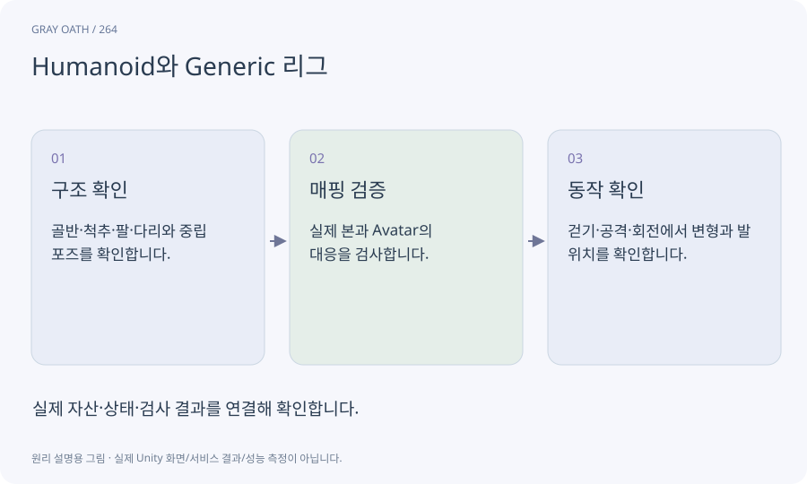

# Humanoid와 Generic 리그

Unity가 사람형 뼈 구조를 공통 신체 부위로 해석하는 방식이 Humanoid입니다. 그 틀에 맞지 않는 모델은 Generic 등 실제 구조에 맞는 설정을 사용합니다.

## 익숙한 비유

사람 공통 치수표와 맞춤 제작 치수표의 차이입니다.



## 작동 원리

### 1. 구조 확인

골반·척추·팔·다리와 중립 포즈를 확인합니다.

### 2. 매핑 검증

실제 본과 Avatar의 대응을 검사합니다.

### 3. 동작 확인

걷기·공격·회전에서 변형과 발 위치를 확인합니다.

## 게임 속 예

서린은 사람형 매핑을 검사하고 거미형 괴물은 Generic 리그와 해당 관절 동작을 사용합니다.

## 혼동하지 않기

Meshy 자동 리깅의 사람형 지원을 비인간형 몬스터까지 보장하는 것으로 해석하면 안 됩니다.

## 확인 질문

팔 네 개인 괴물에 사람형 애니메이션을 그대로 쓸 수 있나요?

공통 매핑에 없는 관절은 해결되지 않습니다. 전용 리그·클립과 실제 변형 검사가 필요합니다.

## 내 프로젝트에서 확인하기

```text
현재 GrayOathRPG3D에서 Humanoid와 Generic 리그을 사용하는 실제 대상과 동작을 읽기 전용으로 확인해 줘. 쉬운 말과 작은 사례로 설명하고 Meshy 자동 리깅의 사람형 지원을 비인간형 몬스터까지 보장하는 것으로 해석하면 안 됩니다. 이 문제를 어떻게 막는지 보여 줘. 코드·데이터·설정은 아직 수정하지 마.
```

## 관련 해설

[rig](rig.md) · [retarget](retarget.md) · [skinning](skinning.md)

## 공식 참고

- [Meshy · Rigging](https://docs.meshy.ai/en/api/rigging)
- [Unity · Animation Rigging](https://docs.unity3d.com/Packages/com.unity.animation.rigging@1.3/manual/index.html)
