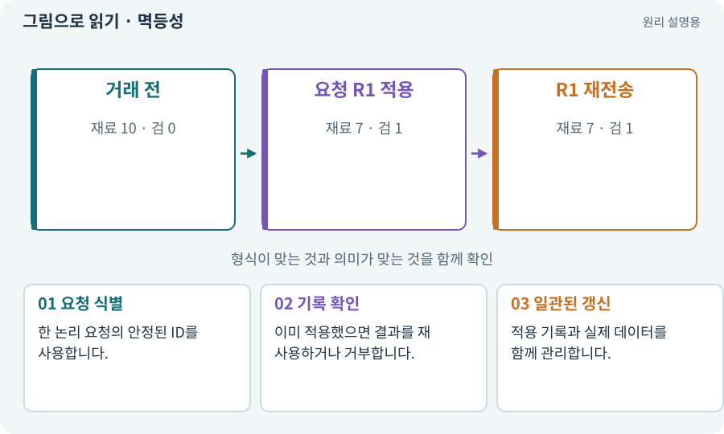

# 멱등성·재시도해도 한 번

**분야:** 코드·데이터·저장·검사

멱등성은 같은 요청을 반복해도 효과가 한 번 적용한 상태와 같도록 만드는 성질입니다. 응답이 늦거나 연결이 끊겨 재시도할 때 중요합니다.

**찾아오는 이름:** 멱등성·재시도해도 한 번, 멱등성, Idempotency, idempotent, 중복 실행, 중복 지급

## 익숙한 것에 비유하면

엘리베이터 같은 층 버튼을 여러 번 눌러도 그 층을 여러 번 방문 예약하지 않는 방식입니다.



개념도입니다. 실제 Unity 화면이나 검사 결과가 아닙니다. 그림의 순서·색은 역할을 구분하며 실제 설정값은 프로젝트에서 확인합니다.

## 이렇게 작동합니다

### 1. 요청 식별

한 논리 요청의 안정된 ID를 사용합니다.

### 2. 기록 확인

이미 적용했으면 결과를 재사용하거나 거부합니다.

### 3. 일관된 갱신

적용 기록과 실제 데이터를 함께 관리합니다.

## 우리 RPG에서는 이렇게 만나요

보스 보상 버튼을 연타하거나 저장 응답을 못 받아 재시도해도 같은 보상이 두 번 생기면 안 됩니다. 단순한 UI 버튼 잠금만으로 모든 경로를 막을 수는 없습니다.

## 이것과 혼동하지 마세요

멱등성은 절대 한 번만 실행된다는 뜻이 아니라 반복 실행의 효과를 통제하는 성질입니다.

## 이해했는지 한 번 생각해 보기

같은 요청인데 재시도마다 새 ID를 만들면?

<details><summary>답과 이유</summary>

새 거래로 보일 수 있어 중복 방지가 깨집니다.

</details>

## 내 프로젝트에서 확인하고 싶다면

아래 요청은 읽기 전용으로 실제 대상을 확인하는 선택 요청입니다. 코드나 설정을 직접 편집할 필요는 없습니다.

```text
현재 프로젝트에서 멱등성·재시도해도 한 번 관련 요소가 어떻게 사용되는지 읽기 전용으로 확인해 줘. 실제 대상과 설정을 찾아 쉬운 말과 작은 예로 설명해 줘. 특히 다음 혼동을 구분해 줘: 멱등성은 절대 한 번만 실행된다는 뜻이 아니라 반복 실행의 효과를 통제하는 성질입니다. 아직 코드·설정·파일은 바꾸지 말고, 확인할 수 없는 내용은 따로 알려 줘.
```

## 이어지는 개념

[트랜잭션·거래의 한 번 적용](transaction.md) · [공격 ID·사건 ID·중복 피해 방지](event-id.md) · [요청 ID·세대 ID·오래된 응답](request-id.md) · [재시도·백오프·복구](retry.md)

## 이 개념을 사용하는 실습

[31 · 퀘스트를 받아 엔딩까지 이어가기](../index.html#lesson-031) · [108 · 기획·구현·QA·검토 역할 만들기](../index.html#lesson-108) · [117 · Unity 작업을 한 창구로 모으기](../index.html#lesson-117) · [119 · 막힌 작업을 안전하게 이어가기](../index.html#lesson-119) · [139 · 재료로 장비 제작하기](../index.html#lesson-139) · [144 · 이번 탐험에만 남는 유물 고르기](../index.html#lesson-144)

## 참고와 설명의 범위

이 항목의 비유·그림·RPG 수치·운영 규칙은 개념을 이해하기 위한 자체 설계 예제입니다. 특정 도구가 이 규칙을 자동으로 구현한다는 뜻은 아닙니다.


그림·계산 예제·조작 모형은 자체 제작한 설명입니다. 실제 Unity 화면, 서비스 생성 결과, 성능 실측 또는 게임 테스트 결과가 아닙니다. 자료 확인: 2026년 9월 26일.
