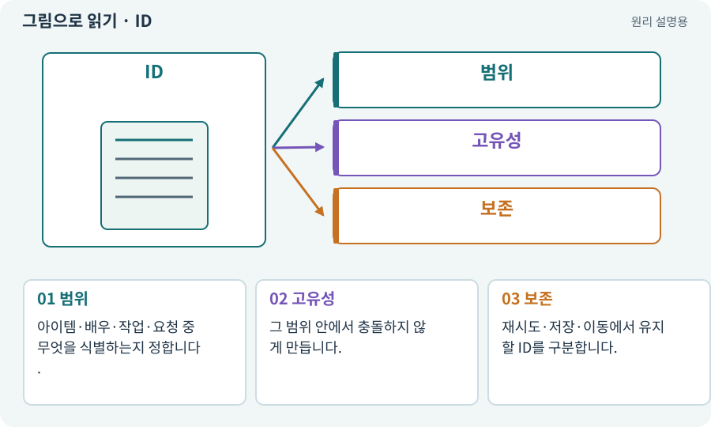

# ID·고유 식별자·버전

**분야:** 코드·데이터·저장·검사

ID는 어떤 대상이나 사건인지 구분하는 값입니다. 대상 종류마다 같은 ID를 어디까지 재사용할 수 있는지 규칙이 필요합니다. 이름·배열 위치·파일명은 항상 안정된 ID가 아닙니다.

**찾아오는 이름:** ID·고유 식별자·버전, ID, 고유 ID, 식별자, ActorId, runId, requestId, eventId, UUID, contentId, definitionId, instanceId, ActorID, actorId

## 익숙한 것에 비유하면

학생 이름이 같아도 학번으로 구분하는 것입니다. 같은 숫자를 다른 학교에서 쓰면 학교 정보도 필요합니다.



개념도입니다. 실제 Unity 화면이나 검사 결과가 아닙니다. 그림의 순서·색은 역할을 구분하며 실제 설정값은 프로젝트에서 확인합니다.

## 이렇게 작동합니다

### 1. 범위

아이템·배우·작업·요청 중 무엇을 식별하는지 정합니다.

### 2. 고유성

그 범위 안에서 충돌하지 않게 만듭니다.

### 3. 보존

재시도·저장·이동에서 유지할 ID를 구분합니다.

## 우리 RPG에서는 이렇게 만나요

검 A의 instanceId는 창고 이동 후에도 같아야 하지만, 새로 생성한 검 B는 다른 ID여야 합니다. 공격 eventId는 같은 공격의 중복 피해를 막는 데 사용합니다.

## 이것과 혼동하지 마세요

ID가 길거나 UUID라는 이유로 소유권 검사를 생략하지 않습니다.

## 이해했는지 한 번 생각해 보기

같은 이름의 몬스터 두 마리를 이름만으로 묶으면?

<details><summary>답과 이유</summary>

한 마리의 피해·사망·보상이 다른 마리와 섞일 수 있습니다.

</details>

## 내 프로젝트에서 확인하고 싶다면

아래 요청은 읽기 전용으로 실제 대상을 확인하는 선택 요청입니다. 코드나 설정을 직접 편집할 필요는 없습니다.

```text
현재 프로젝트에서 ID·고유 식별자·버전 관련 요소가 어떻게 사용되는지 읽기 전용으로 확인해 줘. 실제 대상과 설정을 찾아 쉬운 말과 작은 예로 설명해 줘. 특히 다음 혼동을 구분해 줘: ID가 길거나 UUID라는 이유로 소유권 검사를 생략하지 않습니다. 아직 코드·설정·파일은 바꾸지 말고, 확인할 수 없는 내용은 따로 알려 줘.
```

## 이어지는 개념

[아이템 인스턴스와 소유권](item-instance.md) · [공격 ID·사건 ID·중복 피해 방지](event-id.md) · [요청 ID·세대 ID·오래된 응답](request-id.md) · [스키마·JSON Schema·계약](schema.md)

## 이 개념을 사용하는 실습

[13 · 적을 클릭해 접근하고 공격하기](../index.html#lesson-013) · [18 · 베기·마력탄·회전 공격 만들기](../index.html#lesson-018) · [20 · 같은 검 두 자루를 다른 물건으로 다루기](../index.html#lesson-020) · [21 · 몬스터가 장비를 떨어뜨리게 하기](../index.html#lesson-021) · [22 · 장비를 주워 24칸 가방에 넣기](../index.html#lesson-022) · [23 · 장비를 바꾸고 능력치 확인하기](../index.html#lesson-023) · [25 · 게임을 껐다 켜도 장비 유지하기](../index.html#lesson-025) · [26 · 새 게임·이어하기·마을 연결하기](../index.html#lesson-026) · [29 · 방마다 적과 상자 배치하기](../index.html#lesson-029) · [31 · 퀘스트를 받아 엔딩까지 이어가기](../index.html#lesson-031) · [38 · 테스트 결과와 실제 플레이 구분하기](../index.html#lesson-038) · [41 · 선택할 수 있는9노드 스킬트리 만들기](../index.html#lesson-041) · [42 · 트리에서 투자하고 저장하기](../index.html#lesson-042) · [44 · 시드로 같은 던전 다시 만들기](../index.html#lesson-044) · [46 · 랜덤 지도 위를 실제로 걷기](../index.html#lesson-046) · [47 · 실패하는 시드를 찾고 복구하기](../index.html#lesson-047) · [49 · 여러 근접 적의 공격 나누기](../index.html#lesson-049) · [50 · 석궁수가 거리를 유지하게 만들기](../index.html#lesson-050) · [51 · 전투 전체의 압박 조절하기](../index.html#lesson-051) · [65 · 스프라이트를 정리해 실제 캐릭터에 넣기](../index.html#lesson-065) · [68 · 피격 불꽃과 먼지 만들기](../index.html#lesson-068) · [73 · 주소로 에셋 불러오기](../index.html#lesson-073) · [79 · 추가 기능을 하나의 게임으로 합치기](../index.html#lesson-079) · [81 · 2D 게임을 남기고 3D 작업 시작하기](../index.html#lesson-081) · [82 · 게임 규칙은 재사용하고 공간만 바꾸기](../index.html#lesson-082) · [89 · 같은 전투 규칙을 3D에 연결하기](../index.html#lesson-089) · [92 · 무기를 손에 쥐고 전리품 표시하기](../index.html#lesson-092) · [93 · 3D 마을과 퀘스트 연결하기](../index.html#lesson-093) · [99 · 2D와 3D 사이에 진행 가져오기](../index.html#lesson-099) · [100 · 두 버전이 같은 게임인지 비교하기](../index.html#lesson-100) · [102 · 네 배포물을 구분해 만들기](../index.html#lesson-102) · [109 · 요청을 검사 가능한 작업표로 바꾸기](../index.html#lesson-109) · [110 · 작업마다 필요한 자료만 준비하기](../index.html#lesson-110) · [111 · AI 답변을 안전한 변경안으로 받기](../index.html#lesson-111) · [114 · 테스트를 실행하고 결과 읽기](../index.html#lesson-114) · [120 · 자연어 요청을 계획으로 바꾸기](../index.html#lesson-120) · [121 · 필요한 역할을 하나 추가하기](../index.html#lesson-121) · [122 · 내 게임에 맞는 검사기 추가하기](../index.html#lesson-122) · [126 · 한 요청으로 필터 기능 끝내기](../index.html#lesson-126) · [127 · 내 반복 업무에 맞게 도구 개조하기](../index.html#lesson-127) · [131 · 중요한 전리품만 표시하는 규칙 만들기](../index.html#lesson-131) · [138 · 장비를 분해해 재료 얻기](../index.html#lesson-138) · [139 · 재료로 장비 제작하기](../index.html#lesson-139) · [140 · 개인 창고와 즐겨찾기 만들기](../index.html#lesson-140) · [143 · 새 랜덤 지역 봉인된 대장간 만들기](../index.html#lesson-143) · [144 · 이번 탐험에만 남는 유물 고르기](../index.html#lesson-144) · [152 · 이전 저장을 새 확장판으로 가져오기](../index.html#lesson-152) · [153 · 대장간 고해상도팩 선택 다운로드하기](../index.html#lesson-153) · [155 · 기록을 보고 제작 경제와 전투 조정하기](../index.html#lesson-155) · [156 · 기능 조합에서 숨은 오류 찾기](../index.html#lesson-156) · [158 · 룬 교체 버그를 역할로 수정하기](../index.html#lesson-158)

## 참고와 설명의 범위

기본 도구 동작은 아래 공식 자료를 참고했습니다. 비유·그림·RPG의 예시 수치와 정책은 이해를 위한 자체 예제입니다. 실제 API·지원 기능은 설치 버전과 계정에서 확인합니다.

- [Python · JSON](https://docs.python.org/3/library/json.html)

그림·계산 예제·조작 모형은 자체 제작한 설명입니다. 실제 Unity 화면, 서비스 생성 결과, 성능 실측 또는 게임 테스트 결과가 아닙니다. 자료 확인: 2026년 9월 26일.
