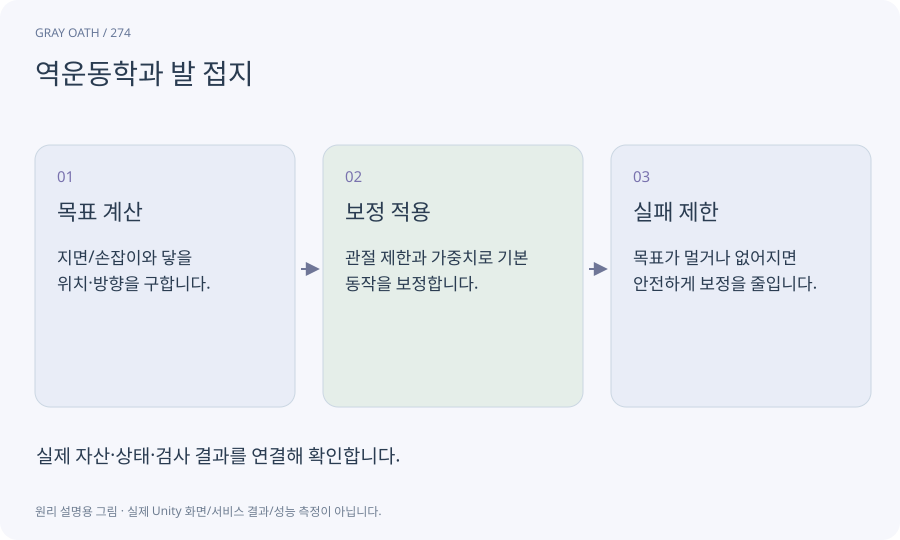

# 역운동학과 발 접지

손이나 발이 닿아야 하는 목표를 주고 관절 자세를 계산하는 기술입니다. 애니메이션의 모든 자세를 대체하기보다 지면·손잡이 접촉을 보정하는 데 사용합니다.

## 익숙한 비유

손을 문손잡이에 놓으려고 팔꿈치와 어깨를 함께 조절하는 움직임입니다.



## 작동 원리

### 1. 목표 계산

지면/손잡이와 닿을 위치·방향을 구합니다.

### 2. 보정 적용

관절 제한과 가중치로 기본 동작을 보정합니다.

### 3. 실패 제한

목표가 멀거나 없어지면 안전하게 보정을 줄입니다.

## 게임 속 예

경사에서 발을 지면에 맞추되 몸체가 계단 아래로 뚫리지 않게 합니다. 말에서 내려올 때 손 목표가 사라지면 보정을 해제합니다.

## 혼동하지 않기

IK가 있다고 잘못된 발판 충돌이나 내리기 위치까지 해결되는 것은 아닙니다.

## 확인 질문

손이 이상하게 길어지면?

목표 범위·관절 길이·루트 스케일·보정 가중치를 확인합니다.

## 내 프로젝트에서 확인하기

```text
현재 GrayOathRPG3D에서 역운동학과 발 접지을 사용하는 실제 대상과 동작을 읽기 전용으로 확인해 줘. 쉬운 말과 작은 사례로 설명하고 IK가 있다고 잘못된 발판 충돌이나 내리기 위치까지 해결되는 것은 아닙니다. 이 문제를 어떻게 막는지 보여 줘. 코드·데이터·설정은 아직 수정하지 마.
```

## 관련 해설

[rig](rig.md) · [bindpose](bindpose.md) · [raycast](raycast.md)

## 공식 참고

- [Unity · Animation Rigging](https://docs.unity3d.com/Packages/com.unity.animation.rigging@1.3/manual/index.html)
