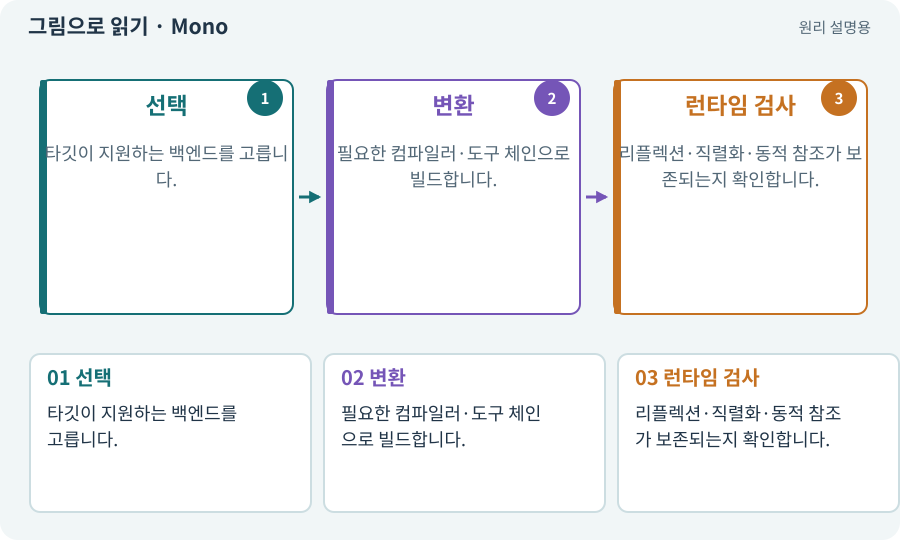

# Mono·IL2CPP·AOT

**분야:** 비동기·다운로드·빌드·버전 관리

Unity의 스크립팅 백엔드는 C# 코드를 실행 가능한 형태로 처리하는 경로입니다. IL2CPP는 중간 코드를 C++로 바꿔 네이티브로 빌드하는 AOT 경로를 사용합니다. MonoBehaviour라는 클래스 이름과 Mono 백엔드는 같은 개념이 아닙니다.

**찾아오는 이름:** Mono·IL2CPP·AOT, IL2CPP, Mono, AOT, 스크립팅 백엔드, stripping, 코드 스트리핑

## 익숙한 것에 비유하면

같은 원고를 현장에서 통역하거나 미리 현지어 책으로 출판하는 방식의 차이로 생각할 수 있지만, 정확한 실행 방식은 플랫폼마다 확인해야 합니다.



개념도입니다. 실제 Unity 화면이나 검사 결과가 아닙니다. 그림의 순서·색은 역할을 구분하며 실제 설정값은 프로젝트에서 확인합니다.

## 이렇게 작동합니다

### 1. 선택

타깃이 지원하는 백엔드를 고릅니다.

### 2. 변환

필요한 컴파일러·도구 체인으로 빌드합니다.

### 3. 런타임 검사

리플렉션·직렬화·동적 참조가 보존되는지 확인합니다.

## 우리 RPG에서는 이렇게 만나요

Editor에서 동작하던 JSON 복원이 IL2CPP 빌드에서 실패하면 타입 보존과 코드 제거 설정을 조사합니다. 이를 해결한다며 무조건 모든 스트리핑을 끄기보다 필요한 범위를 확인합니다.

## 이것과 혼동하지 마세요

IL2CPP를 켜면 모든 코드가 자동으로 더 빨라진다고 단정하지 않습니다. 측정이 필요합니다.

## 이해했는지 한 번 생각해 보기

MonoBehaviour를 사용하면 IL2CPP를 못 쓰나요?

<details><summary>답과 이유</summary>

아닙니다. 컴포넌트 기반 클래스와 실행 백엔드의 이름을 구분합니다.

</details>

## 내 프로젝트에서 확인하고 싶다면

아래 요청은 읽기 전용으로 실제 대상을 확인하는 선택 요청입니다. 코드나 설정을 직접 편집할 필요는 없습니다.

```text
현재 프로젝트에서 Mono·IL2CPP·AOT 관련 요소가 어떻게 사용되는지 읽기 전용으로 확인해 줘. 실제 대상과 설정을 찾아 쉬운 말과 작은 예로 설명해 줘. 특히 다음 혼동을 구분해 줘: IL2CPP를 켜면 모든 코드가 자동으로 더 빨라진다고 단정하지 않습니다. 측정이 필요합니다. 아직 코드·설정·파일은 바꾸지 말고, 확인할 수 없는 내용은 따로 알려 줘.
```

## 이어지는 개념

[C#·Python·스크립트](csharp.md) · [직렬화·역직렬화](serialization.md) · [Profiler·병목·실기기 측정](profiler.md) · [ABI·ARM64·x86_64](abi.md)

## 이 개념을 사용하는 실습

[11 · PC와 휴대폰에서 처음 실행하기](../index.html#lesson-011) · [39 · 다른 PC와 Android 에서 실행할 파일 만들기](../index.html#lesson-039)

## 참고와 설명의 범위

기본 도구 동작은 아래 공식 자료를 참고했습니다. 비유·그림·RPG의 예시 수치와 정책은 이해를 위한 자체 예제입니다. 실제 API·지원 기능은 설치 버전과 계정에서 확인합니다.

- [Unity · IL2CPP](https://docs.unity3d.com/6000.3/Documentation/Manual/scripting-backends-il2cpp.html)

그림·계산 예제·조작 모형은 자체 제작한 설명입니다. 실제 Unity 화면, 서비스 생성 결과, 성능 실측 또는 게임 테스트 결과가 아닙니다. 자료 확인: 2026년 9월 26일.
