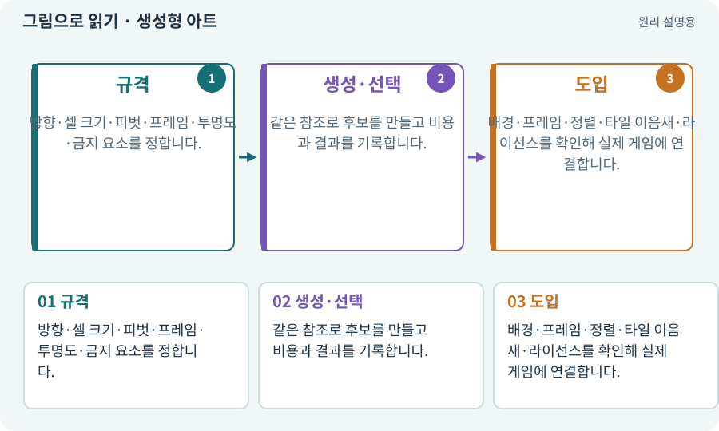

# 생성형 아트·참조 이미지·후처리

**분야:** 자산 제작·렌더링 보충

생성형 아트 도구는 텍스트·참조 그림으로 이미지 후보를 만듭니다. 보기 좋은 그림을 만드는 것과 게임에서 반복 재생·슬라이스·압축 가능한 자산을 완성하는 것은 다른 단계입니다.

**찾아오는 이름:** 생성형 아트·참조 이미지·후처리, 이미지 생성, 이미지생성, 생성형 아트, 참조 이미지, reference image, 후처리, 인페인팅, outpainting, 스타일 참조

## 익숙한 것에 비유하면

삽화가에게 시안을 받는 과정에 가깝습니다. 인쇄 크기·재단선·색·납품 규격을 확인하는 일은 여전히 필요합니다.



개념도입니다. 실제 Unity 화면이나 검사 결과가 아닙니다. 그림의 순서·색은 역할을 구분하며 실제 설정값은 프로젝트에서 확인합니다.

## 이렇게 작동합니다

### 1. 규격

방향·셀 크기·피벗·프레임·투명도·금지 요소를 정합니다.

### 2. 생성·선택

같은 참조로 후보를 만들고 비용과 결과를 기록합니다.

### 3. 도입

배경·프레임·정렬·타일 이음새·라이선스를 확인해 실제 게임에 연결합니다.

## 우리 RPG에서는 이렇게 만나요

한 장에는 멋진 검이 있어도 8프레임에서 검이 사라졌다 나타나면 공격 시트로 바로 사용할 수 없습니다. AI가 프레임별 실제 결과를 비교하고 최소 수정을 수행하게 합니다.

## 이것과 혼동하지 마세요

프롬프트에 투명 PNG를 적었다고 실제 알파가 생긴 것은 아닙니다. 결과 파일을 검사합니다.

## 이해했는지 한 번 생각해 보기

이미지 한 장 생성 성공이면 아트 작업이 끝났나요?

<details><summary>답과 이유</summary>

실제 규격·일관성·게임 화면 연결·사용 조건까지 확인해야 합니다.

</details>

## 내 프로젝트에서 확인하고 싶다면

아래 요청은 읽기 전용으로 실제 대상을 확인하는 선택 요청입니다. 코드나 설정을 직접 편집할 필요는 없습니다.

```text
현재 프로젝트에서 생성형 아트·참조 이미지·후처리 관련 요소가 어떻게 사용되는지 읽기 전용으로 확인해 줘. 실제 대상과 설정을 찾아 쉬운 말과 작은 예로 설명해 줘. 특히 다음 혼동을 구분해 줘: 프롬프트에 투명 PNG를 적었다고 실제 알파가 생긴 것은 아닙니다. 결과 파일을 검사합니다. 아직 코드·설정·파일은 바꾸지 말고, 확인할 수 없는 내용은 따로 알려 줘.
```

## 이어지는 개념

[아트 규격·레퍼런스·키 포즈](art-spec.md) · [알파·RGBA·투명 배경](alpha.md) · [스프라이트 시트](sprite-sheet.md) · [라이선스·출처·사용 조건](license.md) · [비용 한도·예약·실사용량](budget.md)

## 이 개념을 사용하는 실습

[33 · 기본 캐릭터·몬스터·타일 아트 만들기](../index.html#lesson-033) · [56 · Unity AI로 캐릭터 움직임 만들기](../index.html#lesson-056) · [57 · Unity AI로 바닥과 벽 타일 만들기](../index.html#lesson-057) · [58 · PixelLab로 방향별 픽셀 캐릭터 만들기](../index.html#lesson-058) · [59 · Retro Diffusion으로 캐릭터와 타일 만들기](../index.html#lesson-059) · [60 · Scenario로 스타일과 동작 유지하기](../index.html#lesson-060) · [61 · Ludo.ai로 키 포즈를 지정해 움직임 만들기](../index.html#lesson-061) · [62 · OpenAI 이미지로 게임 자산 만들기](../index.html#lesson-062) · [63 · Grok 이미지로 같은 자산 시험하기](../index.html#lesson-063) · [64 · 추가 결제 없이 AI로 2D 프레임 만들기](../index.html#lesson-064) · [65 · 스프라이트를 정리해 실제 캐릭터에 넣기](../index.html#lesson-065) · [67 · 내 게임의 아트 제작 경로 선택하기](../index.html#lesson-067)

## 참고와 설명의 범위

기본 도구 동작은 아래 공식 자료를 참고했습니다. 비유·그림·RPG의 예시 수치와 정책은 이해를 위한 자체 예제입니다. 실제 API·지원 기능은 설치 버전과 계정에서 확인합니다.

- [OpenAI · 이미지 생성·편집](https://developers.openai.com/api/docs/guides/image-generation)
- [Unity AI · 스프라이트 시트 생성과 연결](https://docs.unity3d.com/Packages/com.unity.ai.assistant@2.1/manual/Sprite/spritesheet-assistant.html)

그림·계산 예제·조작 모형은 자체 제작한 설명입니다. 실제 Unity 화면, 서비스 생성 결과, 성능 실측 또는 게임 테스트 결과가 아닙니다. 자료 확인: 2026년 9월 26일.
