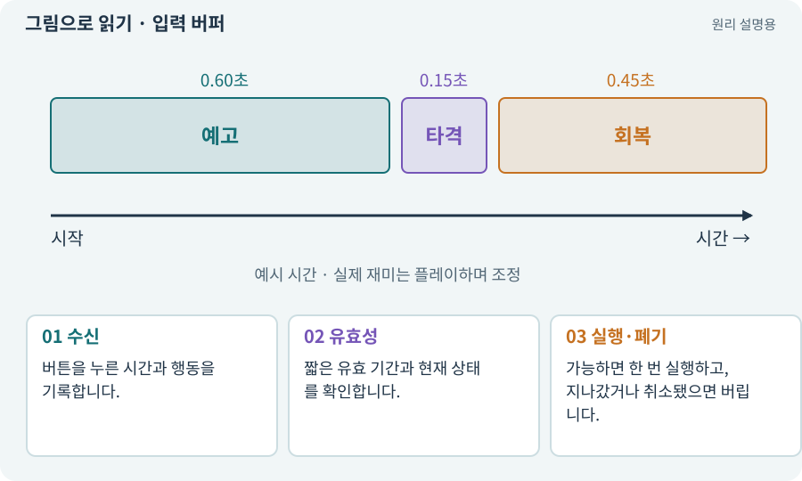

# 입력 버퍼·취소·우선순위

**분야:** 지도·적 AI·전투 규칙

입력 버퍼는 지금 실행할 수 없는 입력을 아주 짧게 기억해 가능한 시점에 실행하는 기능입니다. 취소는 진행 중 행동을 중단하는 규칙으로, 자원·쿨다운·무적과 함께 설계해야 합니다.

**찾아오는 이름:** 입력 버퍼·취소·우선순위, 입력 버퍼, 버퍼링, 입력 취소, 취소 규칙, 입력 우선순위

## 익숙한 것에 비유하면

엘리베이터 문이 열리기 직전 누른 버튼을 기억하는 것과 같습니다. 오래된 버튼을 몇 분 뒤 실행하면 원치 않는 행동이 됩니다.



개념도입니다. 실제 Unity 화면이나 검사 결과가 아닙니다. 그림의 순서·색은 역할을 구분하며 실제 설정값은 프로젝트에서 확인합니다.

## 이렇게 작동합니다

### 1. 수신

버튼을 누른 시간과 행동을 기록합니다.

### 2. 유효성

짧은 유효 기간과 현재 상태를 확인합니다.

### 3. 실행·폐기

가능하면 한 번 실행하고, 지나갔거나 취소됐으면 버립니다.

## 우리 RPG에서는 이렇게 만나요

공격 종료 직전에 누른 다음 공격을 부드럽게 이어 주되, 사망·가방 열기·회피 취소 뒤 예전 공격이 갑자기 나가지 않게 합니다.

## 이것과 혼동하지 마세요

취소로 공격 간격을 계속 초기화하면 정상 속도보다 빠른 공격 편법이 생길 수 있습니다.

## 이해했는지 한 번 생각해 보기

공격 버튼을 한 번 눌렀는데 한참 뒤 나가면?

<details><summary>답과 이유</summary>

버퍼 만료·상태 전환 때 폐기 규칙을 확인합니다.

</details>

## 내 프로젝트에서 확인하고 싶다면

아래 요청은 읽기 전용으로 실제 대상을 확인하는 선택 요청입니다. 코드나 설정을 직접 편집할 필요는 없습니다.

```text
현재 프로젝트에서 입력 버퍼·취소·우선순위 관련 요소가 어떻게 사용되는지 읽기 전용으로 확인해 줘. 실제 대상과 설정을 찾아 쉬운 말과 작은 예로 설명해 줘. 특히 다음 혼동을 구분해 줘: 취소로 공격 간격을 계속 초기화하면 정상 속도보다 빠른 공격 편법이 생길 수 있습니다. 아직 코드·설정·파일은 바꾸지 말고, 확인할 수 없는 내용은 따로 알려 줘.
```

## 이어지는 개념

[쿨다운·마나·자원 소비](cooldown.md) · [상태 기계·FSM](state-machine.md) · [EventSystem·UI 입력·클릭 차단](event-system.md) · [게임 시간·실시간·일시정지](time-scale.md)

## 이 개념을 사용하는 실습

[53 · 입력은 빠르게, 취소 규칙은 명확하게](../index.html#lesson-053) · [86 · 3D에서도 클릭한 곳까지 돌아가기](../index.html#lesson-086) · [88 · 3D 모델에 걷기와 공격 연결하기](../index.html#lesson-088)

## 참고와 설명의 범위

기본 도구 동작은 아래 공식 자료를 참고했습니다. 비유·그림·RPG의 예시 수치와 정책은 이해를 위한 자체 예제입니다. 실제 API·지원 기능은 설치 버전과 계정에서 확인합니다.

- [Unity Input System · UI 지원](https://docs.unity3d.com/Packages/com.unity.inputsystem@1.17/manual/UISupport.html)

그림·계산 예제·조작 모형은 자체 제작한 설명입니다. 실제 Unity 화면, 서비스 생성 결과, 성능 실측 또는 게임 테스트 결과가 아닙니다. 자료 확인: 2026년 9월 26일.
