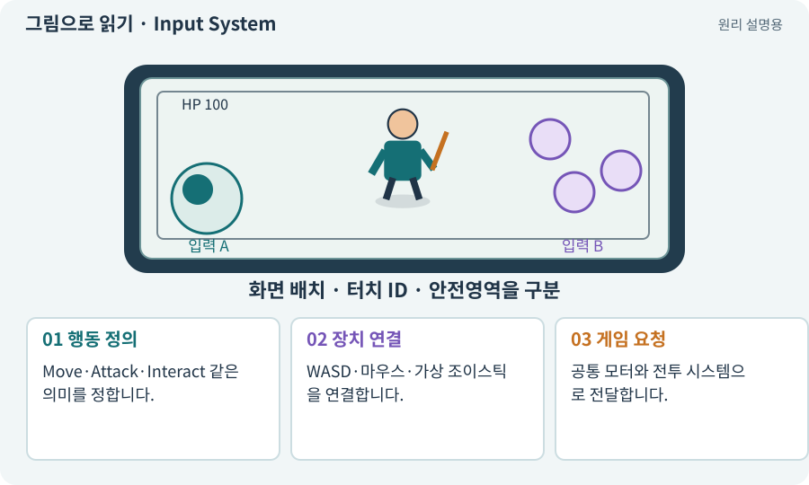

# Input System·Action·Binding

**분야:** 입력·UI·소리·성능

Input System은 키보드·마우스·터치·패드 입력을 다루는 Unity 패키지입니다. Action은 “이동·공격”이라는 의미이고 Binding은 그 의미를 어떤 키나 장치 입력과 연결할지 정합니다.

**찾아오는 이름:** Input System·Action·Binding, Input System, 입력 시스템, InputAction, Input Action, Action Map, Binding, 바인딩, WASD, On-screen Control, OnScreenStick, 액션 맵

## 익숙한 것에 비유하면

집의 여러 스위치가 같은 전등을 켜는 구조입니다. 스위치 종류와 “켜기” 행동을 분리합니다.



개념도입니다. 실제 Unity 화면이나 검사 결과가 아닙니다. 그림의 순서·색은 역할을 구분하며 실제 설정값은 프로젝트에서 확인합니다.

## 이렇게 작동합니다

### 1. 행동 정의

Move·Attack·Interact 같은 의미를 정합니다.

### 2. 장치 연결

WASD·마우스·가상 조이스틱을 연결합니다.

### 3. 게임 요청

공통 모터와 전투 시스템으로 전달합니다.

## 같은 행동에 여러 입력을 연결합니다

Move라는 Action에 키보드와 가상 조이스틱을 연결하면 게임 규칙은 입력 장치의 세부 차이를 덜 알아도 됩니다. Binding은 어느 키나 장치 값이 Action으로 들어오는지 정합니다.

UI 입력과 월드 입력을 모두 받을 때에는 누름이 어디서 시작됐는지 확인합니다. UI에서 시작한 클릭을 이동 요청으로 다시 처리하지 않아야 하지만, 다른 손가락의 이동까지 막으면 안 됩니다.

새 입력 시스템을 추가하면서 기존 Input.GetAxis와 다른 컨트롤러가 계속 동시에 움직이는지 확인합니다. 입력 통합과 최종 이동 책임은 서로 다른 단계입니다.

| 층 | 예 | 역할 |
| --- | --- | --- |
| 장치 | WASD·터치 | 원시 입력 |
| Action·Binding | Move·Attack | 행동 의미로 변환 |
| 게임 로직 | 이동 의도·공격 요청 | 유효 조건과 모터 |

## 직접 값을 바꾸며 보기

[웹 해설의 조작 모형 열기](../index.html#tech-input-system). 조작은 설명용 모형만 바꿉니다. 실제 프로젝트·AI·진행 체크·게임 테스트는 실행하거나 변경하지 않습니다.

## 우리 RPG에서는 이렇게 만나요

PC의 W와 모바일 조이스틱 위 방향은 같은 Move 요청으로 이어져야 합니다. 모바일 전용 이동 코드를 따로 만들어 두 동작이 달라지지 않게 합니다.

## 이것과 혼동하지 마세요

Binding은 하네스 파일 연결에도 쓰는 일반 단어입니다. 여기서는 입력 장치 연결을 뜻합니다.

## 이해했는지 한 번 생각해 보기

WASD는 되는데 모바일 이동은 안 되면?

<details><summary>답과 이유</summary>

같은 Action에 가상 장치 입력이 연결되고 활성화됐는지 확인합니다.

</details>

## 내 프로젝트에서 확인하고 싶다면

아래 요청은 읽기 전용으로 실제 대상을 확인하는 선택 요청입니다. 코드나 설정을 직접 편집할 필요는 없습니다.

```text
현재 프로젝트에서 Input System·Action·Binding 관련 요소가 어떻게 사용되는지 읽기 전용으로 확인해 줘. 실제 대상과 설정을 찾아 쉬운 말과 작은 예로 설명해 줘. 특히 다음 혼동을 구분해 줘: Binding은 하네스 파일 연결에도 쓰는 일반 단어입니다. 여기서는 입력 장치 연결을 뜻합니다. 아직 코드·설정·파일은 바꾸지 말고, 확인할 수 없는 내용은 따로 알려 줘.
```

## 이어지는 개념

[EventSystem·UI 입력·클릭 차단](event-system.md) · [데드존·입력 강도](deadzone.md) · [멀티터치·가상 조이스틱](multitouch.md) · [이동 모터와 단일 위치 책임](motor.md)

## 이 개념을 사용하는 실습

[01 · 빈 2D 프로젝트 만들기](../index.html#lesson-001) · [04 · 되돌릴 수 있는 작업 습관 만들기](../index.html#lesson-004) · [08 · WASD로 벽에 부딪히며 이동하기](../index.html#lesson-008) · [09 · 클릭한 곳까지 벽을 돌아가기](../index.html#lesson-009) · [10 · 모바일 조이스틱과 버튼 배치하기](../index.html#lesson-010) · [11 · PC와 휴대폰에서 처음 실행하기](../index.html#lesson-011) · [12 · 체력과 피해를 눈으로 확인하기](../index.html#lesson-012) · [85 · 3D 캐릭터를 한 모터로 움직이기](../index.html#lesson-085) · [86 · 3D에서도 클릭한 곳까지 돌아가기](../index.html#lesson-086) · [104 · 2D와 3D를 두 플랫폼에서 완주하기](../index.html#lesson-104)

## 참고와 설명의 범위

기본 도구 동작은 아래 공식 자료를 참고했습니다. 비유·그림·RPG의 예시 수치와 정책은 이해를 위한 자체 예제입니다. 실제 API·지원 기능은 설치 버전과 계정에서 확인합니다.

- [Unity Input System · UI 지원](https://docs.unity3d.com/Packages/com.unity.inputsystem@1.17/manual/UISupport.html)

그림·계산 예제·조작 모형은 자체 제작한 설명입니다. 실제 Unity 화면, 서비스 생성 결과, 성능 실측 또는 게임 테스트 결과가 아닙니다. 자료 확인: 2026년 9월 26일.
