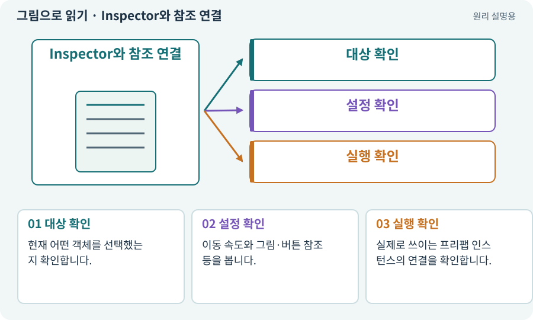

# Inspector와 참조 연결

**분야:** 시작·도구·작업 공간

Inspector는 선택한 오브젝트나 에셋의 컴포넌트와 설정을 보는 창입니다. 값만 바꾸는 곳이 아니라 어떤 객체를 사용해야 하는지 참조를 연결하는 곳이기도 합니다.

**찾아오는 이름:** Inspector와 참조 연결, Inspector, 인스펙터, 컴포넌트 부착, 참조 연결

## 익숙한 것에 비유하면

가전제품 뒷면의 전원·케이블·설정 패널입니다. 버튼 프로그램이 있어도 케이블이 연결되지 않으면 화면이 반응하지 않습니다.



개념도입니다. 실제 Unity 화면이나 검사 결과가 아닙니다. 그림의 순서·색은 역할을 구분하며 실제 설정값은 프로젝트에서 확인합니다.

## 이렇게 작동합니다

### 1. 대상 확인

현재 어떤 객체를 선택했는지 확인합니다.

### 2. 설정 확인

이동 속도와 그림·버튼 참조 등을 봅니다.

### 3. 실행 확인

실제로 쓰이는 프리팹 인스턴스의 연결을 확인합니다.

## 우리 RPG에서는 이렇게 만나요

가방 버튼 스크립트가 있어도 InventoryPanel 참조가 비면 눌러도 창이 안 열릴 수 있습니다. AI에게 씬과 Inspector까지 연결하도록 요청합니다.

## 이것과 혼동하지 마세요

같은 이름의 테스트 객체를 고치고 실제 플레이어가 바뀌었다고 착각하지 않습니다.

## 이해했는지 한 번 생각해 보기

컴파일은 성공인데 버튼이 아무 일도 안 하면?

<details><summary>답과 이유</summary>

실제 버튼의 이벤트와 대상 참조부터 조사합니다.

</details>

## 내 프로젝트에서 확인하고 싶다면

아래 요청은 읽기 전용으로 실제 대상을 확인하는 선택 요청입니다. 코드나 설정을 직접 편집할 필요는 없습니다.

```text
현재 프로젝트에서 Inspector와 참조 연결 관련 요소가 어떻게 사용되는지 읽기 전용으로 확인해 줘. 실제 대상과 설정을 찾아 쉬운 말과 작은 예로 설명해 줘. 특히 다음 혼동을 구분해 줘: 같은 이름의 테스트 객체를 고치고 실제 플레이어가 바뀌었다고 착각하지 않습니다. 아직 코드·설정·파일은 바꾸지 말고, 확인할 수 없는 내용은 따로 알려 줘.
```

## 이어지는 개념

[컴포넌트](component.md) · [참조·null·Missing Reference](reference.md) · [프리팹·인스턴스·Variant](prefab.md) · [Console·로그·스택 추적](console.md)

## 이 개념을 사용하는 실습

[37 · 느려지는 원인을 측정해 고치기](../index.html#lesson-037) · [117 · Unity 작업을 한 창구로 모으기](../index.html#lesson-117) · [125 · 하네스로 작은 전리품 화면 만들기](../index.html#lesson-125)

## 참고와 설명의 범위

기본 도구 동작은 아래 공식 자료를 참고했습니다. 비유·그림·RPG의 예시 수치와 정책은 이해를 위한 자체 예제입니다. 실제 API·지원 기능은 설치 버전과 계정에서 확인합니다.

- [Unity · 컴포넌트](https://docs.unity3d.com/6000.3/Documentation/Manual/Components.html)

그림·계산 예제·조작 모형은 자체 제작한 설명입니다. 실제 Unity 화면, 서비스 생성 결과, 성능 실측 또는 게임 테스트 결과가 아닙니다. 자료 확인: 2026년 9월 26일.
