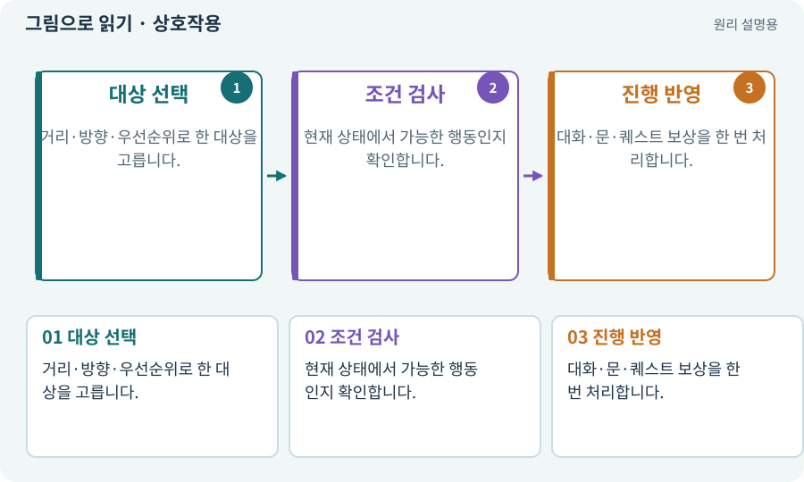

# 상호작용·NPC·퀘스트

**분야:** 입력·UI·소리·성능

상호작용은 근처 객체와 대화·문 열기·줍기 등의 행동을 하는 기능입니다. NPC는 플레이어가 아닌 캐릭터, 퀘스트는 목표와 진행·보상 규칙을 가진 작업입니다.

**찾아오는 이름:** 상호작용·NPC·퀘스트, 상호작용, Interact, NPC, 퀘스트, Quest, 대화 분기

## 익숙한 것에 비유하면

직원에게 말을 걸고 주문서를 받아 조건을 충족하면 보상을 받는 흐름입니다.



개념도입니다. 실제 Unity 화면이나 검사 결과가 아닙니다. 그림의 순서·색은 역할을 구분하며 실제 설정값은 프로젝트에서 확인합니다.

## 이렇게 작동합니다

### 1. 대상 선택

거리·방향·우선순위로 한 대상을 고릅니다.

### 2. 조건 검사

현재 상태에서 가능한 행동인지 확인합니다.

### 3. 진행 반영

대화·문·퀘스트 보상을 한 번 처리합니다.

## 우리 RPG에서는 이렇게 만나요

NPC가 겹친 위치에서 버튼을 누를 때 매 프레임 대상이 바뀌면 대화가 불안정합니다. 대상 고정과 새 입력 정책을 정합니다.

## 이것과 혼동하지 마세요

NPC의 말풍선을 봤다고 보상 지급이 완료된 것은 아닙니다. 데이터 상태와 저장을 확인합니다.

## 이해했는지 한 번 생각해 보기

퀘스트 완료 버튼을 연타해도 골드가 늘지 않게 하려면?

<details><summary>답과 이유</summary>

보상 키와 완료 상태를 같은 거래에서 한 번 갱신합니다.

</details>

## 내 프로젝트에서 확인하고 싶다면

아래 요청은 읽기 전용으로 실제 대상을 확인하는 선택 요청입니다. 코드나 설정을 직접 편집할 필요는 없습니다.

```text
현재 프로젝트에서 상호작용·NPC·퀘스트 관련 요소가 어떻게 사용되는지 읽기 전용으로 확인해 줘. 실제 대상과 설정을 찾아 쉬운 말과 작은 예로 설명해 줘. 특히 다음 혼동을 구분해 줘: NPC의 말풍선을 봤다고 보상 지급이 완료된 것은 아닙니다. 데이터 상태와 저장을 확인합니다. 아직 코드·설정·파일은 바꾸지 말고, 확인할 수 없는 내용은 따로 알려 줘.
```

## 이어지는 개념

[트랜잭션·거래의 한 번 적용](transaction.md) · [공격 ID·사건 ID·중복 피해 방지](event-id.md) · [상태 기계·FSM](state-machine.md) · [파일 저장·게임 세이브·백업](save.md)

## 이 개념을 사용하는 실습

[04 · 되돌릴 수 있는 작업 습관 만들기](../index.html#lesson-004) · [10 · 모바일 조이스틱과 버튼 배치하기](../index.html#lesson-010) · [22 · 장비를 주워 24칸 가방에 넣기](../index.html#lesson-022) · [25 · 게임을 껐다 켜도 장비 유지하기](../index.html#lesson-025) · [26 · 새 게임·이어하기·마을 연결하기](../index.html#lesson-026) · [27 · 회복하고 물약을 사는 마을 만들기](../index.html#lesson-027) · [29 · 방마다 적과 상자 배치하기](../index.html#lesson-029) · [31 · 퀘스트를 받아 엔딩까지 이어가기](../index.html#lesson-031) · [32 · 길 안내와 처음 하는 사람의 동선 만들기](../index.html#lesson-032) · [36 · 휴대폰에서 두 손가락으로 전투하기](../index.html#lesson-036) · [38 · 테스트 결과와 실제 플레이 구분하기](../index.html#lesson-038) · [42 · 트리에서 투자하고 저장하기](../index.html#lesson-042) · [47 · 실패하는 시드를 찾고 복구하기](../index.html#lesson-047) · [73 · 주소로 에셋 불러오기](../index.html#lesson-073) · [81 · 2D 게임을 남기고 3D 작업 시작하기](../index.html#lesson-081) · [82 · 게임 규칙은 재사용하고 공간만 바꾸기](../index.html#lesson-082) · [93 · 3D 마을과 퀘스트 연결하기](../index.html#lesson-093) · [95 · 3D 조명과 환경을 읽기 좋게 만들기](../index.html#lesson-095) · [99 · 2D와 3D 사이에 진행 가져오기](../index.html#lesson-099) · [100 · 두 버전이 같은 게임인지 비교하기](../index.html#lesson-100) · [121 · 필요한 역할을 하나 추가하기](../index.html#lesson-121) · [123 · 기존 게임의 실제 파일 찾아 연결하기](../index.html#lesson-123) · [125 · 하네스로 작은 전리품 화면 만들기](../index.html#lesson-125) · [126 · 한 요청으로 필터 기능 끝내기](../index.html#lesson-126) · [127 · 내 반복 업무에 맞게 도구 개조하기](../index.html#lesson-127) · [131 · 중요한 전리품만 표시하는 규칙 만들기](../index.html#lesson-131) · [132 · 필터를 실제 던전과 모바일에 연결하기](../index.html#lesson-132) · [133 · 첫 기능의 실패를 고쳐 다음 기준 만들기](../index.html#lesson-133) · [137 · 기름·폭발통·밸브로 공간 활용하기](../index.html#lesson-137) · [138 · 장비를 분해해 재료 얻기](../index.html#lesson-138) · [143 · 새 랜덤 지역 봉인된 대장간 만들기](../index.html#lesson-143) · [146 · 대장장이 구조 퀘스트 만들기](../index.html#lesson-146) · [147 · 용광로 감시자와 3단계 전투 만들기](../index.html#lesson-147) · [151 · 도감과 장비 비교로 새 기능 찾기](../index.html#lesson-151) · [152 · 이전 저장을 새 확장판으로 가져오기](../index.html#lesson-152) · [153 · 대장간 고해상도팩 선택 다운로드하기](../index.html#lesson-153) · [156 · 기능 조합에서 숨은 오류 찾기](../index.html#lesson-156) · [159 · 최종 확장판 배포 후보 만들기](../index.html#lesson-159) · [160 · 대장간 보스까지 완주하고 새 기능 맡기기](../index.html#lesson-160)

## 참고와 설명의 범위

이 항목의 비유·그림·RPG 수치·운영 규칙은 개념을 이해하기 위한 자체 설계 예제입니다. 특정 도구가 이 규칙을 자동으로 구현한다는 뜻은 아닙니다.


그림·계산 예제·조작 모형은 자체 제작한 설명입니다. 실제 Unity 화면, 서비스 생성 결과, 성능 실측 또는 게임 테스트 결과가 아닙니다. 자료 확인: 2026년 9월 26일.
