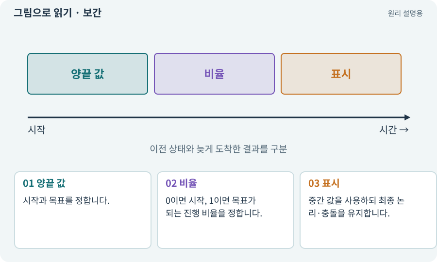

# 보간·Lerp·이동 보정

**분야:** 오브젝트·좌표·움직임

보간은 두 값 사이의 중간 값을 구하는 방법입니다. 위치나 색을 부드럽게 바꿀 때 사용합니다. 부드럽게 보이는 것과 물리적으로 올바르게 이동하는 것은 별개입니다.

**찾아오는 이름:** 보간·Lerp·이동 보정, 보간, Interpolation, Lerp, Slerp, 스무딩

## 익숙한 것에 비유하면

두 사진 사이를 중간 그림으로 채우는 것입니다. 중간 그림이 예뻐도 실제 캐릭터가 벽을 통과해서는 안 됩니다.



개념도입니다. 실제 Unity 화면이나 검사 결과가 아닙니다. 그림의 순서·색은 역할을 구분하며 실제 설정값은 프로젝트에서 확인합니다.

## 이렇게 작동합니다

### 1. 양끝 값

시작과 목표를 정합니다.

### 2. 비율

0이면 시작, 1이면 목표가 되는 진행 비율을 정합니다.

### 3. 표시

중간 값을 사용하되 최종 논리·충돌을 유지합니다.

## 우리 RPG에서는 이렇게 만나요

카메라가 캐릭터를 너무 딱딱하게 따라가면 보간을 쓰지만 지연이 과하면 화면 끝의 적이 늦게 보입니다. 값은 직접 플레이하며 조절합니다.

## 이것과 혼동하지 마세요

매 프레임 같은 비율로 Lerp하면 “정확히 1초 후 도착”과 다를 수 있습니다. 시간 기반 진행률과 추적 완화를 구분합니다.

## 이해했는지 한 번 생각해 보기

중간 비율 0.5를 계속 적용하면 정확히 두 번 만에 도착하나요?

<details><summary>답과 이유</summary>

아닙니다. 현재값에서 다시 절반씩 이동한다면 점차 가까워지는 추적입니다.

</details>

## 내 프로젝트에서 확인하고 싶다면

아래 요청은 읽기 전용으로 실제 대상을 확인하는 선택 요청입니다. 코드나 설정을 직접 편집할 필요는 없습니다.

```text
현재 프로젝트에서 보간·Lerp·이동 보정 관련 요소가 어떻게 사용되는지 읽기 전용으로 확인해 줘. 실제 대상과 설정을 찾아 쉬운 말과 작은 예로 설명해 줘. 특히 다음 혼동을 구분해 줘: 매 프레임 같은 비율로 Lerp하면 “정확히 1초 후 도착”과 다를 수 있습니다. 시간 기반 진행률과 추적 완화를 구분합니다. 아직 코드·설정·파일은 바꾸지 말고, 확인할 수 없는 내용은 따로 알려 줘.
```

## 이어지는 개념

[deltaTime과 초당 속도](delta-time.md) · [카메라·직교·원근](camera.md) · [이동 모터와 단일 위치 책임](motor.md) · [Transform: 위치·회전·크기](transform.md)

## 이 개념을 사용하는 실습

[135 · 벽을 통과하지 않는 회피 만들기](../index.html#lesson-135)

## 참고와 설명의 범위

기본 도구 동작은 아래 공식 자료를 참고했습니다. 비유·그림·RPG의 예시 수치와 정책은 이해를 위한 자체 예제입니다. 실제 API·지원 기능은 설치 버전과 계정에서 확인합니다.

- [Unity · GameObject와 컴포넌트](https://docs.unity3d.com/6000.3/Documentation/Manual/GameObjects.html)

그림·계산 예제·조작 모형은 자체 제작한 설명입니다. 실제 Unity 화면, 서비스 생성 결과, 성능 실측 또는 게임 테스트 결과가 아닙니다. 자료 확인: 2026년 9월 26일.
