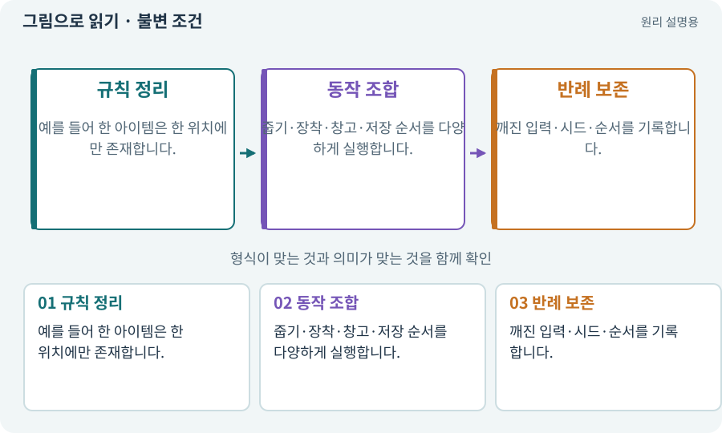

# 불변 조건·경계값·속성 검사

**분야:** 코드·데이터·저장·검사

불변 조건은 어떤 허용된 동작을 거쳐도 유지되어야 하는 규칙입니다. 경계값 검사는 0·최대·바로 전후 같은 오류가 잘 생기는 지점을 시험합니다.

**찾아오는 이름:** 불변 조건·경계값·속성 검사, 불변 조건, Invariant, 경계값, 속성 검사, property test, 소유권 불변

## 익숙한 것에 비유하면

은행에서 이체를 반복해도 총액이 갑자기 늘지 않아야 한다는 회계 원칙입니다.



개념도입니다. 실제 Unity 화면이나 검사 결과가 아닙니다. 그림의 순서·색은 역할을 구분하며 실제 설정값은 프로젝트에서 확인합니다.

## 이렇게 작동합니다

### 1. 규칙 정리

예를 들어 한 아이템은 한 위치에만 존재합니다.

### 2. 동작 조합

줍기·장착·창고·저장 순서를 다양하게 실행합니다.

### 3. 반례 보존

깨진 입력·시드·순서를 기록합니다.

## 우리 RPG에서는 이렇게 만나요

장비 교체 100회 후 기본 공격력으로 정확히 돌아와야 합니다. 같은 ID가 가방·장비·창고에 동시에 있으면 한 화면이 정상이어도 실패입니다.

## 이것과 혼동하지 마세요

많은 무작위 검사 통과가 모든 경우의 증명은 아닙니다. 알려진 경계와 반례를 별도 고정합니다.

## 이해했는지 한 번 생각해 보기

장비 화면이 맞으면 소유권도 정상인가요?

<details><summary>답과 이유</summary>

아닙니다. 실제 데이터 위치와 고유 ID 중복을 확인합니다.

</details>

## 내 프로젝트에서 확인하고 싶다면

아래 요청은 읽기 전용으로 실제 대상을 확인하는 선택 요청입니다. 코드나 설정을 직접 편집할 필요는 없습니다.

```text
현재 프로젝트에서 불변 조건·경계값·속성 검사 관련 요소가 어떻게 사용되는지 읽기 전용으로 확인해 줘. 실제 대상과 설정을 찾아 쉬운 말과 작은 예로 설명해 줘. 특히 다음 혼동을 구분해 줘: 많은 무작위 검사 통과가 모든 경우의 증명은 아닙니다. 알려진 경계와 반례를 별도 고정합니다. 아직 코드·설정·파일은 바꾸지 말고, 확인할 수 없는 내용은 따로 알려 줘.
```

## 이어지는 개념

[트랜잭션·거래의 한 번 적용](transaction.md) · [장비·슬롯·재계산](equipment.md) · [회귀·기준선·수정 전후 비교](regression.md) · [재현성·결정성·동등성](deterministic.md)

## 이 개념을 사용하는 실습

[21 · 몬스터가 장비를 떨어뜨리게 하기](../index.html#lesson-021) · [156 · 기능 조합에서 숨은 오류 찾기](../index.html#lesson-156)

## 참고와 설명의 범위

이 항목의 비유·그림·RPG 수치·운영 규칙은 개념을 이해하기 위한 자체 설계 예제입니다. 특정 도구가 이 규칙을 자동으로 구현한다는 뜻은 아닙니다.


그림·계산 예제·조작 모형은 자체 제작한 설명입니다. 실제 Unity 화면, 서비스 생성 결과, 성능 실측 또는 게임 테스트 결과가 아닙니다. 자료 확인: 2026년 9월 26일.
