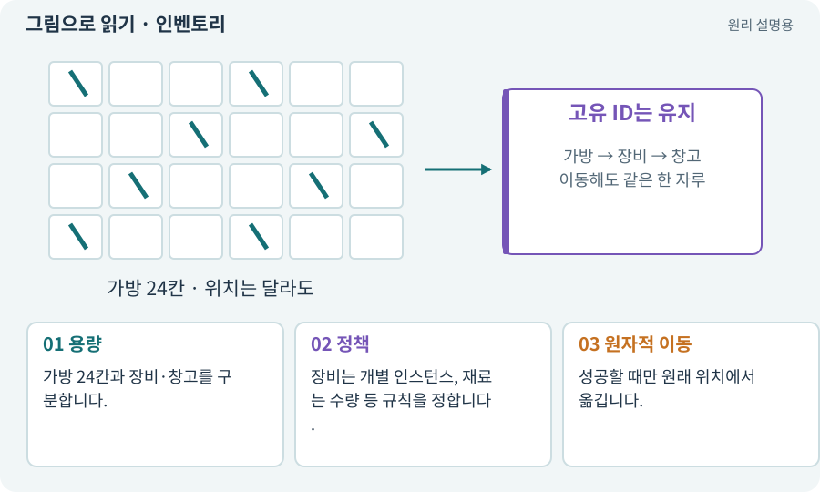

# 인벤토리·슬롯·스택·창고

**분야:** 코드·데이터·저장·검사

인벤토리는 소유 아이템을 담는 구조이고 슬롯은 그 위치 단위입니다. 스택은 동일 종류를 수량으로 합치는 정책입니다. 창고는 다른 보관 위치지만 소유권 규칙은 이어집니다.

**찾아오는 이름:** 인벤토리·슬롯·스택·창고, 인벤토리, Inventory, 가방, 슬롯, 슬롯 인덱스, stack, 스택, 창고

## 익숙한 것에 비유하면

택배 보관함의 칸과 칸 안 물건을 구분합니다. 칸 번호는 물건의 일련번호가 아닙니다.



개념도입니다. 실제 Unity 화면이나 검사 결과가 아닙니다. 그림의 순서·색은 역할을 구분하며 실제 설정값은 프로젝트에서 확인합니다.

## 이렇게 작동합니다

### 1. 용량

가방 24칸과 장비·창고를 구분합니다.

### 2. 정책

장비는 개별 인스턴스, 재료는 수량 등 규칙을 정합니다.

### 3. 원자적 이동

성공할 때만 원래 위치에서 옮깁니다.

## 우리 RPG에서는 이렇게 만나요

가방이 꽉 찼을 때 바닥 검을 먼저 삭제하면 물건을 잃습니다. 목적지 수용 여부를 확인하고 성공 후 바닥 데이터를 제거합니다.

## 이것과 혼동하지 마세요

슬롯 순서를 아이템의 영구 ID로 사용하면 정렬·삽입 때 식별이 바뀝니다.

## 이해했는지 한 번 생각해 보기

가방 정렬 후 저장된 장비가 달라지면?

<details><summary>답과 이유</summary>

슬롯 번호를 고유 아이템 ID처럼 사용했는지 봅니다.

</details>

## 내 프로젝트에서 확인하고 싶다면

아래 요청은 읽기 전용으로 실제 대상을 확인하는 선택 요청입니다. 코드나 설정을 직접 편집할 필요는 없습니다.

```text
현재 프로젝트에서 인벤토리·슬롯·스택·창고 관련 요소가 어떻게 사용되는지 읽기 전용으로 확인해 줘. 실제 대상과 설정을 찾아 쉬운 말과 작은 예로 설명해 줘. 특히 다음 혼동을 구분해 줘: 슬롯 순서를 아이템의 영구 ID로 사용하면 정렬·삽입 때 식별이 바뀝니다. 아직 코드·설정·파일은 바꾸지 말고, 확인할 수 없는 내용은 따로 알려 줘.
```

## 이어지는 개념

[아이템 인스턴스와 소유권](item-instance.md) · [트랜잭션·거래의 한 번 적용](transaction.md) · [장비·슬롯·재계산](equipment.md) · [파일 저장·게임 세이브·백업](save.md)

## 이 개념을 사용하는 실습

[20 · 같은 검 두 자루를 다른 물건으로 다루기](../index.html#lesson-020) · [21 · 몬스터가 장비를 떨어뜨리게 하기](../index.html#lesson-021) · [22 · 장비를 주워 24칸 가방에 넣기](../index.html#lesson-022) · [23 · 장비를 바꾸고 능력치 확인하기](../index.html#lesson-023) · [24 · 보기 편한 인벤토리 화면 만들기](../index.html#lesson-024) · [25 · 게임을 껐다 켜도 장비 유지하기](../index.html#lesson-025) · [27 · 회복하고 물약을 사는 마을 만들기](../index.html#lesson-027) · [29 · 방마다 적과 상자 배치하기](../index.html#lesson-029) · [31 · 퀘스트를 받아 엔딩까지 이어가기](../index.html#lesson-031) · [32 · 길 안내와 처음 하는 사람의 동선 만들기](../index.html#lesson-032) · [35 · 앞뒤 가림과 PC 조작 다듬기](../index.html#lesson-035) · [36 · 휴대폰에서 두 손가락으로 전투하기](../index.html#lesson-036) · [38 · 테스트 결과와 실제 플레이 구분하기](../index.html#lesson-038) · [40 · 작은 RPG를 처음부터 끝까지 플레이하기](../index.html#lesson-040) · [42 · 트리에서 투자하고 저장하기](../index.html#lesson-042) · [80 · 나만의 2D RPG 완성하기](../index.html#lesson-080) · [82 · 게임 규칙은 재사용하고 공간만 바꾸기](../index.html#lesson-082) · [90 · 적의 판단을 3D 공간에 연결하기](../index.html#lesson-090) · [92 · 무기를 손에 쥐고 전리품 표시하기](../index.html#lesson-092) · [93 · 3D 마을과 퀘스트 연결하기](../index.html#lesson-093) · [100 · 두 버전이 같은 게임인지 비교하기](../index.html#lesson-100) · [123 · 기존 게임의 실제 파일 찾아 연결하기](../index.html#lesson-123) · [125 · 하네스로 작은 전리품 화면 만들기](../index.html#lesson-125) · [129 · 기존 2D 게임에서 확장팩 시작하기](../index.html#lesson-129) · [133 · 첫 기능의 실패를 고쳐 다음 기준 만들기](../index.html#lesson-133) · [134 · 화상·냉기·표식으로 전투 확장하기](../index.html#lesson-134) · [138 · 장비를 분해해 재료 얻기](../index.html#lesson-138) · [139 · 재료로 장비 제작하기](../index.html#lesson-139) · [140 · 개인 창고와 즐겨찾기 만들기](../index.html#lesson-140) · [141 · 소켓 한 칸에 룬 장착하기](../index.html#lesson-141) · [145 · 지원 동료 하나 만들기](../index.html#lesson-145) · [154 · 확장 기능을 켠 휴대폰 성능 고치기](../index.html#lesson-154) · [156 · 기능 조합에서 숨은 오류 찾기](../index.html#lesson-156) · [158 · 룬 교체 버그를 역할로 수정하기](../index.html#lesson-158) · [160 · 대장간 보스까지 완주하고 새 기능 맡기기](../index.html#lesson-160)

## 참고와 설명의 범위

이 항목의 비유·그림·RPG 수치·운영 규칙은 개념을 이해하기 위한 자체 설계 예제입니다. 특정 도구가 이 규칙을 자동으로 구현한다는 뜻은 아닙니다.


그림·계산 예제·조작 모형은 자체 제작한 설명입니다. 실제 Unity 화면, 서비스 생성 결과, 성능 실측 또는 게임 테스트 결과가 아닙니다. 자료 확인: 2026년 9월 26일.
