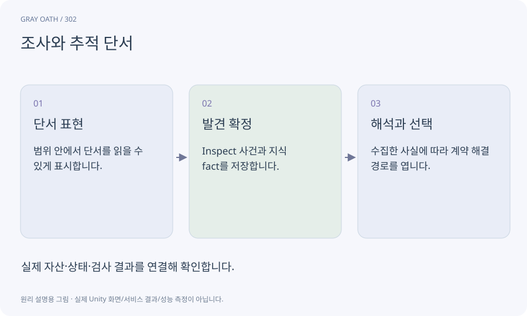

# 조사와 추적 단서

단서를 찾아 정보를 모으고 해석해 목적지나 해결법을 알아내는 흐름입니다. 강조 효과와 실제 발견 사실·지식 조건을 구분합니다.

## 익숙한 비유

탐정이 증거를 발견하고 수첩에 기록한 뒤 가설을 세우는 과정입니다.



## 작동 원리

### 1. 단서 표현

범위 안에서 단서를 읽을 수 있게 표시합니다.

### 2. 발견 확정

Inspect 사건과 지식 fact를 저장합니다.

### 3. 해석과 선택

수집한 사실에 따라 계약 해결 경로를 엽니다.

## 게임 속 예

돌다리의 천 조각과 꺼진 등불 두 단서를 조사하면 처치 외에 저주 해제법을 알 수 있습니다. 수색 원은 충분한 정보가 생긴 후 정확 위치로 바뀝니다.

## 혼동하지 않기

화면에 반짝임이 보인 것을 조사 완료로 계산하면 가까이 지나가기만 해도 모든 퀘스트가 끝납니다.

## 확인 질문

단서를 수락 전에 찾았다면?

지속 발견 사실을 보관해 나중에 수락한 목표가 정책대로 인식하게 합니다.

## 내 프로젝트에서 확인하기

```text
현재 GrayOathRPG3D에서 조사와 추적 단서을 사용하는 실제 대상과 동작을 읽기 전용으로 확인해 줘. 쉬운 말과 작은 사례로 설명하고 화면에 반짝임이 보인 것을 조사 완료로 계산하면 가까이 지나가기만 해도 모든 퀘스트가 끝납니다. 이 문제를 어떻게 막는지 보여 줘. 코드·데이터·설정은 아직 수정하지 마.
```

## 관련 해설

[objective-event](objective-event.md) · [world-state](world-state.md) · [bestiary](bestiary.md)

## 공식 참고

- [Unity · AssetDatabase](https://docs.unity3d.com/6000.3/Documentation/ScriptReference/AssetDatabase.html)
