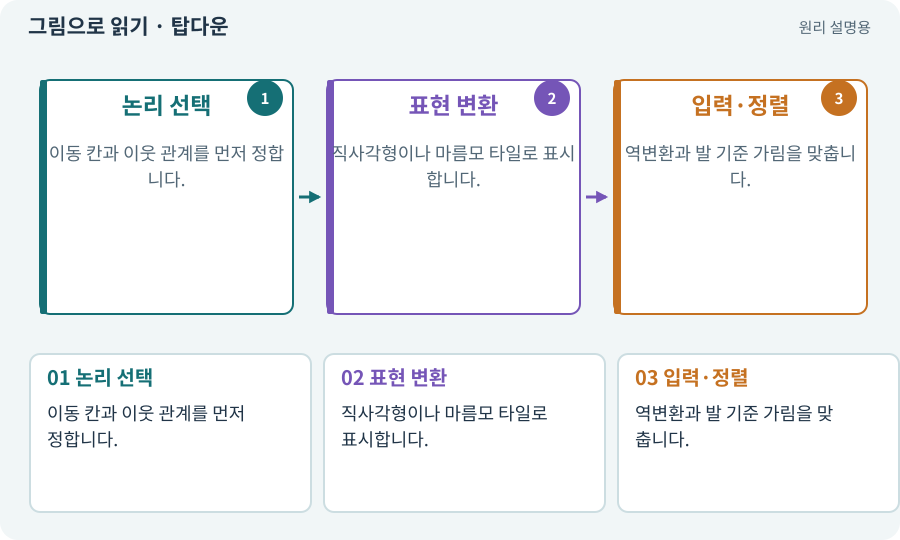

# 탑다운·쿼터뷰·아이소메트릭

**분야:** 그림·애니메이션·화면 만들기

탑다운은 위에서 내려다보는 플레이 방식, 쿼터뷰는 비스듬히 보이는 시각 표현을 가리킬 때 쓰입니다. 아이소메트릭은 일정 축척의 축 방향을 사용하는 표현·격자 방식입니다. 2.5D는 다양한 혼합 표현을 통칭합니다.

**찾아오는 이름:** 탑다운·쿼터뷰·아이소메트릭, 탑다운, 쿼터뷰, 아이소메트릭, Isometric, 2.5D

## 익숙한 것에 비유하면

같은 바둑판을 정면 지도나 비스듬한 그림으로 그릴 수 있습니다. 그렸다고 실제 물리 세계가 바뀌는 것은 아닙니다.



개념도입니다. 실제 Unity 화면이나 검사 결과가 아닙니다. 그림의 순서·색은 역할을 구분하며 실제 설정값은 프로젝트에서 확인합니다.

## 이렇게 작동합니다

### 1. 논리 선택

이동 칸과 이웃 관계를 먼저 정합니다.

### 2. 표현 변환

직사각형이나 마름모 타일로 표시합니다.

### 3. 입력·정렬

역변환과 발 기준 가림을 맞춥니다.

## 우리 RPG에서는 이렇게 만나요

2D 본편은 XY와 직사각형 격자로 먼저 완성합니다. 아이소메트릭 선택 경로는 보이는 격자뿐 아니라 클릭 좌표·정렬도 함께 수정합니다.

## 이것과 혼동하지 마세요

쿼터뷰풍 캐릭터 그림을 썼다는 이유로 3D Collider를 붙이지 않습니다.

## 이해했는지 한 번 생각해 보기

바닥을 마름모로 바꾸면 클릭 좌표도 그대로일까요?

<details><summary>답과 이유</summary>

표현 변환에 맞는 화면→셀 변환을 확인해야 합니다.

</details>

## 내 프로젝트에서 확인하고 싶다면

아래 요청은 읽기 전용으로 실제 대상을 확인하는 선택 요청입니다. 코드나 설정을 직접 편집할 필요는 없습니다.

```text
현재 프로젝트에서 탑다운·쿼터뷰·아이소메트릭 관련 요소가 어떻게 사용되는지 읽기 전용으로 확인해 줘. 실제 대상과 설정을 찾아 쉬운 말과 작은 예로 설명해 줘. 특히 다음 혼동을 구분해 줘: 쿼터뷰풍 캐릭터 그림을 썼다는 이유로 3D Collider를 붙이지 않습니다. 아직 코드·설정·파일은 바꾸지 말고, 확인할 수 없는 내용은 따로 알려 줘.
```

## 이어지는 개념

[Grid·셀·격자 좌표](grid.md) · [카메라·직교·원근](camera.md) · [Sorting Layer·Order·발 정렬](sorting.md) · [화면 좌표에서 월드 좌표로](screen-world.md)

## 이 개념을 사용하는 실습

[01 · 빈 2D 프로젝트 만들기](../index.html#lesson-001) · [04 · 되돌릴 수 있는 작업 습관 만들기](../index.html#lesson-004) · [35 · 앞뒤 가림과 PC 조작 다듬기](../index.html#lesson-035) · [55 · 어떤 그림도 맞춰 넣는 아트 규격 정하기](../index.html#lesson-055) · [56 · Unity AI로 캐릭터 움직임 만들기](../index.html#lesson-056) · [66 · 타일 경계와 랜덤맵 외형 연결하기](../index.html#lesson-066)

## 참고와 설명의 범위

기본 도구 동작은 아래 공식 자료를 참고했습니다. 비유·그림·RPG의 예시 수치와 정책은 이해를 위한 자체 예제입니다. 실제 API·지원 기능은 설치 버전과 계정에서 확인합니다.

- [Unity · Tilemap Collider 2D](https://docs.unity3d.com/6000.3/Documentation/Manual/tilemaps/work-with-tilemaps/tilemap-collider-2d.html)

그림·계산 예제·조작 모형은 자체 제작한 설명입니다. 실제 Unity 화면, 서비스 생성 결과, 성능 실측 또는 게임 테스트 결과가 아닙니다. 자료 확인: 2026년 9월 26일.
