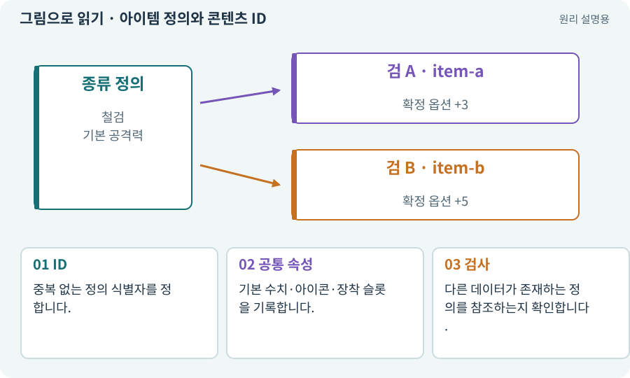

# 아이템 정의와 콘텐츠 ID

**분야:** 코드·데이터·저장·검사

아이템 정의는 “어떤 종류의 물건인가”를 설명합니다. 콘텐츠 ID는 그 정의를 찾는 안정된 식별자입니다. 표시 이름은 번역·밸런스 수정으로 바뀔 수 있으므로 ID와 나눕니다.

**찾아오는 이름:** 아이템 정의와 콘텐츠 ID, ItemDefinition, itemDefinition, Definition, 아이템 원형, 아이템 정의, contentId, definitionId

## 익숙한 것에 비유하면

상품 종류 코드와 상품 이름표의 차이입니다. “녹슨 검”이라는 글자가 바뀌어도 같은 정의를 찾아야 합니다.



개념도입니다. 실제 Unity 화면이나 검사 결과가 아닙니다. 그림의 순서·색은 역할을 구분하며 실제 설정값은 프로젝트에서 확인합니다.

## 이렇게 작동합니다

### 1. ID

중복 없는 정의 식별자를 정합니다.

### 2. 공통 속성

기본 수치·아이콘·장착 슬롯을 기록합니다.

### 3. 검사

다른 데이터가 존재하는 정의를 참조하는지 확인합니다.

## 우리 RPG에서는 이렇게 만나요

저장 파일에는 표시 이름 대신 정의 ID를 담습니다. 나중에 이름이 “낡은 검”으로 바뀌어도 기존 소유 검을 불러올 수 있습니다.

## 이것과 혼동하지 마세요

정의 ID와 소유한 한 자루의 instanceId를 같은 값으로 쓰지 않습니다.

## 이해했는지 한 번 생각해 보기

동일한 검 두 자루의 definitionId는 같아도 되나요?

<details><summary>답과 이유</summary>

같은 종류라면 같습니다. instanceId는 서로 달라야 합니다.

</details>

## 내 프로젝트에서 확인하고 싶다면

아래 요청은 읽기 전용으로 실제 대상을 확인하는 선택 요청입니다. 코드나 설정을 직접 편집할 필요는 없습니다.

```text
현재 프로젝트에서 아이템 정의와 콘텐츠 ID 관련 요소가 어떻게 사용되는지 읽기 전용으로 확인해 줘. 실제 대상과 설정을 찾아 쉬운 말과 작은 예로 설명해 줘. 특히 다음 혼동을 구분해 줘: 정의 ID와 소유한 한 자루의 instanceId를 같은 값으로 쓰지 않습니다. 아직 코드·설정·파일은 바꾸지 말고, 확인할 수 없는 내용은 따로 알려 줘.
```

## 이어지는 개념

[ScriptableObject와 정의 데이터](scriptable.md) · [아이템 인스턴스와 소유권](item-instance.md) · [ID·고유 식별자·버전](identifier.md) · [스키마·JSON Schema·계약](schema.md)

## 이 개념을 사용하는 실습

[20 · 같은 검 두 자루를 다른 물건으로 다루기](../index.html#lesson-020) · [21 · 몬스터가 장비를 떨어뜨리게 하기](../index.html#lesson-021) · [25 · 게임을 껐다 켜도 장비 유지하기](../index.html#lesson-025) · [73 · 주소로 에셋 불러오기](../index.html#lesson-073) · [82 · 게임 규칙은 재사용하고 공간만 바꾸기](../index.html#lesson-082) · [92 · 무기를 손에 쥐고 전리품 표시하기](../index.html#lesson-092) · [98 · 3D 팩을 2D 팩과 따로 내려받기](../index.html#lesson-098) · [123 · 기존 게임의 실제 파일 찾아 연결하기](../index.html#lesson-123) · [139 · 재료로 장비 제작하기](../index.html#lesson-139)

## 참고와 설명의 범위

기본 도구 동작은 아래 공식 자료를 참고했습니다. 비유·그림·RPG의 예시 수치와 정책은 이해를 위한 자체 예제입니다. 실제 API·지원 기능은 설치 버전과 계정에서 확인합니다.

- [Unity · ScriptableObject](https://docs.unity3d.com/6000.3/Documentation/Manual/class-ScriptableObject.html)

그림·계산 예제·조작 모형은 자체 제작한 설명입니다. 실제 Unity 화면, 서비스 생성 결과, 성능 실측 또는 게임 테스트 결과가 아닙니다. 자료 확인: 2026년 9월 26일.
