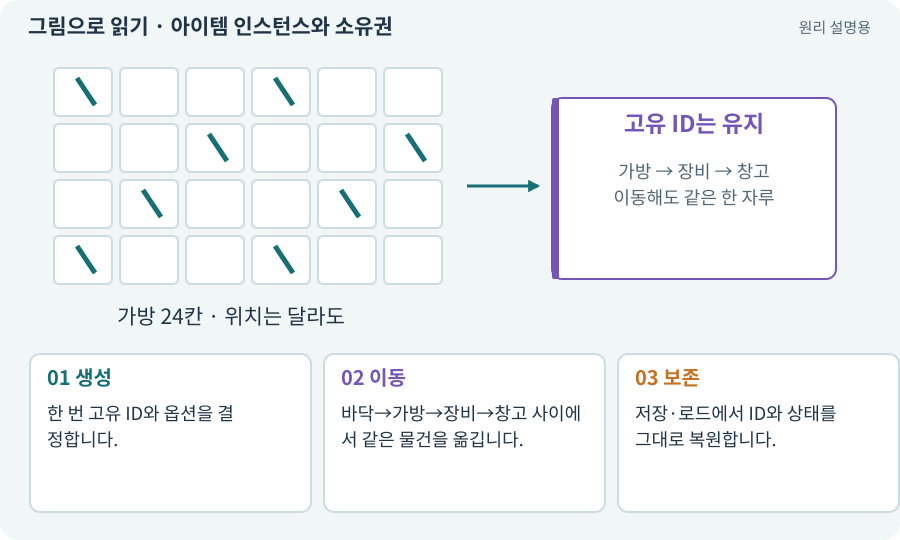

# 아이템 인스턴스와 소유권

**분야:** 코드·데이터·저장·검사

인스턴스는 실제로 생성되어 소유되는 한 개의 물건입니다. 같은 종류의 검이라도 고유 ID·랜덤 옵션·소켓 상태가 각각 다를 수 있습니다.

**찾아오는 이름:** 아이템 인스턴스와 소유권, ItemInstance, instanceId, Instance, 인스턴스, 소유권, 고유 아이템

## 익숙한 것에 비유하면

같은 모델의 휴대폰 두 대가 서로 다른 일련번호와 저장 내용을 갖는 것과 같습니다.



개념도입니다. 실제 Unity 화면이나 검사 결과가 아닙니다. 그림의 순서·색은 역할을 구분하며 실제 설정값은 프로젝트에서 확인합니다.

## 이렇게 작동합니다

### 1. 생성

한 번 고유 ID와 옵션을 결정합니다.

### 2. 이동

바닥→가방→장비→창고 사이에서 같은 물건을 옮깁니다.

### 3. 보존

저장·로드에서 ID와 상태를 그대로 복원합니다.

## 같은 종류의 검 두 자루를 구분하세요

정의 ID는 “어떤 종류인가”를 식별하고 인스턴스 ID는 “정확히 어느 한 자루인가”를 식별합니다. 이름·등급·같은 공격력으로 두 자루를 구분하려 하면 복제와 분실이 생길 수 있습니다.

예를 들어 sword_iron 정의를 사용하는 검 A와 검 B가 각각 roll +3과 +5를 가질 수 있습니다. 가방에서 장비 슬롯으로 옮길 때는 같은 instanceId가 이동하고 랜덤 옵션을 새로 굴리지 않습니다.

저장에는 Unity 씬 오브젝트 참조 대신 복원 가능한 ID·옵션·위치 데이터를 기록합니다. 불러올 때 정의 목록을 찾아 외형과 규칙을 연결하되 없는 정의의 처리 정책도 둡니다.

| 항목 | 검 A | 검 B |
| --- | --- | --- |
| definitionId | sword_iron | sword_iron |
| instanceId | item-a | item-b |
| 확정 옵션 | 공격력 +3 | 공격력 +5 |

## 직접 값을 바꾸며 보기

[웹 해설의 조작 모형 열기](../index.html#tech-item-instance). 조작은 설명용 모형만 바꿉니다. 실제 프로젝트·AI·진행 체크·게임 테스트는 실행하거나 변경하지 않습니다.

## 우리 RPG에서는 이렇게 만나요

검 A를 장착하면 같은 instanceId가 가방과 장비에 동시에 남지 않게 합니다. 아이템을 옮길 때 옵션을 다시 뽑는 것도 잘못된 소유권 처리입니다.

## 이것과 혼동하지 마세요

화면 아이콘 두 개와 소유 데이터 두 개는 다를 수 있습니다. 실제 데이터 목록을 검사합니다.

## 이해했는지 한 번 생각해 보기

창고로 옮겼는데 옵션이 바뀌면?

<details><summary>답과 이유</summary>

이동 대신 새 인스턴스를 생성했는지 확인합니다.

</details>

## 내 프로젝트에서 확인하고 싶다면

아래 요청은 읽기 전용으로 실제 대상을 확인하는 선택 요청입니다. 코드나 설정을 직접 편집할 필요는 없습니다.

```text
현재 프로젝트에서 아이템 인스턴스와 소유권 관련 요소가 어떻게 사용되는지 읽기 전용으로 확인해 줘. 실제 대상과 설정을 찾아 쉬운 말과 작은 예로 설명해 줘. 특히 다음 혼동을 구분해 줘: 화면 아이콘 두 개와 소유 데이터 두 개는 다를 수 있습니다. 실제 데이터 목록을 검사합니다. 아직 코드·설정·파일은 바꾸지 말고, 확인할 수 없는 내용은 따로 알려 줘.
```

## 이어지는 개념

[아이템 정의와 콘텐츠 ID](item-definition.md) · [트랜잭션·거래의 한 번 적용](transaction.md) · [인벤토리·슬롯·스택·창고](inventory.md) · [ID·고유 식별자·버전](identifier.md)

## 이 개념을 사용하는 실습

[10 · 모바일 조이스틱과 버튼 배치하기](../index.html#lesson-010) · [20 · 같은 검 두 자루를 다른 물건으로 다루기](../index.html#lesson-020) · [21 · 몬스터가 장비를 떨어뜨리게 하기](../index.html#lesson-021) · [22 · 장비를 주워 24칸 가방에 넣기](../index.html#lesson-022) · [23 · 장비를 바꾸고 능력치 확인하기](../index.html#lesson-023) · [25 · 게임을 껐다 켜도 장비 유지하기](../index.html#lesson-025) · [44 · 시드로 같은 던전 다시 만들기](../index.html#lesson-044) · [70 · 피격 강조와 보스 예고 셰이더 만들기](../index.html#lesson-070) · [73 · 주소로 에셋 불러오기](../index.html#lesson-073) · [76 · 연결이 끊겨도 게임 계속하기](../index.html#lesson-076) · [82 · 게임 규칙은 재사용하고 공간만 바꾸기](../index.html#lesson-082) · [92 · 무기를 손에 쥐고 전리품 표시하기](../index.html#lesson-092) · [99 · 2D와 3D 사이에 진행 가져오기](../index.html#lesson-099) · [100 · 두 버전이 같은 게임인지 비교하기](../index.html#lesson-100) · [108 · 기획·구현·QA·검토 역할 만들기](../index.html#lesson-108) · [123 · 기존 게임의 실제 파일 찾아 연결하기](../index.html#lesson-123) · [125 · 하네스로 작은 전리품 화면 만들기](../index.html#lesson-125) · [131 · 중요한 전리품만 표시하는 규칙 만들기](../index.html#lesson-131) · [132 · 필터를 실제 던전과 모바일에 연결하기](../index.html#lesson-132) · [138 · 장비를 분해해 재료 얻기](../index.html#lesson-138) · [139 · 재료로 장비 제작하기](../index.html#lesson-139) · [140 · 개인 창고와 즐겨찾기 만들기](../index.html#lesson-140) · [145 · 지원 동료 하나 만들기](../index.html#lesson-145) · [154 · 확장 기능을 켠 휴대폰 성능 고치기](../index.html#lesson-154) · [156 · 기능 조합에서 숨은 오류 찾기](../index.html#lesson-156) · [160 · 대장간 보스까지 완주하고 새 기능 맡기기](../index.html#lesson-160)

## 참고와 설명의 범위

기본 도구 동작은 아래 공식 자료를 참고했습니다. 비유·그림·RPG의 예시 수치와 정책은 이해를 위한 자체 예제입니다. 실제 API·지원 기능은 설치 버전과 계정에서 확인합니다.

- [Unity · ScriptableObject](https://docs.unity3d.com/6000.3/Documentation/Manual/class-ScriptableObject.html)

그림·계산 예제·조작 모형은 자체 제작한 설명입니다. 실제 Unity 화면, 서비스 생성 결과, 성능 실측 또는 게임 테스트 결과가 아닙니다. 자료 확인: 2026년 9월 26일.
