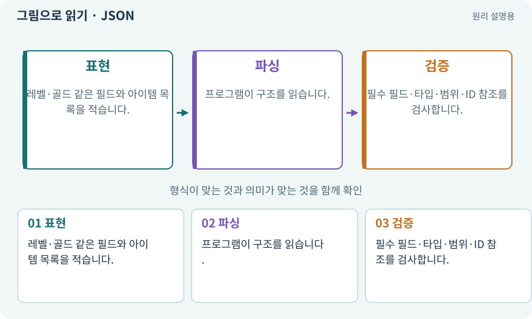

# JSON·객체·배열·필드

**분야:** 코드·데이터·저장·검사

JSON은 이름과 값, 목록으로 데이터를 표현하는 텍스트 형식입니다. 객체는 이름 있는 값의 묶음이고 배열은 순서 있는 목록입니다. 형식이 맞는 것과 내용이 유효한 것은 다릅니다.

**찾아오는 이름:** JSON·객체·배열·필드, JSON, 필드, 객체, 배열, dictionary, 딕셔너리, key-value

## 익숙한 것에 비유하면

이름 칸이 있는 신청서와 물건 목록입니다. 빈 신청서가 인쇄됐다고 자격 조건을 충족한 것은 아닙니다.



개념도입니다. 실제 Unity 화면이나 검사 결과가 아닙니다. 그림의 순서·색은 역할을 구분하며 실제 설정값은 프로젝트에서 확인합니다.

## 이렇게 작동합니다

### 1. 표현

레벨·골드 같은 필드와 아이템 목록을 적습니다.

### 2. 파싱

프로그램이 구조를 읽습니다.

### 3. 검증

필수 필드·타입·범위·ID 참조를 검사합니다.

## 우리 RPG에서는 이렇게 만나요

골드가 숫자가 아니라 “많음”이면 JSON 문법은 맞아도 게임 저장에는 맞지 않습니다. 없는 아이템 정의 ID도 의미 검사에서 거부해야 합니다.

## 이것과 혼동하지 마세요

JSON을 직접 고칠 필요는 없습니다. AI에게 작성을 요청하고 실제 검사 결과를 확인합니다. 값의 의미와 잘못된 입력은 이해하고 판단할 수 있어야 합니다.

## 이해했는지 한 번 생각해 보기

JSON을 읽는 데 성공하면 저장이 정상인가요?

<details><summary>답과 이유</summary>

아닙니다. 스키마와 게임 불변 조건까지 확인합니다.

</details>

## 내 프로젝트에서 확인하고 싶다면

아래 요청은 읽기 전용으로 실제 대상을 확인하는 선택 요청입니다. 코드나 설정을 직접 편집할 필요는 없습니다.

```text
현재 프로젝트의 JSON 데이터에서 객체·배열·필드가 실제로 어떻게 사용되는지 읽기 전용으로 확인해 줘. 간단한 아이템 예로 각각을 구분하고, 문법이 맞는 JSON이라도 중복 ID나 잘못된 값 때문에 사용할 수 없는 사례를 설명해 줘. 파일 작성·검사는 네가 맡으며 지금은 기존 파일을 바꾸지 마.
```

## 이어지는 개념

[스키마·JSON Schema·계약](schema.md) · [직렬화·역직렬화](serialization.md) · [파서·XML·결과 판정](parser.md) · [ID·고유 식별자·버전](identifier.md)

## 이 개념을 사용하는 실습

[22 · 장비를 주워 24칸 가방에 넣기](../index.html#lesson-022) · [38 · 테스트 결과와 실제 플레이 구분하기](../index.html#lesson-038) · [61 · Ludo.ai로 키 포즈를 지정해 움직임 만들기](../index.html#lesson-061) · [65 · 스프라이트를 정리해 실제 캐릭터에 넣기](../index.html#lesson-065) · [82 · 게임 규칙은 재사용하고 공간만 바꾸기](../index.html#lesson-082) · [99 · 2D와 3D 사이에 진행 가져오기](../index.html#lesson-099) · [106 · 도구가 상태를 기억하게 만들기](../index.html#lesson-106) · [109 · 요청을 검사 가능한 작업표로 바꾸기](../index.html#lesson-109) · [111 · AI 답변을 안전한 변경안으로 받기](../index.html#lesson-111) · [122 · 내 게임에 맞는 검사기 추가하기](../index.html#lesson-122) · [123 · 기존 게임의 실제 파일 찾아 연결하기](../index.html#lesson-123) · [128 · 내 도구를 대화로 운영하기](../index.html#lesson-128) · [129 · 기존 2D 게임에서 확장팩 시작하기](../index.html#lesson-129) · [133 · 첫 기능의 실패를 고쳐 다음 기준 만들기](../index.html#lesson-133) · [138 · 장비를 분해해 재료 얻기](../index.html#lesson-138) · [139 · 재료로 장비 제작하기](../index.html#lesson-139) · [148 · 아트 역할로 새 지역 외형 완성하기](../index.html#lesson-148) · [152 · 이전 저장을 새 확장판으로 가져오기](../index.html#lesson-152)

## 참고와 설명의 범위

기본 도구 동작은 아래 공식 자료를 참고했습니다. 비유·그림·RPG의 예시 수치와 정책은 이해를 위한 자체 예제입니다. 실제 API·지원 기능은 설치 버전과 계정에서 확인합니다.

- [Python · JSON](https://docs.python.org/3/library/json.html)

그림·계산 예제·조작 모형은 자체 제작한 설명입니다. 실제 Unity 화면, 서비스 생성 결과, 성능 실측 또는 게임 테스트 결과가 아닙니다. 자료 확인: 2026년 9월 26일.
