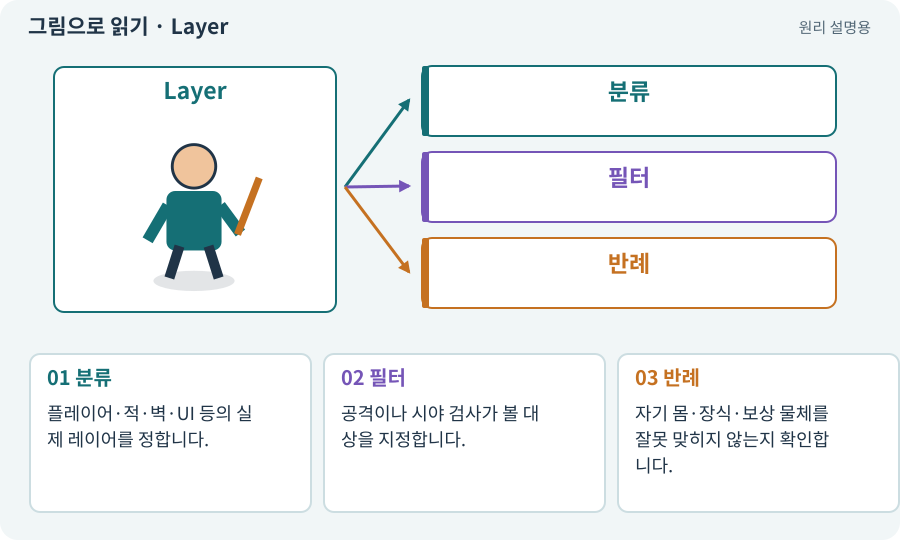

# Layer·LayerMask·Tag

**분야:** 오브젝트·좌표·움직임

Layer는 렌더링·물리 조회에서 대상을 분류하는 값이고 LayerMask는 어떤 레이어를 포함할지 고르는 필터입니다. Tag는 객체를 이름 있는 범주로 구분할 때 쓰며 역할이 다릅니다.

**찾아오는 이름:** Layer·LayerMask·Tag, LayerMask, Layer, 레이어, Tag, 태그, 충돌 매트릭스

## 익숙한 것에 비유하면

서랍에 분류표를 붙이고 검색할 서랍만 선택하는 방식입니다. 그리기 순서표와 보관 분류표는 같지 않습니다.



개념도입니다. 실제 Unity 화면이나 검사 결과가 아닙니다. 그림의 순서·색은 역할을 구분하며 실제 설정값은 프로젝트에서 확인합니다.

## 이렇게 작동합니다

### 1. 분류

플레이어·적·벽·UI 등의 실제 레이어를 정합니다.

### 2. 필터

공격이나 시야 검사가 볼 대상을 지정합니다.

### 3. 반례

자기 몸·장식·보상 물체를 잘못 맞히지 않는지 확인합니다.

## 우리 RPG에서는 이렇게 만나요

벽만 봐야 하는 LOS 검사가 아이템 Trigger까지 벽으로 간주하면 적이 플레이어를 놓칠 수 있습니다. 질문마다 다른 마스크가 필요합니다.

## 이것과 혼동하지 마세요

Sorting Layer는 2D 그림 순서용입니다. 물리 Layer와 이름이 비슷하지만 자동 연동되지 않습니다.

## 이해했는지 한 번 생각해 보기

Sorting Layer를 바꾸면 벽 충돌도 바뀌나요?

<details><summary>답과 이유</summary>

아닙니다. 물리 Layer와 Collider 설정을 따로 확인합니다.

</details>

## 내 프로젝트에서 확인하고 싶다면

아래 요청은 읽기 전용으로 실제 대상을 확인하는 선택 요청입니다. 코드나 설정을 직접 편집할 필요는 없습니다.

```text
현재 프로젝트에서 Layer·LayerMask·Tag 관련 요소가 어떻게 사용되는지 읽기 전용으로 확인해 줘. 실제 대상과 설정을 찾아 쉬운 말과 작은 예로 설명해 줘. 특히 다음 혼동을 구분해 줘: Sorting Layer는 2D 그림 순서용입니다. 물리 Layer와 이름이 비슷하지만 자동 연동되지 않습니다. 아직 코드·설정·파일은 바꾸지 말고, 확인할 수 없는 내용은 따로 알려 줘.
```

## 이어지는 개념

[Sorting Layer·Order·발 정렬](sorting.md) · [Raycast·Linecast·Cast](raycast.md) · [시야·LOS·마지막 목격 위치](los.md) · [Physics2D와 3D Physics](physics2d.md)

## 이 개념을 사용하는 실습

[03 · AI와 실행 중인 Unity 연결하기](../index.html#lesson-003) · [06 · 시작 메뉴와 테스트 공간 연결하기](../index.html#lesson-006) · [07 · 캐릭터와 벽이 있는 공간 만들기](../index.html#lesson-007) · [09 · 클릭한 곳까지 벽을 돌아가기](../index.html#lesson-009) · [12 · 체력과 피해를 눈으로 확인하기](../index.html#lesson-012) · [14 · 나를 발견하고 공격하는 적 만들기](../index.html#lesson-014) · [15 · 다른 방식으로 싸우는 적 추가하기](../index.html#lesson-015) · [16 · 물약을 쓰고 죽은 뒤 다시 시작하기](../index.html#lesson-016) · [19 · 누가 때렸는지 보이는 전투 만들기](../index.html#lesson-019) · [20 · 같은 검 두 자루를 다른 물건으로 다루기](../index.html#lesson-020) · [26 · 새 게임·이어하기·마을 연결하기](../index.html#lesson-026) · [28 · 여덟 구역의 첫 던전 만들기](../index.html#lesson-028) · [29 · 방마다 적과 상자 배치하기](../index.html#lesson-029) · [30 · 예고를 보고 피하는 보스 만들기](../index.html#lesson-030) · [32 · 길 안내와 처음 하는 사람의 동선 만들기](../index.html#lesson-032) · [33 · 기본 캐릭터·몬스터·타일 아트 만들기](../index.html#lesson-033) · [35 · 앞뒤 가림과 PC 조작 다듬기](../index.html#lesson-035) · [43 · 빌드를 바꾸며 전투 비교하기](../index.html#lesson-043) · [46 · 랜덤 지도 위를 실제로 걷기](../index.html#lesson-046) · [47 · 실패하는 시드를 찾고 복구하기](../index.html#lesson-047) · [48 · 적이 나를 보고 놓치게 만들기](../index.html#lesson-048) · [49 · 여러 근접 적의 공격 나누기](../index.html#lesson-049) · [50 · 석궁수가 거리를 유지하게 만들기](../index.html#lesson-050) · [51 · 전투 전체의 압박 조절하기](../index.html#lesson-051) · [53 · 입력은 빠르게, 취소 규칙은 명확하게](../index.html#lesson-053) · [54 · 느낌을 근거로 밸런스 고치기](../index.html#lesson-054) · [71 · 카메라·소리·피해 숫자 맞추기](../index.html#lesson-071) · [72 · 모바일 효과를 줄여도 위험은 남기기](../index.html#lesson-072) · [73 · 주소로 에셋 불러오기](../index.html#lesson-073) · [74 · 추가 외형을 서버에서 받게 준비하기](../index.html#lesson-074) · [79 · 추가 기능을 하나의 게임으로 합치기](../index.html#lesson-079) · [83 · 3D 카메라와 재질로 공간 보기](../index.html#lesson-083) · [86 · 3D에서도 클릭한 곳까지 돌아가기](../index.html#lesson-086) · [87 · 같은 캐릭터를 실제 3D 모델로 만들기](../index.html#lesson-087) · [89 · 같은 전투 규칙을 3D에 연결하기](../index.html#lesson-089) · [90 · 적의 판단을 3D 공간에 연결하기](../index.html#lesson-090) · [91 · 보스 예고를 3D 바닥에 맞추기](../index.html#lesson-091) · [93 · 3D 마을과 퀘스트 연결하기](../index.html#lesson-093) · [94 · 같은 랜덤 던전을 3D로 생성하기](../index.html#lesson-094) · [95 · 3D 조명과 환경을 읽기 좋게 만들기](../index.html#lesson-095) · [96 · 3D 카메라 가림과 터치 조작 다듬기](../index.html#lesson-096) · [98 · 3D 팩을 2D 팩과 따로 내려받기](../index.html#lesson-098) · [136 · 방패병과 화염술사 정예 추가하기](../index.html#lesson-136) · [137 · 기름·폭발통·밸브로 공간 활용하기](../index.html#lesson-137) · [141 · 소켓 한 칸에 룬 장착하기](../index.html#lesson-141) · [145 · 지원 동료 하나 만들기](../index.html#lesson-145) · [148 · 아트 역할로 새 지역 외형 완성하기](../index.html#lesson-148) · [150 · 소리가 없어도 읽히는 전투 만들기](../index.html#lesson-150) · [160 · 대장간 보스까지 완주하고 새 기능 맡기기](../index.html#lesson-160)

## 참고와 설명의 범위

기본 도구 동작은 아래 공식 자료를 참고했습니다. 비유·그림·RPG의 예시 수치와 정책은 이해를 위한 자체 예제입니다. 실제 API·지원 기능은 설치 버전과 계정에서 확인합니다.

- [Unity · Physics2D.CircleCast](https://docs.unity3d.com/6000.3/Documentation/ScriptReference/Physics2D.CircleCast.html)

그림·계산 예제·조작 모형은 자체 제작한 설명입니다. 실제 Unity 화면, 서비스 생성 결과, 성능 실측 또는 게임 테스트 결과가 아닙니다. 자료 확인: 2026년 9월 26일.
