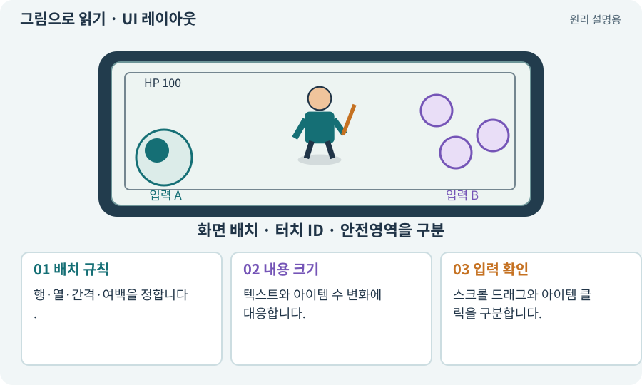

# UI 레이아웃·스크롤·9슬라이스

**분야:** 입력·UI·소리·성능

UI 레이아웃은 버튼·아이콘·문자를 자동으로 배치하는 규칙입니다. 스크롤은 제한된 화면에 더 많은 항목을 보여 주며, 9슬라이스는 테두리를 크게 늘이지 않고 패널 크기를 조절하는 표현 방식입니다.

**찾아오는 이름:** UI 레이아웃·스크롤·9슬라이스, LayoutGroup, Layout Group, GridLayoutGroup, ScrollRect, 스크롤, 9-slice, 9슬라이스, 레이아웃

## 익숙한 것에 비유하면

책장의 칸 배치와 서랍을 여는 방식입니다. 작은 장식 테두리를 그대로 두고 서랍 몸통만 늘립니다.



개념도입니다. 실제 Unity 화면이나 검사 결과가 아닙니다. 그림의 순서·색은 역할을 구분하며 실제 설정값은 프로젝트에서 확인합니다.

## 이렇게 작동합니다

### 1. 배치 규칙

행·열·간격·여백을 정합니다.

### 2. 내용 크기

텍스트와 아이템 수 변화에 대응합니다.

### 3. 입력 확인

스크롤 드래그와 아이템 클릭을 구분합니다.

## 우리 RPG에서는 이렇게 만나요

24칸 가방은 같은 크기 셀로 구성하지만 긴 아이템 이름과 비교 패널은 작은 기기에서 넘칠 수 있습니다. 레이아웃 재계산과 클릭 영역을 봅니다.

## 이것과 혼동하지 마세요

스크롤하는 동안 놓는 이벤트가 장착 클릭으로 바뀌지 않게 합니다.

## 이해했는지 한 번 생각해 보기

가방을 드래그했는데 아이템이 장착되면?

<details><summary>답과 이유</summary>

드래그·클릭 판별과 포인터 종료 처리가 겹치는지 확인합니다.

</details>

## 내 프로젝트에서 확인하고 싶다면

아래 요청은 읽기 전용으로 실제 대상을 확인하는 선택 요청입니다. 코드나 설정을 직접 편집할 필요는 없습니다.

```text
현재 프로젝트에서 UI 레이아웃·스크롤·9슬라이스 관련 요소가 어떻게 사용되는지 읽기 전용으로 확인해 줘. 실제 대상과 설정을 찾아 쉬운 말과 작은 예로 설명해 줘. 특히 다음 혼동을 구분해 줘: 스크롤하는 동안 놓는 이벤트가 장착 클릭으로 바뀌지 않게 합니다. 아직 코드·설정·파일은 바꾸지 말고, 확인할 수 없는 내용은 따로 알려 줘.
```

## 이어지는 개념

[Canvas·RectTransform·앵커](canvas.md) · [EventSystem·UI 입력·클릭 차단](event-system.md) · [인벤토리·슬롯·스택·창고](inventory.md) · [접근성·가독성·피드백](accessibility.md)

## 이 개념을 사용하는 실습

[24 · 보기 편한 인벤토리 화면 만들기](../index.html#lesson-024) · [44 · 시드로 같은 던전 다시 만들기](../index.html#lesson-044) · [73 · 주소로 에셋 불러오기](../index.html#lesson-073)

## 참고와 설명의 범위

기본 도구 동작은 아래 공식 자료를 참고했습니다. 비유·그림·RPG의 예시 수치와 정책은 이해를 위한 자체 예제입니다. 실제 API·지원 기능은 설치 버전과 계정에서 확인합니다.

- [Unity Input System · UI 지원](https://docs.unity3d.com/Packages/com.unity.inputsystem@1.17/manual/UISupport.html)

그림·계산 예제·조작 모형은 자체 제작한 설명입니다. 실제 Unity 화면, 서비스 생성 결과, 성능 실측 또는 게임 테스트 결과가 아닙니다. 자료 확인: 2026년 9월 26일.
