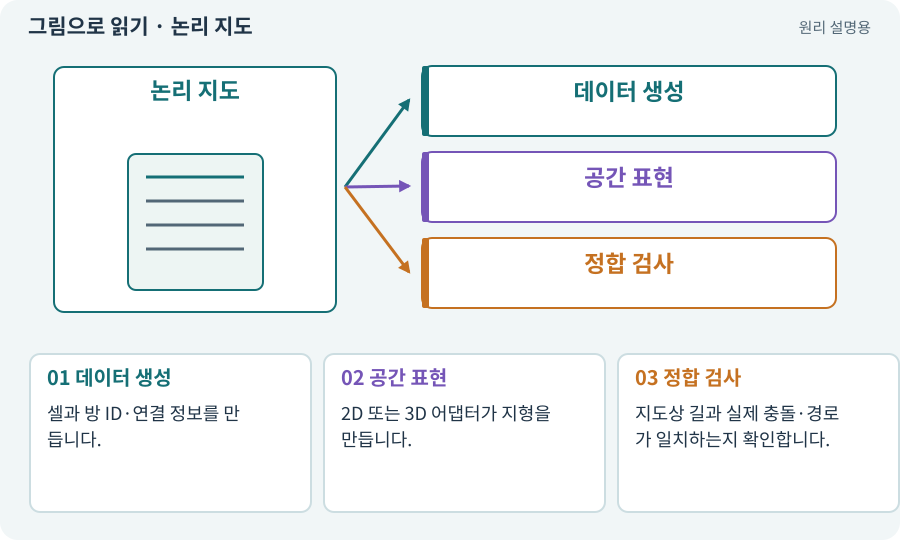

# 논리 지도·DungeonLayout

**분야:** 지도·적 AI·전투 규칙

논리 지도는 그림과 상관없이 방·통로·문·스폰 후보를 표현한 데이터입니다. 이를 2D Tilemap과 3D 메시가 각각 화면과 충돌로 바꿉니다.

**찾아오는 이름:** 논리 지도·DungeonLayout, DungeonLayout, Layout, 논리 지도, roomId, walkable, 이동 가능 칸

## 익숙한 것에 비유하면

건물 설계도와 실제 인테리어를 분리하는 것입니다. 벽지 색을 바꿔도 출입구 위치는 같아야 합니다.



개념도입니다. 실제 Unity 화면이나 검사 결과가 아닙니다. 그림의 순서·색은 역할을 구분하며 실제 설정값은 프로젝트에서 확인합니다.

## 이렇게 작동합니다

### 1. 데이터 생성

셀과 방 ID·연결 정보를 만듭니다.

### 2. 공간 표현

2D 또는 3D 어댑터가 지형을 만듭니다.

### 3. 정합 검사

지도상 길과 실제 충돌·경로가 일치하는지 확인합니다.

## 우리 RPG에서는 이렇게 만나요

같은 seed의 2D·3D 버전은 방 순서와 입구·보스방 역할을 비교할 수 있습니다. 실제 발밑 높이·NavMesh 오차까지 완전히 같다는 뜻은 아닙니다.

## 이것과 혼동하지 마세요

Layout이라는 단어는 UI 배치에도 쓰입니다. 여기서는 던전의 논리 배치 데이터입니다.

## 이해했는지 한 번 생각해 보기

바닥 재질을 바꿨는데 전리품까지 달라지면?

<details><summary>답과 이유</summary>

시각 자료와 논리·난수 스트림이 불필요하게 결합됐는지 확인합니다.

</details>

## 내 프로젝트에서 확인하고 싶다면

아래 요청은 읽기 전용으로 실제 대상을 확인하는 선택 요청입니다. 코드나 설정을 직접 편집할 필요는 없습니다.

```text
현재 프로젝트에서 논리 지도·DungeonLayout 관련 요소가 어떻게 사용되는지 읽기 전용으로 확인해 줘. 실제 대상과 설정을 찾아 쉬운 말과 작은 예로 설명해 줘. 특히 다음 혼동을 구분해 줘: Layout이라는 단어는 UI 배치에도 쓰입니다. 여기서는 던전의 논리 배치 데이터입니다. 아직 코드·설정·파일은 바꾸지 말고, 확인할 수 없는 내용은 따로 알려 줘.
```

## 이어지는 개념

[Grid·셀·격자 좌표](grid.md) · [절차적·무작위 지형 생성](generation.md) · [어댑터·인터페이스·의존성 분리](adapter.md) · [시드·난수·PRNG](rng.md)

## 이 개념을 사용하는 실습

[09 · 클릭한 곳까지 벽을 돌아가기](../index.html#lesson-009) · [28 · 여덟 구역의 첫 던전 만들기](../index.html#lesson-028) · [29 · 방마다 적과 상자 배치하기](../index.html#lesson-029) · [45 · 무작위 방과 통로 만들기](../index.html#lesson-045) · [46 · 랜덤 지도 위를 실제로 걷기](../index.html#lesson-046) · [50 · 석궁수가 거리를 유지하게 만들기](../index.html#lesson-050) · [66 · 타일 경계와 랜덤맵 외형 연결하기](../index.html#lesson-066) · [81 · 2D 게임을 남기고 3D 작업 시작하기](../index.html#lesson-081) · [82 · 게임 규칙은 재사용하고 공간만 바꾸기](../index.html#lesson-082) · [84 · 같은 지도를 3D 바닥과 벽으로 만들기](../index.html#lesson-084) · [93 · 3D 마을과 퀘스트 연결하기](../index.html#lesson-093) · [94 · 같은 랜덤 던전을 3D로 생성하기](../index.html#lesson-094) · [95 · 3D 조명과 환경을 읽기 좋게 만들기](../index.html#lesson-095) · [100 · 두 버전이 같은 게임인지 비교하기](../index.html#lesson-100) · [143 · 새 랜덤 지역 봉인된 대장간 만들기](../index.html#lesson-143) · [144 · 이번 탐험에만 남는 유물 고르기](../index.html#lesson-144)

## 참고와 설명의 범위

이 항목의 비유·그림·RPG 수치·운영 규칙은 개념을 이해하기 위한 자체 설계 예제입니다. 특정 도구가 이 규칙을 자동으로 구현한다는 뜻은 아닙니다.


그림·계산 예제·조작 모형은 자체 제작한 설명입니다. 실제 Unity 화면, 서비스 생성 결과, 성능 실측 또는 게임 테스트 결과가 아닙니다. 자료 확인: 2026년 9월 26일.
