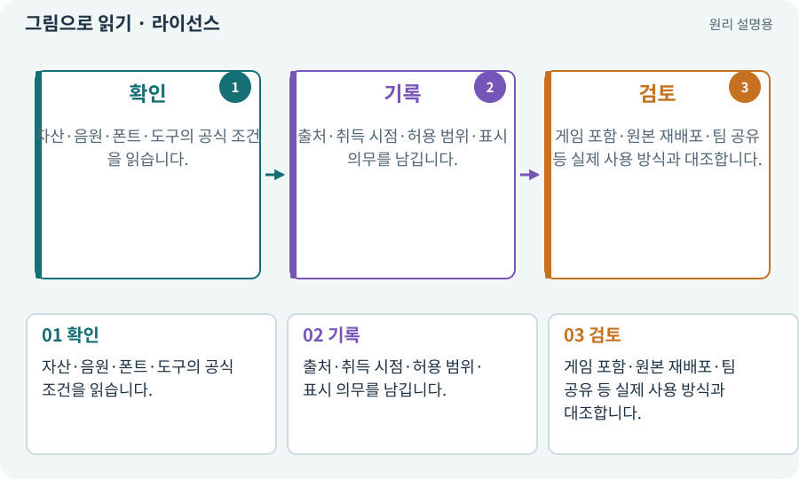

# 라이선스·출처·사용 조건

**분야:** 자산 제작·렌더링 보충

라이선스는 자산·도구를 어떤 조건에서 사용할 수 있는지 정한 허용 범위입니다. 다운로드 가능하다는 것과 게임에 포함해 배포할 수 있다는 것은 다릅니다. 생성 이미지도 서비스 조건과 입력 자료의 권리를 확인합니다.

**찾아오는 이름:** 라이선스·출처·사용 조건, 라이선스, License, license, 출처, 상업 이용, 저작권, 에셋 라이선스

## 익숙한 것에 비유하면

빌린 물건을 집에서 쓰는 허락과 복제해서 판매하는 허락은 다를 수 있는 것과 같습니다.



개념도입니다. 실제 Unity 화면이나 검사 결과가 아닙니다. 그림의 순서·색은 역할을 구분하며 실제 설정값은 프로젝트에서 확인합니다.

## 이렇게 작동합니다

### 1. 확인

자산·음원·폰트·도구의 공식 조건을 읽습니다.

### 2. 기록

출처·취득 시점·허용 범위·표시 의무를 남깁니다.

### 3. 검토

게임 포함·원본 재배포·팀 공유 등 실제 사용 방식과 대조합니다.

## 우리 RPG에서는 이렇게 만나요

게임 스크린샷에 보이는 것과 원본 스프라이트 파일을 교재 ZIP에 배포하는 것은 조건이 다를 수 있습니다. 불명확하면 권리자 확인이나 다른 자산을 선택합니다.

## 이것과 혼동하지 마세요

“AI로 생성했으니 모든 제약이 없다”거나 “무료니까 재배포도 된다”는 식으로 단정하지 않습니다.

## 이해했는지 한 번 생각해 보기

인터넷에서 찾은 효과음을 출처 없이 넣어도 되나요?

<details><summary>답과 이유</summary>

사용·배포 조건을 확인하고 기록해야 합니다. 불명확하면 대안을 씁니다.

</details>

## 내 프로젝트에서 확인하고 싶다면

아래 요청은 읽기 전용으로 실제 대상을 확인하는 선택 요청입니다. 코드나 설정을 직접 편집할 필요는 없습니다.

```text
현재 프로젝트에서 라이선스·출처·사용 조건 관련 요소가 어떻게 사용되는지 읽기 전용으로 확인해 줘. 실제 대상과 설정을 찾아 쉬운 말과 작은 예로 설명해 줘. 특히 다음 혼동을 구분해 줘: “AI로 생성했으니 모든 제약이 없다”거나 “무료니까 재배포도 된다”는 식으로 단정하지 않습니다. 아직 코드·설정·파일은 바꾸지 말고, 확인할 수 없는 내용은 따로 알려 줘.
```

## 이어지는 개념

[생성형 아트·참조 이미지·후처리](image-service.md) · [AudioClip·AudioSource·AudioListener](audio.md) · [앱 서명·키·자격 증명](signature.md) · [권한·승인·최소 권한](permission.md)

## 이 개념을 사용하는 실습

[01 · 빈 2D 프로젝트 만들기](../index.html#lesson-001) · [02 · 내 게임을 알아듣는 개발 스킬 만들기](../index.html#lesson-002) · [55 · 어떤 그림도 맞춰 넣는 아트 규격 정하기](../index.html#lesson-055) · [58 · PixelLab로 방향별 픽셀 캐릭터 만들기](../index.html#lesson-058) · [59 · Retro Diffusion으로 캐릭터와 타일 만들기](../index.html#lesson-059) · [60 · Scenario로 스타일과 동작 유지하기](../index.html#lesson-060) · [80 · 나만의 2D RPG 완성하기](../index.html#lesson-080) · [88 · 3D 모델에 걷기와 공격 연결하기](../index.html#lesson-088) · [104 · 2D와 3D를 두 플랫폼에서 완주하기](../index.html#lesson-104) · [105 · 내 개발 도구를 빈 폴더에서 시작하기](../index.html#lesson-105) · [148 · 아트 역할로 새 지역 외형 완성하기](../index.html#lesson-148) · [150 · 소리가 없어도 읽히는 전투 만들기](../index.html#lesson-150)

## 참고와 설명의 범위

이 항목의 비유·그림·RPG 수치·운영 규칙은 개념을 이해하기 위한 자체 설계 예제입니다. 특정 도구가 이 규칙을 자동으로 구현한다는 뜻은 아닙니다.


그림·계산 예제·조작 모형은 자체 제작한 설명입니다. 실제 Unity 화면, 서비스 생성 결과, 성능 실측 또는 게임 테스트 결과가 아닙니다. 자료 확인: 2026년 9월 26일.
