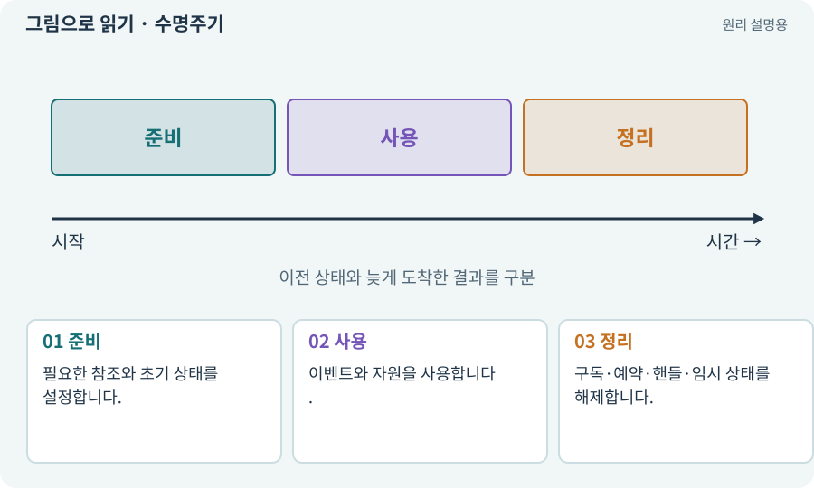

# 수명주기·초기화·정리

**분야:** 오브젝트·좌표·움직임

객체는 생성·준비·활성·비활성·파괴의 단계를 거칩니다. 각 단계에서 구독·타이머·자원·참조를 준비하고 정리해야 합니다. “안 보임”과 “완전히 없어짐”도 다릅니다.

**찾아오는 이름:** 수명주기·초기화·정리, 수명주기, 초기화, OnEnable, OnDisable, OnDestroy, Awake, Start, dispose, Dispose

## 익숙한 것에 비유하면

도서관 좌석을 예약·사용·반납하는 과정입니다. 자리를 떠나도 예약을 반납하지 않으면 다음 사람이 쓸 수 없습니다.



개념도입니다. 실제 Unity 화면이나 검사 결과가 아닙니다. 그림의 순서·색은 역할을 구분하며 실제 설정값은 프로젝트에서 확인합니다.

## 이렇게 작동합니다

### 1. 준비

필요한 참조와 초기 상태를 설정합니다.

### 2. 사용

이벤트와 자원을 사용합니다.

### 3. 정리

구독·예약·핸들·임시 상태를 해제합니다.

## 우리 RPG에서는 이렇게 만나요

적이 사망하면 공격 토큰을 반환하고, 씬이 바뀌면 이전 적의 콜백이 새 플레이어에게 피해를 주지 않게 합니다. 풀로 돌아간 객체도 이전 상태를 비워야 합니다.

## 이것과 혼동하지 마세요

OnDisable과 파괴는 같은 사건이 아닙니다. 다시 활성화될 수 있는지에 따라 정리·초기화 규칙을 맞춥니다.

## 이해했는지 한 번 생각해 보기

죽은 적 때문에 다른 적이 공격을 못 한다면?

<details><summary>답과 이유</summary>

사망 때 공격 권한을 반환하지 않았는지 확인합니다.

</details>

## 내 프로젝트에서 확인하고 싶다면

아래 요청은 읽기 전용으로 실제 대상을 확인하는 선택 요청입니다. 코드나 설정을 직접 편집할 필요는 없습니다.

```text
현재 프로젝트에서 수명주기·초기화·정리 관련 요소가 어떻게 사용되는지 읽기 전용으로 확인해 줘. 실제 대상과 설정을 찾아 쉬운 말과 작은 예로 설명해 줘. 특히 다음 혼동을 구분해 줘: OnDisable과 파괴는 같은 사건이 아닙니다. 다시 활성화될 수 있는지에 따라 정리·초기화 규칙을 맞춥니다. 아직 코드·설정·파일은 바꾸지 말고, 확인할 수 없는 내용은 따로 알려 줘.
```

## 이어지는 개념

[이벤트·콜백·구독·이벤트 버스](event.md) · [오브젝트 풀링](pool.md) · [핸들·참조 계수·Release](handle.md) · [동시 공격 제한·공격 토큰](attack-token.md)

## 이 개념을 사용하는 실습

[04 · 되돌릴 수 있는 작업 습관 만들기](../index.html#lesson-004) · [06 · 시작 메뉴와 테스트 공간 연결하기](../index.html#lesson-006) · [08 · WASD로 벽에 부딪히며 이동하기](../index.html#lesson-008) · [16 · 물약을 쓰고 죽은 뒤 다시 시작하기](../index.html#lesson-016) · [24 · 보기 편한 인벤토리 화면 만들기](../index.html#lesson-024) · [26 · 새 게임·이어하기·마을 연결하기](../index.html#lesson-026) · [27 · 회복하고 물약을 사는 마을 만들기](../index.html#lesson-027) · [29 · 방마다 적과 상자 배치하기](../index.html#lesson-029) · [32 · 길 안내와 처음 하는 사람의 동선 만들기](../index.html#lesson-032) · [38 · 테스트 결과와 실제 플레이 구분하기](../index.html#lesson-038) · [43 · 빌드를 바꾸며 전투 비교하기](../index.html#lesson-043) · [47 · 실패하는 시드를 찾고 복구하기](../index.html#lesson-047) · [48 · 적이 나를 보고 놓치게 만들기](../index.html#lesson-048) · [53 · 입력은 빠르게, 취소 규칙은 명확하게](../index.html#lesson-053) · [68 · 피격 불꽃과 먼지 만들기](../index.html#lesson-068) · [70 · 피격 강조와 보스 예고 셰이더 만들기](../index.html#lesson-070) · [75 · 다운로드 용량과 진행률 보여 주기](../index.html#lesson-075) · [76 · 연결이 끊겨도 게임 계속하기](../index.html#lesson-076) · [77 · 앱을 바꾸지 않고 외형 업데이트하기](../index.html#lesson-077) · [80 · 나만의 2D RPG 완성하기](../index.html#lesson-080) · [99 · 2D와 3D 사이에 진행 가져오기](../index.html#lesson-099) · [120 · 자연어 요청을 계획으로 바꾸기](../index.html#lesson-120) · [132 · 필터를 실제 던전과 모바일에 연결하기](../index.html#lesson-132) · [134 · 화상·냉기·표식으로 전투 확장하기](../index.html#lesson-134) · [142 · 배운 스킬의 변형 선택하기](../index.html#lesson-142) · [144 · 이번 탐험에만 남는 유물 고르기](../index.html#lesson-144) · [152 · 이전 저장을 새 확장판으로 가져오기](../index.html#lesson-152)

## 참고와 설명의 범위

기본 도구 동작은 아래 공식 자료를 참고했습니다. 비유·그림·RPG의 예시 수치와 정책은 이해를 위한 자체 예제입니다. 실제 API·지원 기능은 설치 버전과 계정에서 확인합니다.

- [Unity · 컴포넌트](https://docs.unity3d.com/6000.3/Documentation/Manual/Components.html)
- [Unity · 코루틴](https://docs.unity3d.com/6000.3/Documentation/Manual/Coroutines.html)

그림·계산 예제·조작 모형은 자체 제작한 설명입니다. 실제 Unity 화면, 서비스 생성 결과, 성능 실측 또는 게임 테스트 결과가 아닙니다. 자료 확인: 2026년 9월 26일.
