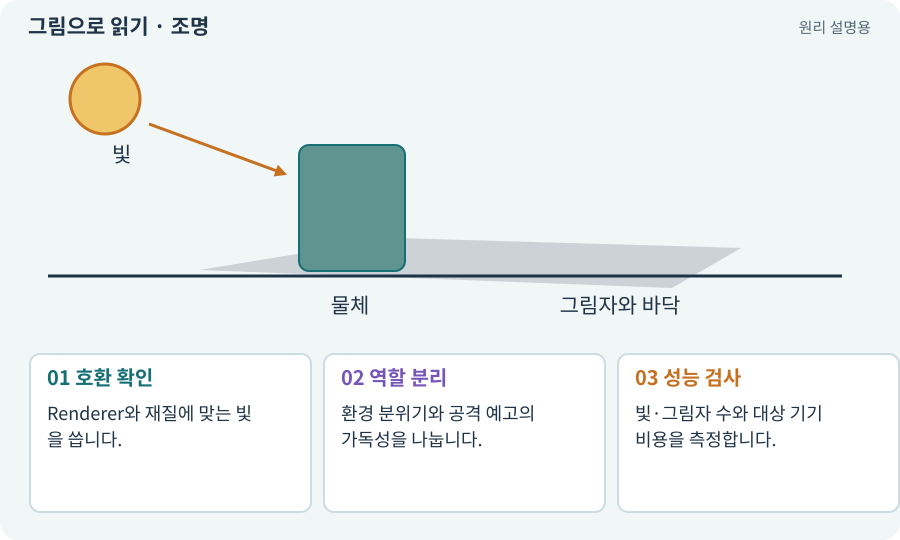

# 조명·Lit·Unlit·그림자

**분야:** 그림·애니메이션·화면 만들기

조명은 표면이 밝고 어두워 보이는 원인을 계산하는 요소입니다. Lit 재질은 지정된 조명 경로의 영향을 받고 Unlit은 일반적으로 그 조명 계산 없이 표시됩니다.

**찾아오는 이름:** 조명·Lit·Unlit·그림자, 조명, Lighting, Light, Lit, Unlit, 그림자, Shadow, Directional Light, 2D Light

## 익숙한 것에 비유하면

같은 종이를 전등 아래에서 보는 것과 종이 자체가 일정 색으로 빛나는 화면에 표시되는 차이입니다.



개념도입니다. 실제 Unity 화면이나 검사 결과가 아닙니다. 그림의 순서·색은 역할을 구분하며 실제 설정값은 프로젝트에서 확인합니다.

## 이렇게 작동합니다

### 1. 호환 확인

Renderer와 재질에 맞는 빛을 씁니다.

### 2. 역할 분리

환경 분위기와 공격 예고의 가독성을 나눕니다.

### 3. 성능 검사

빛·그림자 수와 대상 기기 비용을 측정합니다.

## 우리 RPG에서는 이렇게 만나요

픽셀 캐릭터가 이미 한쪽 광원을 그려 넣었다면 장면 빛과 충돌해 어색할 수 있습니다. 어두운 던전에서도 적의 예고 테두리는 읽혀야 합니다.

## 이것과 혼동하지 마세요

Unlit이 모든 투명·후처리·색 영향에서 완전히 자유롭다는 뜻은 아닙니다. 파이프라인 구성을 봅니다.

## 이해했는지 한 번 생각해 보기

빛을 추가했는데 Sprite가 그대로라면?

<details><summary>답과 이유</summary>

Unlit 재질인지, 사용 중인 Renderer와 조명 종류가 맞는지 확인합니다.

</details>

## 내 프로젝트에서 확인하고 싶다면

아래 요청은 읽기 전용으로 실제 대상을 확인하는 선택 요청입니다. 코드나 설정을 직접 편집할 필요는 없습니다.

```text
현재 프로젝트에서 조명·Lit·Unlit·그림자 관련 요소가 어떻게 사용되는지 읽기 전용으로 확인해 줘. 실제 대상과 설정을 찾아 쉬운 말과 작은 예로 설명해 줘. 특히 다음 혼동을 구분해 줘: Unlit이 모든 투명·후처리·색 영향에서 완전히 자유롭다는 뜻은 아닙니다. 파이프라인 구성을 봅니다. 아직 코드·설정·파일은 바꾸지 말고, 확인할 수 없는 내용은 따로 알려 줘.
```

## 이어지는 개념

[Material과 Shader](material.md) · [URP·2D Renderer·Universal Renderer](render-pipeline.md) · [공격 예고·선행동작·회복](telegraph.md) · [그림자·가림·가시성](shadow.md)

## 이 개념을 사용하는 실습

[05 · 말로 스프라이트 하나 만들기](../index.html#lesson-005) · [37 · 느려지는 원인을 측정해 고치기](../index.html#lesson-037) · [81 · 2D 게임을 남기고 3D 작업 시작하기](../index.html#lesson-081) · [83 · 3D 카메라와 재질로 공간 보기](../index.html#lesson-083) · [95 · 3D 조명과 환경을 읽기 좋게 만들기](../index.html#lesson-095) · [97 · 선택: 3D 모델에서 2D 시트 만들기](../index.html#lesson-097) · [101 · 3D Android 성능 다시 측정하기](../index.html#lesson-101)

## 참고와 설명의 범위

기본 도구 동작은 아래 공식 자료를 참고했습니다. 비유·그림·RPG의 예시 수치와 정책은 이해를 위한 자체 예제입니다. 실제 API·지원 기능은 설치 버전과 계정에서 확인합니다.

- [Unity · 2D Renderer](https://docs.unity3d.com/6000.3/Documentation/Manual/urp/2DRendererData-overview.html)

그림·계산 예제·조작 모형은 자체 제작한 설명입니다. 실제 Unity 화면, 서비스 생성 결과, 성능 실측 또는 게임 테스트 결과가 아닙니다. 자료 확인: 2026년 9월 26일.
