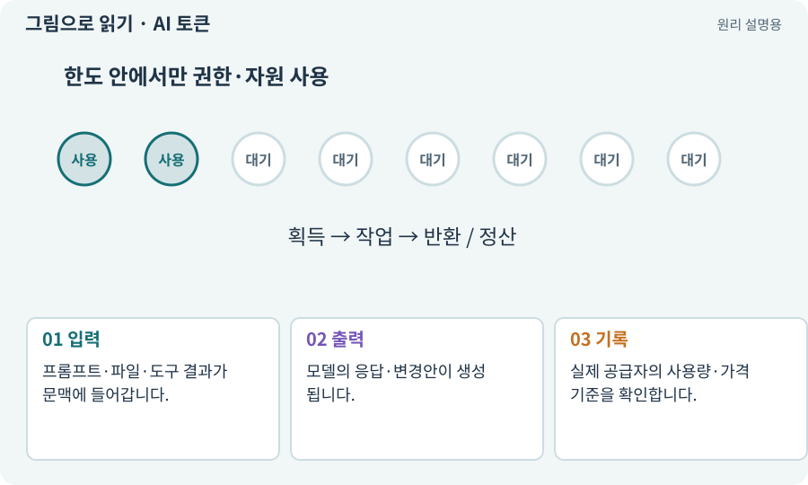

# AI 토큰·입출력·비용

**분야:** AI·스킬·훅·하네스 운영

AI 토큰은 모델이 텍스트 등을 처리하는 단위입니다. 글자나 단어와 일대일로 같지 않으며 모델·언어에 따라 나뉘는 방식이 다릅니다. 입력·출력 사용량은 비용·한도와 관련됩니다.

**찾아오는 이름:** AI 토큰·입출력·비용, 토큰, Token, tokens, 입력 토큰, 출력 토큰, 사용량

## 익숙한 것에 비유하면

택배 무게를 재는 과금 단위처럼 생각할 수 있지만 실제로는 텍스트를 나누는 계산 단위입니다. 문자 수만으로 정확한 비용을 단정할 수 없습니다.



개념도입니다. 실제 Unity 화면이나 검사 결과가 아닙니다. 그림의 순서·색은 역할을 구분하며 실제 설정값은 프로젝트에서 확인합니다.

## 이렇게 작동합니다

### 1. 입력

프롬프트·파일·도구 결과가 문맥에 들어갑니다.

### 2. 출력

모델의 응답·변경안이 생성됩니다.

### 3. 기록

실제 공급자의 사용량·가격 기준을 확인합니다.

## 우리 RPG에서는 이렇게 만나요

같은 큰 파일을 역할마다 다시 보내면 입력량이 늘 수 있습니다. 필요한 읽기 범위를 선택하되 맥락을 잘라 잘못된 구현이 나오지 않게 합니다.

## 이것과 혼동하지 마세요

적 AI의 공격 토큰은 동시 공격 권한이며 AI 과금 단위와 관계없습니다.

## 이해했는지 한 번 생각해 보기

한글 1000자면 항상 1000토큰인가요?

<details><summary>답과 이유</summary>

아닙니다. 실제 토크나이저와 입력 형식에 따라 달라집니다.

</details>

## 내 프로젝트에서 확인하고 싶다면

아래 요청은 읽기 전용으로 실제 대상을 확인하는 선택 요청입니다. 코드나 설정을 직접 편집할 필요는 없습니다.

```text
현재 프로젝트에서 AI 토큰·입출력·비용 관련 요소가 어떻게 사용되는지 읽기 전용으로 확인해 줘. 실제 대상과 설정을 찾아 쉬운 말과 작은 예로 설명해 줘. 특히 다음 혼동을 구분해 줘: 적 AI의 공격 토큰은 동시 공격 권한이며 AI 과금 단위와 관계없습니다. 아직 코드·설정·파일은 바꾸지 말고, 확인할 수 없는 내용은 따로 알려 줘.
```

## 이어지는 개념

[비용 한도·예약·실사용량](budget.md) · [컨텍스트·세션·작업 기록](context.md) · [동시 공격 제한·공격 토큰](attack-token.md) · [AI 모델·LLM·모델 선택](llm.md)

## 이 개념을 사용하는 실습

[03 · AI와 실행 중인 Unity 연결하기](../index.html#lesson-003) · [18 · 베기·마력탄·회전 공격 만들기](../index.html#lesson-018) · [38 · 테스트 결과와 실제 플레이 구분하기](../index.html#lesson-038) · [48 · 적이 나를 보고 놓치게 만들기](../index.html#lesson-048) · [54 · 느낌을 근거로 밸런스 고치기](../index.html#lesson-054) · [55 · 어떤 그림도 맞춰 넣는 아트 규격 정하기](../index.html#lesson-055) · [58 · PixelLab로 방향별 픽셀 캐릭터 만들기](../index.html#lesson-058) · [63 · Grok 이미지로 같은 자산 시험하기](../index.html#lesson-063) · [74 · 추가 외형을 서버에서 받게 준비하기](../index.html#lesson-074) · [80 · 나만의 2D RPG 완성하기](../index.html#lesson-080) · [118 · 모의 응답 대신 실제 Claude 연결하기](../index.html#lesson-118) · [119 · 막힌 작업을 안전하게 이어가기](../index.html#lesson-119) · [130 · 첫 확장 작업을 하네스에 연결하기](../index.html#lesson-130) · [156 · 기능 조합에서 숨은 오류 찾기](../index.html#lesson-156)

## 참고와 설명의 범위

기본 도구 동작은 아래 공식 자료를 참고했습니다. 비유·그림·RPG의 예시 수치와 정책은 이해를 위한 자체 예제입니다. 실제 API·지원 기능은 설치 버전과 계정에서 확인합니다.

- [Claude Code · CLI 명령 옵션](https://code.claude.com/docs/en/cli-reference)

그림·계산 예제·조작 모형은 자체 제작한 설명입니다. 실제 Unity 화면, 서비스 생성 결과, 성능 실측 또는 게임 테스트 결과가 아닙니다. 자료 확인: 2026년 9월 26일.
