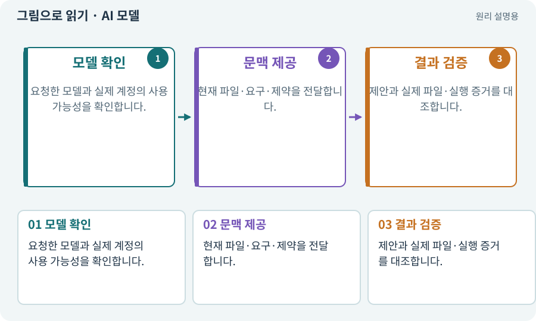

# AI 모델·LLM·모델 선택

**분야:** AI·스킬·훅·하네스 운영

언어 모델은 입력된 문맥을 바탕으로 문장·코드·계획 등을 생성하는 시스템입니다. 모델과 실제 컴퓨터 도구는 별개이므로 답변으로 작성했다고 말해도 파일이 생겼다는 증거는 아닙니다.

**찾아오는 이름:** AI 모델·LLM·모델 선택, LLM, 언어 모델, AI 모델, 모델 선택, Opus, Claude Opus, claude-opus-5-5

## 익숙한 것에 비유하면

설계안을 제안하는 사람과 공구를 쥔 작업자를 구분하는 것입니다. 모델은 도구를 사용할 수 있을 때 실제 작업까지 연결할 수 있습니다.



개념도입니다. 실제 Unity 화면이나 검사 결과가 아닙니다. 그림의 순서·색은 역할을 구분하며 실제 설정값은 프로젝트에서 확인합니다.

## 이렇게 작동합니다

### 1. 모델 확인

요청한 모델과 실제 계정의 사용 가능성을 확인합니다.

### 2. 문맥 제공

현재 파일·요구·제약을 전달합니다.

### 3. 결과 검증

제안과 실제 파일·실행 증거를 대조합니다.

## 우리 RPG에서는 이렇게 만나요

강력한 모델이라도 존재하지 않는 Unity API를 그럴듯하게 쓸 수 있습니다. 설치본 문서·컴파일·실제 명령 발견으로 확인합니다.

## 이것과 혼동하지 마세요

모델이 스스로 말한 이름은 실제 실행 메타데이터 확인을 대신하지 않습니다.

## 이해했는지 한 번 생각해 보기

AI가 “실행했다”고 답하면 검사 완료인가요?

<details><summary>답과 이유</summary>

실제 도구 호출 결과와 파일·현재 소스의 증거를 확인해야 합니다.

</details>

## 내 프로젝트에서 확인하고 싶다면

아래 요청은 읽기 전용으로 실제 대상을 확인하는 선택 요청입니다. 코드나 설정을 직접 편집할 필요는 없습니다.

```text
현재 프로젝트에서 AI 모델·LLM·모델 선택 관련 요소가 어떻게 사용되는지 읽기 전용으로 확인해 줘. 실제 대상과 설정을 찾아 쉬운 말과 작은 예로 설명해 줘. 특히 다음 혼동을 구분해 줘: 모델이 스스로 말한 이름은 실제 실행 메타데이터 확인을 대신하지 않습니다. 아직 코드·설정·파일은 바꾸지 말고, 확인할 수 없는 내용은 따로 알려 줘.
```

## 이어지는 개념

[에이전트·서브에이전트·역할](agent.md) · [도구 호출·로컬·클라우드](tool.md) · [환각·프롬프트 인젝션·신뢰 경계](hallucination.md) · [컨텍스트·세션·작업 기록](context.md)

## 이 개념을 사용하는 실습

[02 · 내 게임을 알아듣는 개발 스킬 만들기](../index.html#lesson-002) · [04 · 되돌릴 수 있는 작업 습관 만들기](../index.html#lesson-004) · [48 · 적이 나를 보고 놓치게 만들기](../index.html#lesson-048) · [62 · OpenAI 이미지로 게임 자산 만들기](../index.html#lesson-062) · [118 · 모의 응답 대신 실제 Claude 연결하기](../index.html#lesson-118)

## 참고와 설명의 범위

기본 도구 동작은 아래 공식 자료를 참고했습니다. 비유·그림·RPG의 예시 수치와 정책은 이해를 위한 자체 예제입니다. 실제 API·지원 기능은 설치 버전과 계정에서 확인합니다.

- [Claude Code · 비대화형 실행](https://code.claude.com/docs/en/headless)

그림·계산 예제·조작 모형은 자체 제작한 설명입니다. 실제 Unity 화면, 서비스 생성 결과, 성능 실측 또는 게임 테스트 결과가 아닙니다. 자료 확인: 2026년 9월 26일.
