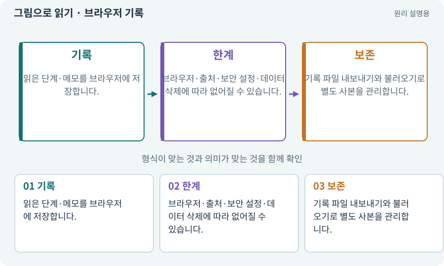

# 브라우저 기록·localStorage·내보내기

**분야:** 설명을 읽기 위한 기초 언어

localStorage는 웹페이지가 브라우저의 해당 출처에 작은 데이터를 보관하는 기능입니다. 이 실습서의 확인 표시와 메모는 게임 저장 파일·AI 작업 기록·테스트 PASS와 별개입니다.

**찾아오는 이름:** 브라우저 기록·localStorage·내보내기, localStorage, 브라우저 저장, 진행 기록, 내 기록, 기록 내보내기, 브라우저 기록

## 익숙한 것에 비유하면

책에 끼운 개인 책갈피와 같습니다. 게임 세계의 아이템을 저장하는 장부는 아닙니다.



개념도입니다. 실제 Unity 화면이나 검사 결과가 아닙니다. 그림의 순서·색은 역할을 구분하며 실제 설정값은 프로젝트에서 확인합니다.

## 이렇게 작동합니다

### 1. 기록

읽은 단계·메모를 브라우저에 저장합니다.

### 2. 한계

브라우저·출처·보안 설정·데이터 삭제에 따라 없어질 수 있습니다.

### 3. 보존

기록 파일 내보내기와 불러오기로 별도 사본을 관리합니다.

## 우리 RPG에서는 이렇게 만나요

새 컴퓨터에서 같은 HTML을 열어도 이전 브라우저 기록이 자동으로 따라오지 않을 수 있습니다. 메모 내보내기는 웹 진행을 보존하지만 실제 Unity 파일을 백업하지 않습니다.

## 이것과 혼동하지 마세요

메시지 복사나 용어 열람은 게임 기능이 검증됐다는 뜻이 아닙니다.

## 이해했는지 한 번 생각해 보기

확인 체크를 눌렀으면 하네스 게이트도 PASS인가요?

<details><summary>답과 이유</summary>

아닙니다. 웹의 개인 기록과 실제 검사 결과를 분리합니다.

</details>

## 내 프로젝트에서 확인하고 싶다면

아래 요청은 읽기 전용으로 실제 대상을 확인하는 선택 요청입니다. 코드나 설정을 직접 편집할 필요는 없습니다.

```text
현재 프로젝트에서 브라우저 기록·localStorage·내보내기 관련 요소가 어떻게 사용되는지 읽기 전용으로 확인해 줘. 실제 대상과 설정을 찾아 쉬운 말과 작은 예로 설명해 줘. 특히 다음 혼동을 구분해 줘: 메시지 복사나 용어 열람은 게임 기능이 검증됐다는 뜻이 아닙니다. 아직 코드·설정·파일은 바꾸지 말고, 확인할 수 없는 내용은 따로 알려 줘.
```

## 이어지는 개념

[파일 저장·게임 세이브·백업](save.md) · [증거·검사 상태·미실행](evidence.md) · [스냅샷·기준선·baseline](snapshot.md) · [JSON·객체·배열·필드](json.md)

## 이 개념을 사용하는 실습

다른 개념을 이해하기 위한 보충 해설입니다.

## 참고와 설명의 범위

기본 도구 동작은 아래 공식 자료를 참고했습니다. 비유·그림·RPG의 예시 수치와 정책은 이해를 위한 자체 예제입니다. 실제 API·지원 기능은 설치 버전과 계정에서 확인합니다.

- [MDN · localStorage](https://developer.mozilla.org/en-US/docs/Web/API/Window/localStorage)

그림·계산 예제·조작 모형은 자체 제작한 설명입니다. 실제 Unity 화면, 서비스 생성 결과, 성능 실측 또는 게임 테스트 결과가 아닙니다. 자료 확인: 2026년 9월 26일.
