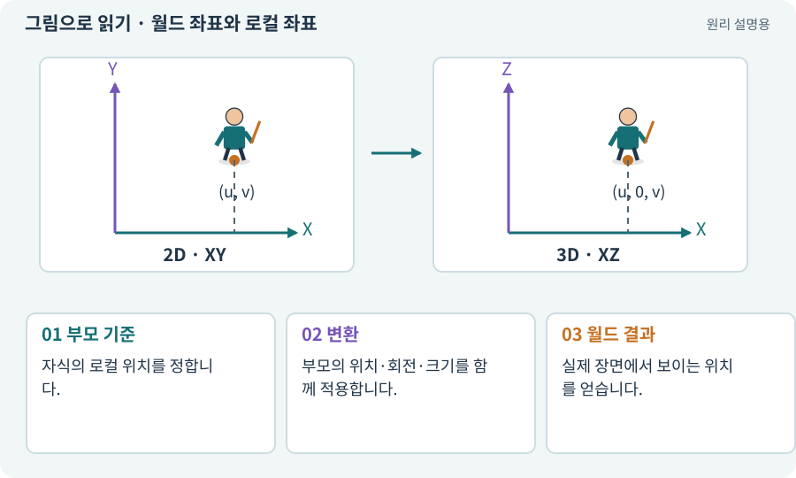

# 월드 좌표와 로컬 좌표

**분야:** 오브젝트·좌표·움직임

월드 좌표는 장면 전체를 기준으로 한 위치이고, 로컬 좌표는 부모를 기준으로 한 위치입니다. 부모의 회전·크기도 월드 결과에 영향을 줍니다.

**찾아오는 이름:** 월드 좌표와 로컬 좌표, 월드 좌표, 로컬 좌표, world position, localPosition, World, Local

## 익숙한 것에 비유하면

건물 전체의 지도 좌표와 “내 방 문에서 오른쪽 1m”를 구분하는 것입니다. 방을 돌리면 오른쪽이라는 방향도 바뀝니다.



개념도입니다. 실제 Unity 화면이나 검사 결과가 아닙니다. 그림의 순서·색은 역할을 구분하며 실제 설정값은 프로젝트에서 확인합니다.

## 이렇게 작동합니다

### 1. 부모 기준

자식의 로컬 위치를 정합니다.

### 2. 변환

부모의 위치·회전·크기를 함께 적용합니다.

### 3. 월드 결과

실제 장면에서 보이는 위치를 얻습니다.

## 우리 RPG에서는 이렇게 만나요

회전·확대가 없는 부모가 (5,2), 자식이 로컬 (1,0)이면 월드 (6,2)입니다. 부모가 회전한 경우 단순 덧셈만으로는 계산할 수 없습니다.

## 이것과 혼동하지 마세요

발 위치와 카메라 좌표를 서로 다른 기준으로 비교하면 정렬이나 공격 예고가 어긋납니다.

## 이해했는지 한 번 생각해 보기

손에 붙인 검의 로컬 위치가 안 변했는데 화면에서는 움직이는 이유는?

<details><summary>답과 이유</summary>

부모인 손과 캐릭터가 움직이기 때문입니다.

</details>

## 내 프로젝트에서 확인하고 싶다면

아래 요청은 읽기 전용으로 실제 대상을 확인하는 선택 요청입니다. 코드나 설정을 직접 편집할 필요는 없습니다.

```text
현재 프로젝트에서 월드 좌표와 로컬 좌표 관련 요소가 어떻게 사용되는지 읽기 전용으로 확인해 줘. 실제 대상과 설정을 찾아 쉬운 말과 작은 예로 설명해 줘. 특히 다음 혼동을 구분해 줘: 발 위치와 카메라 좌표를 서로 다른 기준으로 비교하면 정렬이나 공격 예고가 어긋납니다. 아직 코드·설정·파일은 바꾸지 말고, 확인할 수 없는 내용은 따로 알려 줘.
```

## 이어지는 개념

[Transform: 위치·회전·크기](transform.md) · [Hierarchy와 부모·자식](hierarchy.md) · [소켓: 무기 부착점과 장비 홈](socket.md) · [XY·XZ 평면과 논리 좌표](coordinates.md)

## 이 개념을 사용하는 실습

[05 · 말로 스프라이트 하나 만들기](../index.html#lesson-005) · [07 · 캐릭터와 벽이 있는 공간 만들기](../index.html#lesson-007) · [35 · 앞뒤 가림과 PC 조작 다듬기](../index.html#lesson-035) · [66 · 타일 경계와 랜덤맵 외형 연결하기](../index.html#lesson-066) · [68 · 피격 불꽃과 먼지 만들기](../index.html#lesson-068) · [70 · 피격 강조와 보스 예고 셰이더 만들기](../index.html#lesson-070) · [79 · 추가 기능을 하나의 게임으로 합치기](../index.html#lesson-079)

## 참고와 설명의 범위

기본 도구 동작은 아래 공식 자료를 참고했습니다. 비유·그림·RPG의 예시 수치와 정책은 이해를 위한 자체 예제입니다. 실제 API·지원 기능은 설치 버전과 계정에서 확인합니다.

- [Unity · Transform](https://docs.unity3d.com/6000.3/Documentation/Manual/class-Transform.html)

그림·계산 예제·조작 모형은 자체 제작한 설명입니다. 실제 Unity 화면, 서비스 생성 결과, 성능 실측 또는 게임 테스트 결과가 아닙니다. 자료 확인: 2026년 9월 26일.
