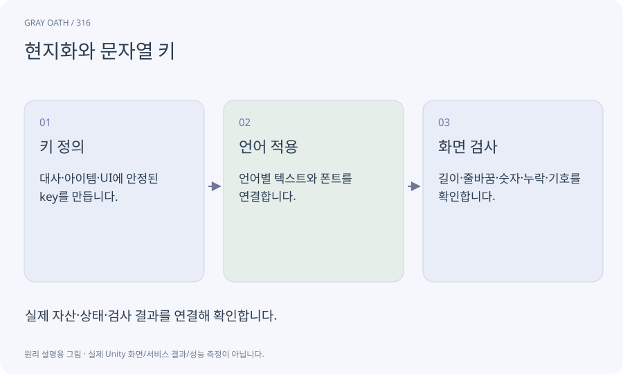

# 현지화와 문자열 키

문자열·언어·폰트·형식을 데이터로 분리해 다른 언어에서도 같은 기능을 보여 주는 구조입니다. 문장을 코드나 퀘스트 ID로 사용하지 않습니다.

## 익숙한 비유

상품 번호는 같고 안내문만 여러 언어로 바꿔 붙이는 것입니다.



## 작동 원리

### 1. 키 정의

대사·아이템·UI에 안정된 key를 만듭니다.

### 2. 언어 적용

언어별 텍스트와 폰트를 연결합니다.

### 3. 화면 검사

길이·줄바꿈·숫자·누락·기호를 확인합니다.

## 게임 속 예

한국어와 영어의 버튼 길이가 달라도 선택 영역이 겹치지 않아야 합니다. AI가 번역해도 인물의 지식·스포일러·의미는 사람이 확인합니다.

## 혼동하지 않기

번역이 끝났다고 글리프 누락·레이아웃·자막 타이밍까지 검증된 것은 아닙니다.

## 확인 질문

NPC 이름을 번역하면 quest 참조가 달라지나요?

안정된 npcId와 별도 표시 문자열을 쓰면 달라지지 않습니다.

## 내 프로젝트에서 확인하기

```text
현재 GrayOathRPG3D에서 현지화와 문자열 키을 사용하는 실제 대상과 동작을 읽기 전용으로 확인해 줘. 쉬운 말과 작은 사례로 설명하고 번역이 끝났다고 글리프 누락·레이아웃·자막 타이밍까지 검증된 것은 아닙니다. 이 문제를 어떻게 막는지 보여 줘. 코드·데이터·설정은 아직 수정하지 마.
```

## 관련 해설

[identifier](identifier.md) · [dialogue-node](dialogue-node.md) · [accessibility](accessibility.md)

## 공식 참고

- [Unity · UI Toolkit EditorWindow](https://docs.unity3d.com/6000.3/Documentation/Manual/UIE-HowTo-CreateEditorWindow.html)
