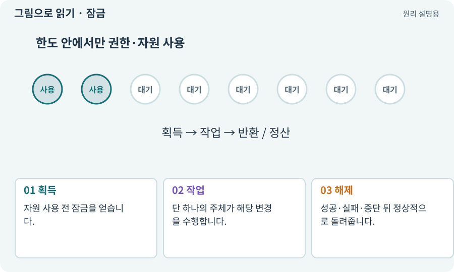

# 잠금·경합·경쟁 상태

**분야:** AI·스킬·훅·하네스 운영

잠금은 같은 자원을 동시에 변경하지 않도록 순서를 조정하는 장치입니다. 경쟁 상태는 실행 순서에 따라 결과가 달라지는 문제입니다. 협력 잠금은 따르는 프로그램 사이에서만 유효합니다.

**찾아오는 이름:** 잠금·경합·경쟁 상태, 잠금, Lock, lock, 경합, 경쟁 상태, Race Condition, 뮤텍스

## 익숙한 것에 비유하면

회의실 사용 중 표시입니다. 다른 예약 시스템을 쓰거나 표시를 무시하면 충돌을 막지 못합니다.



개념도입니다. 실제 Unity 화면이나 검사 결과가 아닙니다. 그림의 순서·색은 역할을 구분하며 실제 설정값은 프로젝트에서 확인합니다.

## 이렇게 작동합니다

### 1. 획득

자원 사용 전 잠금을 얻습니다.

### 2. 작업

단 하나의 주체가 해당 변경을 수행합니다.

### 3. 해제

성공·실패·중단 뒤 정상적으로 돌려줍니다.

## 우리 RPG에서는 이렇게 만나요

두 역할이 같은 Editor에서 씬 생성과 빌드를 동시에 시작하지 않게 합니다. 프로세스가 죽은 뒤 오래된 잠금이 남으면 소유자를 확인하고 복구합니다.

## 이것과 혼동하지 마세요

잠금 파일이 있다는 이유로 실제 살아 있는 프로세스라고 단정하지 않습니다. 무조건 지우지도 않습니다.

## 이해했는지 한 번 생각해 보기

오래된 잠금 때문에 막혔다면?

<details><summary>답과 이유</summary>

실제 프로세스와 작업 상태를 확인한 뒤 기록을 남기며 복구합니다.

</details>

## 내 프로젝트에서 확인하고 싶다면

아래 요청은 읽기 전용으로 실제 대상을 확인하는 선택 요청입니다. 코드나 설정을 직접 편집할 필요는 없습니다.

```text
현재 프로젝트에서 잠금·경합·경쟁 상태 관련 요소가 어떻게 사용되는지 읽기 전용으로 확인해 줘. 실제 대상과 설정을 찾아 쉬운 말과 작은 예로 설명해 줘. 특히 다음 혼동을 구분해 줘: 잠금 파일이 있다는 이유로 실제 살아 있는 프로세스라고 단정하지 않습니다. 무조건 지우지도 않습니다. 아직 코드·설정·파일은 바꾸지 말고, 확인할 수 없는 내용은 따로 알려 줘.
```

## 이어지는 개념

[프로세스·종료 코드·표준 출력](process.md) · [스케줄러·순차·병렬](scheduler.md) · [수명주기·초기화·정리](lifecycle.md) · [샌드박스·후보 폴더·격리](sandbox.md)

## 이 개념을 사용하는 실습

[16 · 물약을 쓰고 죽은 뒤 다시 시작하기](../index.html#lesson-016) · [24 · 보기 편한 인벤토리 화면 만들기](../index.html#lesson-024) · [36 · 휴대폰에서 두 손가락으로 전투하기](../index.html#lesson-036) · [108 · 기획·구현·QA·검토 역할 만들기](../index.html#lesson-108) · [117 · Unity 작업을 한 창구로 모으기](../index.html#lesson-117) · [119 · 막힌 작업을 안전하게 이어가기](../index.html#lesson-119) · [130 · 첫 확장 작업을 하네스에 연결하기](../index.html#lesson-130) · [145 · 지원 동료 하나 만들기](../index.html#lesson-145) · [157 · 하네스가 실패해도 기록 지키기](../index.html#lesson-157)

## 참고와 설명의 범위

기본 도구 동작은 아래 공식 자료를 참고했습니다. 비유·그림·RPG의 예시 수치와 정책은 이해를 위한 자체 예제입니다. 실제 API·지원 기능은 설치 버전과 계정에서 확인합니다.

- [Python · subprocess](https://docs.python.org/3/library/subprocess.html)

그림·계산 예제·조작 모형은 자체 제작한 설명입니다. 실제 Unity 화면, 서비스 생성 결과, 성능 실측 또는 게임 테스트 결과가 아닙니다. 자료 확인: 2026년 9월 26일.
