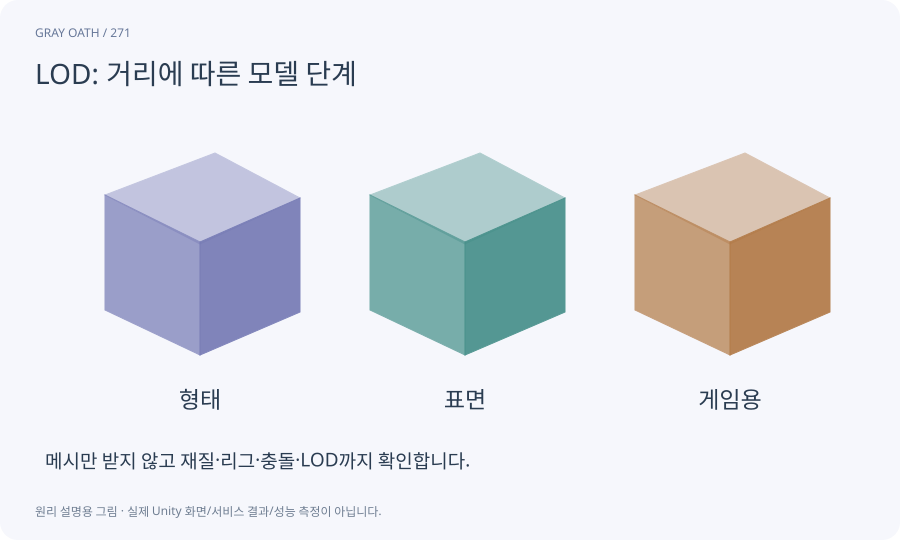

# LOD: 거리에 따른 모델 단계

작게 보이는 물체에 더 단순한 모델을 사용하는 방식입니다. 화면 점유와 품질을 기준으로 선택하고 마지막 단계에서 무엇이 남는지 정합니다.

## 익숙한 비유

멀리 있는 사람을 사진의 작은 아이콘으로 볼 때 모든 주름을 그릴 필요가 없는 것과 같습니다.



## 작동 원리

### 1. 단계 만들기

실루엣을 유지하는 여러 복잡도의 모델을 준비합니다.

### 2. 전환 규칙

화면 크기·거리·hysteresis를 정합니다.

### 3. 눈과 수치 확인

팝핑·그림자·draw·GPU 비용을 비교합니다.

## 게임 속 예

멀리 있는 적은 단순 메시로 바꾸되 위험 예고와 표적 선택은 유지합니다. 마지막 LOD가 비어 있어 적이 사라지지 않게 합니다.

## 혼동하지 않기

LOD는 모든 오브젝트가 프레임 병목일 때만 이득을 보장하는 마법 버튼이 아닙니다.

## 확인 질문

LOD를 바꾸니 캐릭터가 사라지는 이유는?

잘못된 Renderer 등록·bounds·마지막 단계·culling 조건을 확인합니다.

## 내 프로젝트에서 확인하기

```text
현재 GrayOathRPG3D에서 LOD: 거리에 따른 모델 단계을 사용하는 실제 대상과 동작을 읽기 전용으로 확인해 줘. 쉬운 말과 작은 사례로 설명하고 LOD는 모든 오브젝트가 프레임 병목일 때만 이득을 보장하는 마법 버튼이 아닙니다. 이 문제를 어떻게 막는지 보여 줘. 코드·데이터·설정은 아직 수정하지 마.
```

## 관련 해설

[culling](culling.md) · [bounds](bounds.md) · [retopology](retopology.md)

## 공식 참고

- [Unity · URP performance](https://docs.unity3d.com/6000.3/Documentation/Manual/urp/understand-performance.html)
