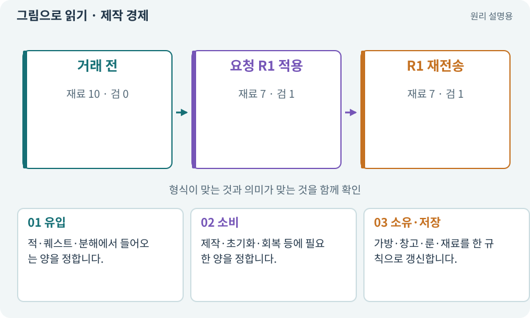

# 제작 경제·재료·소켓·유물

**분야:** 설명을 읽기 위한 기초 언어

제작 경제는 획득·소비·보관·교환이 이어지는 규칙입니다. 분해는 아이템을 재료로 바꾸고, 제작은 재료를 써 새 아이템을 만들며, 룬은 장비 선택을 바꾸고 유물은 이번 탐험 효과로 분리할 수 있습니다.

**찾아오는 이름:** 제작 경제·재료·소켓·유물, 제작, 분해, 레시피, Recipe, 재료 지갑, 룬, Rune, 유물, Relic, 재화, 경제

## 익숙한 것에 비유하면

물건을 팔아 재료를 사고 새 도구를 만드는 순환입니다. 거래 한쪽만 기록되면 재료나 결과가 복제됩니다.



개념도입니다. 실제 Unity 화면이나 검사 결과가 아닙니다. 그림의 순서·색은 역할을 구분하며 실제 설정값은 프로젝트에서 확인합니다.

## 이렇게 작동합니다

### 1. 유입

적·퀘스트·분해에서 들어오는 양을 정합니다.

### 2. 소비

제작·초기화·회복 등에 필요한 양을 정합니다.

### 3. 소유·저장

가방·창고·룬·재료를 한 규칙으로 갱신합니다.

## 우리 RPG에서는 이렇게 만나요

가방이 가득 찬 제작은 재료만 먼저 빼지 않게 합니다. 같은 거래 ID 재전송은 새 결과를 다시 지급하지 않아야 합니다. 유물의 탐험 종료 후 정리도 필요합니다.

## 이것과 혼동하지 마세요

가격 숫자를 바꾸는 것만이 경제 조정은 아닙니다. 획득 빈도·쓰임·선택을 함께 봅니다.

## 이해했는지 한 번 생각해 보기

재료가 줄었는데 장비가 안 생겼다면?

<details><summary>답과 이유</summary>

거래의 원자성·실패 복구·소유권·저장 순서를 검사해야 합니다.

</details>

## 내 프로젝트에서 확인하고 싶다면

아래 요청은 읽기 전용으로 실제 대상을 확인하는 선택 요청입니다. 코드나 설정을 직접 편집할 필요는 없습니다.

```text
현재 프로젝트에서 제작 경제·재료·소켓·유물 관련 요소가 어떻게 사용되는지 읽기 전용으로 확인해 줘. 실제 대상과 설정을 찾아 쉬운 말과 작은 예로 설명해 줘. 특히 다음 혼동을 구분해 줘: 가격 숫자를 바꾸는 것만이 경제 조정은 아닙니다. 획득 빈도·쓰임·선택을 함께 봅니다. 아직 코드·설정·파일은 바꾸지 말고, 확인할 수 없는 내용은 따로 알려 줘.
```

## 이어지는 개념

[트랜잭션·거래의 한 번 적용](transaction.md) · [인벤토리·슬롯·스택·창고](inventory.md) · [소켓: 무기 부착점과 장비 홈](socket.md) · [영구 진행·탐험 세션·런타임 상태](session.md)

## 이 개념을 사용하는 실습

[01 · 빈 2D 프로젝트 만들기](../index.html#lesson-001) · [02 · 내 게임을 알아듣는 개발 스킬 만들기](../index.html#lesson-002) · [03 · AI와 실행 중인 Unity 연결하기](../index.html#lesson-003) · [04 · 되돌릴 수 있는 작업 습관 만들기](../index.html#lesson-004) · [05 · 말로 스프라이트 하나 만들기](../index.html#lesson-005) · [06 · 시작 메뉴와 테스트 공간 연결하기](../index.html#lesson-006) · [07 · 캐릭터와 벽이 있는 공간 만들기](../index.html#lesson-007) · [08 · WASD로 벽에 부딪히며 이동하기](../index.html#lesson-008) · [09 · 클릭한 곳까지 벽을 돌아가기](../index.html#lesson-009) · [10 · 모바일 조이스틱과 버튼 배치하기](../index.html#lesson-010) · [11 · PC와 휴대폰에서 처음 실행하기](../index.html#lesson-011) · [12 · 체력과 피해를 눈으로 확인하기](../index.html#lesson-012) · [13 · 적을 클릭해 접근하고 공격하기](../index.html#lesson-013) · [14 · 나를 발견하고 공격하는 적 만들기](../index.html#lesson-014) · [15 · 다른 방식으로 싸우는 적 추가하기](../index.html#lesson-015) · [16 · 물약을 쓰고 죽은 뒤 다시 시작하기](../index.html#lesson-016) · [17 · 적을 잡아 레벨 올리기](../index.html#lesson-017) · [18 · 베기·마력탄·회전 공격 만들기](../index.html#lesson-018) · [19 · 누가 때렸는지 보이는 전투 만들기](../index.html#lesson-019) · [20 · 같은 검 두 자루를 다른 물건으로 다루기](../index.html#lesson-020) · [21 · 몬스터가 장비를 떨어뜨리게 하기](../index.html#lesson-021) · [22 · 장비를 주워 24칸 가방에 넣기](../index.html#lesson-022) · [23 · 장비를 바꾸고 능력치 확인하기](../index.html#lesson-023) · [24 · 보기 편한 인벤토리 화면 만들기](../index.html#lesson-024) · [25 · 게임을 껐다 켜도 장비 유지하기](../index.html#lesson-025) · [26 · 새 게임·이어하기·마을 연결하기](../index.html#lesson-026) · [27 · 회복하고 물약을 사는 마을 만들기](../index.html#lesson-027) · [28 · 여덟 구역의 첫 던전 만들기](../index.html#lesson-028) · [29 · 방마다 적과 상자 배치하기](../index.html#lesson-029) · [30 · 예고를 보고 피하는 보스 만들기](../index.html#lesson-030) · [31 · 퀘스트를 받아 엔딩까지 이어가기](../index.html#lesson-031) · [32 · 길 안내와 처음 하는 사람의 동선 만들기](../index.html#lesson-032) · [33 · 기본 캐릭터·몬스터·타일 아트 만들기](../index.html#lesson-033) · [34 · 걷기·공격·피격·사망 움직임 연결하기](../index.html#lesson-034) · [35 · 앞뒤 가림과 PC 조작 다듬기](../index.html#lesson-035) · [36 · 휴대폰에서 두 손가락으로 전투하기](../index.html#lesson-036) · [37 · 느려지는 원인을 측정해 고치기](../index.html#lesson-037) · [38 · 테스트 결과와 실제 플레이 구분하기](../index.html#lesson-038) · [39 · 다른 PC와 Android 에서 실행할 파일 만들기](../index.html#lesson-039) · [40 · 작은 RPG를 처음부터 끝까지 플레이하기](../index.html#lesson-040) · [41 · 선택할 수 있는9노드 스킬트리 만들기](../index.html#lesson-041) · [42 · 트리에서 투자하고 저장하기](../index.html#lesson-042) · [43 · 빌드를 바꾸며 전투 비교하기](../index.html#lesson-043) · [44 · 시드로 같은 던전 다시 만들기](../index.html#lesson-044) · [45 · 무작위 방과 통로 만들기](../index.html#lesson-045) · [46 · 랜덤 지도 위를 실제로 걷기](../index.html#lesson-046) · [47 · 실패하는 시드를 찾고 복구하기](../index.html#lesson-047) · [48 · 적이 나를 보고 놓치게 만들기](../index.html#lesson-048) · [49 · 여러 근접 적의 공격 나누기](../index.html#lesson-049) · [50 · 석궁수가 거리를 유지하게 만들기](../index.html#lesson-050) · [51 · 전투 전체의 압박 조절하기](../index.html#lesson-051) · [52 · 전투에서 선택할 이유 만들기](../index.html#lesson-052) · [53 · 입력은 빠르게, 취소 규칙은 명확하게](../index.html#lesson-053) · [54 · 느낌을 근거로 밸런스 고치기](../index.html#lesson-054) · [55 · 어떤 그림도 맞춰 넣는 아트 규격 정하기](../index.html#lesson-055) · [56 · Unity AI로 캐릭터 움직임 만들기](../index.html#lesson-056) · [57 · Unity AI로 바닥과 벽 타일 만들기](../index.html#lesson-057) · [58 · PixelLab로 방향별 픽셀 캐릭터 만들기](../index.html#lesson-058) · [59 · Retro Diffusion으로 캐릭터와 타일 만들기](../index.html#lesson-059) · [60 · Scenario로 스타일과 동작 유지하기](../index.html#lesson-060) · [61 · Ludo.ai로 키 포즈를 지정해 움직임 만들기](../index.html#lesson-061) · [62 · OpenAI 이미지로 게임 자산 만들기](../index.html#lesson-062) · [63 · Grok 이미지로 같은 자산 시험하기](../index.html#lesson-063) · [64 · 추가 결제 없이 AI로 2D 프레임 만들기](../index.html#lesson-064) · [65 · 스프라이트를 정리해 실제 캐릭터에 넣기](../index.html#lesson-065) · [66 · 타일 경계와 랜덤맵 외형 연결하기](../index.html#lesson-066) · [67 · 내 게임의 아트 제작 경로 선택하기](../index.html#lesson-067) · [68 · 피격 불꽃과 먼지 만들기](../index.html#lesson-068) · [69 · 베기와 폭발을 시트 애니메이션으로 만들기](../index.html#lesson-069) · [70 · 피격 강조와 보스 예고 셰이더 만들기](../index.html#lesson-070) · [71 · 카메라·소리·피해 숫자 맞추기](../index.html#lesson-071) · [72 · 모바일 효과를 줄여도 위험은 남기기](../index.html#lesson-072) · [73 · 주소로 에셋 불러오기](../index.html#lesson-073) · [74 · 추가 외형을 서버에서 받게 준비하기](../index.html#lesson-074) · [75 · 다운로드 용량과 진행률 보여 주기](../index.html#lesson-075) · [76 · 연결이 끊겨도 게임 계속하기](../index.html#lesson-076) · [77 · 앱을 바꾸지 않고 외형 업데이트하기](../index.html#lesson-077) · [78 · 선택: Google Play 에셋 전달 사용하기](../index.html#lesson-078) · [79 · 추가 기능을 하나의 게임으로 합치기](../index.html#lesson-079) · [80 · 나만의 2D RPG 완성하기](../index.html#lesson-080) · [81 · 2D 게임을 남기고 3D 작업 시작하기](../index.html#lesson-081) · [82 · 게임 규칙은 재사용하고 공간만 바꾸기](../index.html#lesson-082) · [83 · 3D 카메라와 재질로 공간 보기](../index.html#lesson-083) · [84 · 같은 지도를 3D 바닥과 벽으로 만들기](../index.html#lesson-084) · [85 · 3D 캐릭터를 한 모터로 움직이기](../index.html#lesson-085) · [86 · 3D에서도 클릭한 곳까지 돌아가기](../index.html#lesson-086) · [87 · 같은 캐릭터를 실제 3D 모델로 만들기](../index.html#lesson-087) · [88 · 3D 모델에 걷기와 공격 연결하기](../index.html#lesson-088) · [89 · 같은 전투 규칙을 3D에 연결하기](../index.html#lesson-089) · [90 · 적의 판단을 3D 공간에 연결하기](../index.html#lesson-090) · [91 · 보스 예고를 3D 바닥에 맞추기](../index.html#lesson-091) · [92 · 무기를 손에 쥐고 전리품 표시하기](../index.html#lesson-092) · [93 · 3D 마을과 퀘스트 연결하기](../index.html#lesson-093) · [94 · 같은 랜덤 던전을 3D로 생성하기](../index.html#lesson-094) · [95 · 3D 조명과 환경을 읽기 좋게 만들기](../index.html#lesson-095) · [96 · 3D 카메라 가림과 터치 조작 다듬기](../index.html#lesson-096) · [97 · 선택: 3D 모델에서 2D 시트 만들기](../index.html#lesson-097) · [98 · 3D 팩을 2D 팩과 따로 내려받기](../index.html#lesson-098) · [99 · 2D와 3D 사이에 진행 가져오기](../index.html#lesson-099) · [100 · 두 버전이 같은 게임인지 비교하기](../index.html#lesson-100) · [101 · 3D Android 성능 다시 측정하기](../index.html#lesson-101) · [102 · 네 배포물을 구분해 만들기](../index.html#lesson-102) · [103 · 같은 전투를 2D와 3D로 플레이하기](../index.html#lesson-103) · [104 · 2D와 3D를 두 플랫폼에서 완주하기](../index.html#lesson-104) · [105 · 내 개발 도구를 빈 폴더에서 시작하기](../index.html#lesson-105) · [106 · 도구가 상태를 기억하게 만들기](../index.html#lesson-106) · [108 · 기획·구현·QA·검토 역할 만들기](../index.html#lesson-108) · [110 · 작업마다 필요한 자료만 준비하기](../index.html#lesson-110) · [114 · 테스트를 실행하고 결과 읽기](../index.html#lesson-114) · [116 · “어디까지 됐어?”에 근거로 답하기](../index.html#lesson-116) · [118 · 모의 응답 대신 실제 Claude 연결하기](../index.html#lesson-118) · [122 · 내 게임에 맞는 검사기 추가하기](../index.html#lesson-122) · [123 · 기존 게임의 실제 파일 찾아 연결하기](../index.html#lesson-123) · [127 · 내 반복 업무에 맞게 도구 개조하기](../index.html#lesson-127) · [128 · 내 도구를 대화로 운영하기](../index.html#lesson-128) · [129 · 기존 2D 게임에서 확장팩 시작하기](../index.html#lesson-129) · [130 · 첫 확장 작업을 하네스에 연결하기](../index.html#lesson-130) · [131 · 중요한 전리품만 표시하는 규칙 만들기](../index.html#lesson-131) · [132 · 필터를 실제 던전과 모바일에 연결하기](../index.html#lesson-132) · [133 · 첫 기능의 실패를 고쳐 다음 기준 만들기](../index.html#lesson-133) · [134 · 화상·냉기·표식으로 전투 확장하기](../index.html#lesson-134) · [135 · 벽을 통과하지 않는 회피 만들기](../index.html#lesson-135) · [136 · 방패병과 화염술사 정예 추가하기](../index.html#lesson-136) · [137 · 기름·폭발통·밸브로 공간 활용하기](../index.html#lesson-137) · [138 · 장비를 분해해 재료 얻기](../index.html#lesson-138) · [139 · 재료로 장비 제작하기](../index.html#lesson-139) · [140 · 개인 창고와 즐겨찾기 만들기](../index.html#lesson-140) · [141 · 소켓 한 칸에 룬 장착하기](../index.html#lesson-141) · [142 · 배운 스킬의 변형 선택하기](../index.html#lesson-142) · [143 · 새 랜덤 지역 봉인된 대장간 만들기](../index.html#lesson-143) · [144 · 이번 탐험에만 남는 유물 고르기](../index.html#lesson-144) · [145 · 지원 동료 하나 만들기](../index.html#lesson-145) · [146 · 대장장이 구조 퀘스트 만들기](../index.html#lesson-146) · [147 · 용광로 감시자와 3단계 전투 만들기](../index.html#lesson-147) · [148 · 아트 역할로 새 지역 외형 완성하기](../index.html#lesson-148) · [149 · 상태와 보스 효과를 같은 데이터로 맞추기](../index.html#lesson-149) · [150 · 소리가 없어도 읽히는 전투 만들기](../index.html#lesson-150) · [151 · 도감과 장비 비교로 새 기능 찾기](../index.html#lesson-151) · [152 · 이전 저장을 새 확장판으로 가져오기](../index.html#lesson-152) · [153 · 대장간 고해상도팩 선택 다운로드하기](../index.html#lesson-153) · [154 · 확장 기능을 켠 휴대폰 성능 고치기](../index.html#lesson-154) · [155 · 기록을 보고 제작 경제와 전투 조정하기](../index.html#lesson-155) · [156 · 기능 조합에서 숨은 오류 찾기](../index.html#lesson-156) · [157 · 하네스가 실패해도 기록 지키기](../index.html#lesson-157) · [158 · 룬 교체 버그를 역할로 수정하기](../index.html#lesson-158) · [159 · 최종 확장판 배포 후보 만들기](../index.html#lesson-159) · [160 · 대장간 보스까지 완주하고 새 기능 맡기기](../index.html#lesson-160)

## 참고와 설명의 범위

이 항목의 비유·그림·RPG 수치·운영 규칙은 개념을 이해하기 위한 자체 설계 예제입니다. 특정 도구가 이 규칙을 자동으로 구현한다는 뜻은 아닙니다.


그림·계산 예제·조작 모형은 자체 제작한 설명입니다. 실제 Unity 화면, 서비스 생성 결과, 성능 실측 또는 게임 테스트 결과가 아닙니다. 자료 확인: 2026년 9월 26일.
