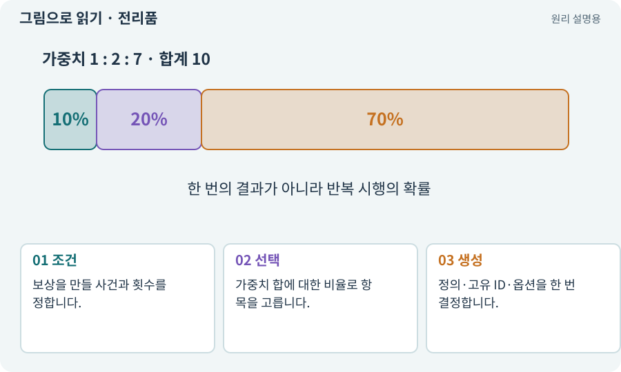

# 전리품·가중치·드롭 확률

**분야:** 코드·데이터·저장·검사

전리품은 처치·상자 등의 보상입니다. 가중치는 여러 후보를 상대적 비중으로 선택하는 값이며, 그 자체가 퍼센트라는 뜻은 아닙니다.

**찾아오는 이름:** 전리품·가중치·드롭 확률, 전리품, 드롭, Drop, Loot, loot, 가중치, 확률표, 랜덤 옵션

## 익숙한 것에 비유하면

빨강 공 7개·파랑 2개·금색 1개가 있는 주머니에서 하나를 뽑는 방식입니다.



개념도입니다. 실제 Unity 화면이나 검사 결과가 아닙니다. 그림의 순서·색은 역할을 구분하며 실제 설정값은 프로젝트에서 확인합니다.

## 이렇게 작동합니다

### 1. 조건

보상을 만들 사건과 횟수를 정합니다.

### 2. 선택

가중치 합에 대한 비율로 항목을 고릅니다.

### 3. 생성

정의·고유 ID·옵션을 한 번 결정합니다.

## 우리 RPG에서는 이렇게 만나요

가중치 70·20·10이면 합 100 기준 70%·20%·10%입니다. 7·2·1도 같은 비율입니다. 단 10번 뽑으면 반드시 희귀 1개라는 뜻은 아닙니다.

## 이것과 혼동하지 마세요

통계 검사와 한 번의 재현 검사는 다릅니다. seed·순서와 장기 분포를 각각 봅니다.

## 이해했는지 한 번 생각해 보기

가중치가 10이면 언제나 10%인가요?

<details><summary>답과 이유</summary>

아닙니다. 전체 가중치 합에 대한 비율입니다.

</details>

## 내 프로젝트에서 확인하고 싶다면

아래 요청은 읽기 전용으로 실제 대상을 확인하는 선택 요청입니다. 코드나 설정을 직접 편집할 필요는 없습니다.

```text
현재 프로젝트에서 전리품·가중치·드롭 확률 관련 요소가 어떻게 사용되는지 읽기 전용으로 확인해 줘. 실제 대상과 설정을 찾아 쉬운 말과 작은 예로 설명해 줘. 특히 다음 혼동을 구분해 줘: 통계 검사와 한 번의 재현 검사는 다릅니다. seed·순서와 장기 분포를 각각 봅니다. 아직 코드·설정·파일은 바꾸지 말고, 확인할 수 없는 내용은 따로 알려 줘.
```

## 이어지는 개념

[시드·난수·PRNG](rng.md) · [아이템 인스턴스와 소유권](item-instance.md) · [트랜잭션·거래의 한 번 적용](transaction.md) · [밸런스·위험과 보상·플레이테스트](balance.md)

## 이 개념을 사용하는 실습

[14 · 나를 발견하고 공격하는 적 만들기](../index.html#lesson-014) · [20 · 같은 검 두 자루를 다른 물건으로 다루기](../index.html#lesson-020) · [21 · 몬스터가 장비를 떨어뜨리게 하기](../index.html#lesson-021) · [24 · 보기 편한 인벤토리 화면 만들기](../index.html#lesson-024) · [32 · 길 안내와 처음 하는 사람의 동선 만들기](../index.html#lesson-032) · [34 · 걷기·공격·피격·사망 움직임 연결하기](../index.html#lesson-034) · [38 · 테스트 결과와 실제 플레이 구분하기](../index.html#lesson-038) · [44 · 시드로 같은 던전 다시 만들기](../index.html#lesson-044) · [52 · 전투에서 선택할 이유 만들기](../index.html#lesson-052) · [53 · 입력은 빠르게, 취소 규칙은 명확하게](../index.html#lesson-053) · [54 · 느낌을 근거로 밸런스 고치기](../index.html#lesson-054) · [66 · 타일 경계와 랜덤맵 외형 연결하기](../index.html#lesson-066) · [68 · 피격 불꽃과 먼지 만들기](../index.html#lesson-068) · [71 · 카메라·소리·피해 숫자 맞추기](../index.html#lesson-071) · [72 · 모바일 효과를 줄여도 위험은 남기기](../index.html#lesson-072) · [79 · 추가 기능을 하나의 게임으로 합치기](../index.html#lesson-079) · [80 · 나만의 2D RPG 완성하기](../index.html#lesson-080) · [81 · 2D 게임을 남기고 3D 작업 시작하기](../index.html#lesson-081) · [82 · 게임 규칙은 재사용하고 공간만 바꾸기](../index.html#lesson-082) · [92 · 무기를 손에 쥐고 전리품 표시하기](../index.html#lesson-092) · [95 · 3D 조명과 환경을 읽기 좋게 만들기](../index.html#lesson-095) · [103 · 같은 전투를 2D와 3D로 플레이하기](../index.html#lesson-103) · [123 · 기존 게임의 실제 파일 찾아 연결하기](../index.html#lesson-123) · [125 · 하네스로 작은 전리품 화면 만들기](../index.html#lesson-125) · [126 · 한 요청으로 필터 기능 끝내기](../index.html#lesson-126) · [129 · 기존 2D 게임에서 확장팩 시작하기](../index.html#lesson-129) · [130 · 첫 확장 작업을 하네스에 연결하기](../index.html#lesson-130) · [131 · 중요한 전리품만 표시하는 규칙 만들기](../index.html#lesson-131) · [132 · 필터를 실제 던전과 모바일에 연결하기](../index.html#lesson-132) · [133 · 첫 기능의 실패를 고쳐 다음 기준 만들기](../index.html#lesson-133) · [134 · 화상·냉기·표식으로 전투 확장하기](../index.html#lesson-134) · [137 · 기름·폭발통·밸브로 공간 활용하기](../index.html#lesson-137) · [139 · 재료로 장비 제작하기](../index.html#lesson-139) · [140 · 개인 창고와 즐겨찾기 만들기](../index.html#lesson-140) · [143 · 새 랜덤 지역 봉인된 대장간 만들기](../index.html#lesson-143) · [152 · 이전 저장을 새 확장판으로 가져오기](../index.html#lesson-152) · [160 · 대장간 보스까지 완주하고 새 기능 맡기기](../index.html#lesson-160)

## 참고와 설명의 범위

이 항목의 비유·그림·RPG 수치·운영 규칙은 개념을 이해하기 위한 자체 설계 예제입니다. 특정 도구가 이 규칙을 자동으로 구현한다는 뜻은 아닙니다.


그림·계산 예제·조작 모형은 자체 제작한 설명입니다. 실제 Unity 화면, 서비스 생성 결과, 성능 실측 또는 게임 테스트 결과가 아닙니다. 자료 확인: 2026년 9월 26일.
