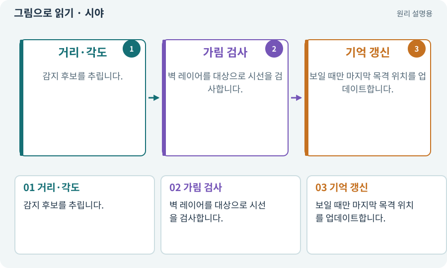

# 시야·LOS·마지막 목격 위치

**분야:** 지도·적 AI·전투 규칙

LOS는 대상까지 시선이 장애물에 가리지 않는지 확인하는 조건입니다. 감지 거리는 가까움, 시야는 보임, 기억은 이전에 본 정보이므로 서로 다릅니다.

**찾아오는 이름:** 시야·LOS·마지막 목격 위치, LOS, Line of Sight, 시야, 마지막 목격, 감지·기억, 감지 거리

## 익숙한 것에 비유하면

커튼 뒤 사람은 가까워도 안 보입니다. 마지막으로 본 위치로 찾아갈 수 있지만 지금 실제 위치를 계속 아는 것은 아닙니다.



개념도입니다. 실제 Unity 화면이나 검사 결과가 아닙니다. 그림의 순서·색은 역할을 구분하며 실제 설정값은 프로젝트에서 확인합니다.

## 이렇게 작동합니다

### 1. 거리·각도

감지 후보를 추립니다.

### 2. 가림 검사

벽 레이어를 대상으로 시선을 검사합니다.

### 3. 기억 갱신

보일 때만 마지막 목격 위치를 업데이트합니다.

## 우리 RPG에서는 이렇게 만나요

플레이어가 벽 뒤로 가면 적은 마지막 본 위치를 조사하다가 조건에 따라 귀환합니다. 그림이 숨었다고 시야가 차단되는 것은 아니므로 실제 벽 판정을 봅니다.

## 이것과 혼동하지 마세요

적에게 플레이어의 현재 위치를 무조건 넘기면 감지·기억 시스템이 있어도 전지적인 추적이 됩니다.

## 이해했는지 한 번 생각해 보기

벽 뒤로 가자마자 정확한 위치로 쏘면 무엇을 보나요?

<details><summary>답과 이유</summary>

LOS 필터와 마지막 목격 위치 갱신 조건을 확인합니다.

</details>

## 내 프로젝트에서 확인하고 싶다면

아래 요청은 읽기 전용으로 실제 대상을 확인하는 선택 요청입니다. 코드나 설정을 직접 편집할 필요는 없습니다.

```text
현재 프로젝트에서 시야·LOS·마지막 목격 위치 관련 요소가 어떻게 사용되는지 읽기 전용으로 확인해 줘. 실제 대상과 설정을 찾아 쉬운 말과 작은 예로 설명해 줘. 특히 다음 혼동을 구분해 줘: 적에게 플레이어의 현재 위치를 무조건 넘기면 감지·기억 시스템이 있어도 전지적인 추적이 됩니다. 아직 코드·설정·파일은 바꾸지 말고, 확인할 수 없는 내용은 따로 알려 줘.
```

## 이어지는 개념

[Raycast·Linecast·Cast](raycast.md) · [상태 기계·FSM](state-machine.md) · [Layer·LayerMask·Tag](layer.md) · [공격 예고·선행동작·회복](telegraph.md)

## 이 개념을 사용하는 실습

[12 · 체력과 피해를 눈으로 확인하기](../index.html#lesson-012) · [13 · 적을 클릭해 접근하고 공격하기](../index.html#lesson-013) · [14 · 나를 발견하고 공격하는 적 만들기](../index.html#lesson-014) · [15 · 다른 방식으로 싸우는 적 추가하기](../index.html#lesson-015) · [18 · 베기·마력탄·회전 공격 만들기](../index.html#lesson-018) · [22 · 장비를 주워 24칸 가방에 넣기](../index.html#lesson-022) · [35 · 앞뒤 가림과 PC 조작 다듬기](../index.html#lesson-035) · [48 · 적이 나를 보고 놓치게 만들기](../index.html#lesson-048) · [49 · 여러 근접 적의 공격 나누기](../index.html#lesson-049) · [50 · 석궁수가 거리를 유지하게 만들기](../index.html#lesson-050) · [79 · 추가 기능을 하나의 게임으로 합치기](../index.html#lesson-079) · [82 · 게임 규칙은 재사용하고 공간만 바꾸기](../index.html#lesson-082) · [89 · 같은 전투 규칙을 3D에 연결하기](../index.html#lesson-089) · [90 · 적의 판단을 3D 공간에 연결하기](../index.html#lesson-090) · [93 · 3D 마을과 퀘스트 연결하기](../index.html#lesson-093) · [96 · 3D 카메라 가림과 터치 조작 다듬기](../index.html#lesson-096) · [101 · 3D Android 성능 다시 측정하기](../index.html#lesson-101) · [103 · 같은 전투를 2D와 3D로 플레이하기](../index.html#lesson-103) · [136 · 방패병과 화염술사 정예 추가하기](../index.html#lesson-136) · [145 · 지원 동료 하나 만들기](../index.html#lesson-145)

## 참고와 설명의 범위

기본 도구 동작은 아래 공식 자료를 참고했습니다. 비유·그림·RPG의 예시 수치와 정책은 이해를 위한 자체 예제입니다. 실제 API·지원 기능은 설치 버전과 계정에서 확인합니다.

- [Unity · Physics2D.CircleCast](https://docs.unity3d.com/6000.3/Documentation/ScriptReference/Physics2D.CircleCast.html)

그림·계산 예제·조작 모형은 자체 제작한 설명입니다. 실제 Unity 화면, 서비스 생성 결과, 성능 실측 또는 게임 테스트 결과가 아닙니다. 자료 확인: 2026년 9월 26일.
