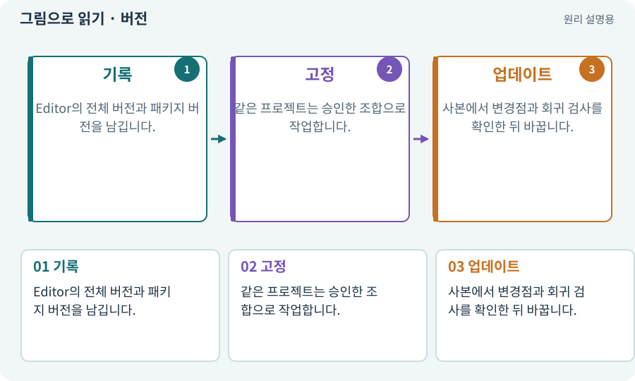

# 버전·패치·LTS

**분야:** 시작·도구·작업 공간

버전은 프로그램의 특정 상태를 식별하는 번호입니다. 패치는 같은 계열의 수정 릴리스이며, LTS는 장기 지원 계열이라는 뜻입니다. LTS라고 모든 환경에서 오류가 없다는 보장은 아닙니다.

**찾아오는 이름:** 버전·패치·LTS, LTS, 패치, Editor 버전, 버전 고정

## 익숙한 것에 비유하면

같은 요리책의 몇 판 몇 쇄인지 기록하는 것과 같습니다. 이름만 같아도 페이지와 재료가 조금 바뀔 수 있습니다.



개념도입니다. 실제 Unity 화면이나 검사 결과가 아닙니다. 그림의 순서·색은 역할을 구분하며 실제 설정값은 프로젝트에서 확인합니다.

## 이렇게 작동합니다

### 1. 기록

Editor의 전체 버전과 패키지 버전을 남깁니다.

### 2. 고정

같은 프로젝트는 승인한 조합으로 작업합니다.

### 3. 업데이트

사본에서 변경점과 회귀 검사를 확인한 뒤 바꿉니다.

## 우리 RPG에서는 이렇게 만나요

실습서는 6.3 LTS 계열을 기준으로 하지만 특정 패치의 설치 가능성과 패키지 호환성은 AI가 현재 환경에서 확인합니다. 숫자를 외워 최신 패치로 자동 변경하지 않습니다.

## 이것과 혼동하지 마세요

새 버전이 출시됐다는 사실만으로 진행 중인 프로젝트를 바로 올리지 않습니다.

## 이해했는지 한 번 생각해 보기

같은 6.3이면 모든 패키지가 똑같이 동작하나요?

<details><summary>답과 이유</summary>

아닙니다. 세부 패치·패키지 잠금·플랫폼 조합이 달라질 수 있습니다.

</details>

## 내 프로젝트에서 확인하고 싶다면

아래 요청은 읽기 전용으로 실제 대상을 확인하는 선택 요청입니다. 코드나 설정을 직접 편집할 필요는 없습니다.

```text
현재 프로젝트에서 버전·패치·LTS 관련 요소가 어떻게 사용되는지 읽기 전용으로 확인해 줘. 실제 대상과 설정을 찾아 쉬운 말과 작은 예로 설명해 줘. 특히 다음 혼동을 구분해 줘: 새 버전이 출시됐다는 사실만으로 진행 중인 프로젝트를 바로 올리지 않습니다. 아직 코드·설정·파일은 바꾸지 말고, 확인할 수 없는 내용은 따로 알려 줘.
```

## 이어지는 개념

[패키지·패키지 관리자](package.md) · [매니페스트·패키지 목록·빌드 기록](manifest.md) · [회귀·기준선·수정 전후 비교](regression.md) · [게임 빌드·개발 빌드·배포](build.md)

## 이 개념을 사용하는 실습

[01 · 빈 2D 프로젝트 만들기](../index.html#lesson-001) · [129 · 기존 2D 게임에서 확장팩 시작하기](../index.html#lesson-129)

## 참고와 설명의 범위

기본 도구 동작은 아래 공식 자료를 참고했습니다. 비유·그림·RPG의 예시 수치와 정책은 이해를 위한 자체 예제입니다. 실제 API·지원 기능은 설치 버전과 계정에서 확인합니다.

- [Unity · 2D 게임 제작 흐름](https://docs.unity3d.com/6000.3/Documentation/Manual/2d-game-creation-wokflow.html)

그림·계산 예제·조작 모형은 자체 제작한 설명입니다. 실제 Unity 화면, 서비스 생성 결과, 성능 실측 또는 게임 테스트 결과가 아닙니다. 자료 확인: 2026년 9월 26일.
