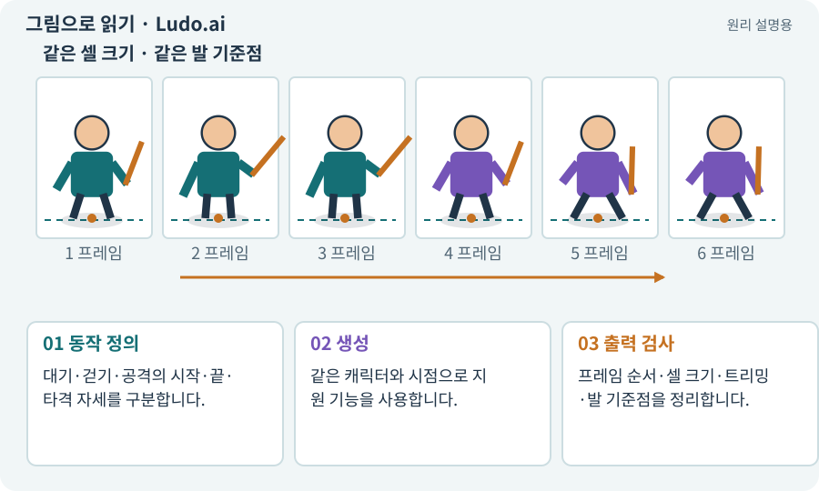

# Ludo.ai·동작 지정·시트 출력

**분야:** 자산 제작·렌더링 보충

Ludo.ai의 스프라이트 제작 경로는 모션·키 포즈·참조 등을 이용해 동작을 지정하고 시트로 내보내는 작업을 지원합니다. 현재 지원 입력과 내보내기 규격은 계정에서 확인합니다.

**찾아오는 이름:** Ludo.ai·동작 지정·시트 출력, Ludo.ai, Ludo, 루도

## 익숙한 것에 비유하면

움직임의 중요한 자세를 먼저 잡고 그 사이 동작을 구성하는 애니메이션 작업에 가깝습니다.



개념도입니다. 실제 Unity 화면이나 검사 결과가 아닙니다. 그림의 순서·색은 역할을 구분하며 실제 설정값은 프로젝트에서 확인합니다.

## 이렇게 작동합니다

### 1. 동작 정의

대기·걷기·공격의 시작·끝·타격 자세를 구분합니다.

### 2. 생성

같은 캐릭터와 시점으로 지원 기능을 사용합니다.

### 3. 출력 검사

프레임 순서·셀 크기·트리밍·발 기준점을 정리합니다.

## 우리 RPG에서는 이렇게 만나요

회전 공격의 핵심 자세와 지속 시간을 정해도 생성된 그림의 검 궤적이 실제 사거리와 맞는지는 게임에서 확인합니다. 과금·상업 이용 조건은 생성 전 확인합니다.

## 이것과 혼동하지 마세요

시트 출력 버튼이 있다고 원본이 자동으로 원하는 셀·피벗 규격을 따른다고 가정하지 않습니다.

## 이해했는지 한 번 생각해 보기

공격 자세가 가장 큰 프레임만 피벗이 달라지면?

<details><summary>답과 이유</summary>

발 기준을 통일하고 프레임별 배치·트리밍을 검사해야 합니다.

</details>

## 내 프로젝트에서 확인하고 싶다면

아래 요청은 읽기 전용으로 실제 대상을 확인하는 선택 요청입니다. 코드나 설정을 직접 편집할 필요는 없습니다.

```text
현재 프로젝트에서 Ludo.ai·동작 지정·시트 출력 관련 요소가 어떻게 사용되는지 읽기 전용으로 확인해 줘. 실제 대상과 설정을 찾아 쉬운 말과 작은 예로 설명해 줘. 특히 다음 혼동을 구분해 줘: 시트 출력 버튼이 있다고 원본이 자동으로 원하는 셀·피벗 규격을 따른다고 가정하지 않습니다. 아직 코드·설정·파일은 바꾸지 말고, 확인할 수 없는 내용은 따로 알려 줘.
```

## 이어지는 개념

[Pivot과 발 기준점](pivot.md) · [스프라이트 시트](sprite-sheet.md) · [Animation Event와 타격 시점](animation-event.md) · [아트 규격·레퍼런스·키 포즈](art-spec.md)

## 이 개념을 사용하는 실습

[61 · Ludo.ai로 키 포즈를 지정해 움직임 만들기](../index.html#lesson-061) · [67 · 내 게임의 아트 제작 경로 선택하기](../index.html#lesson-067)

## 참고와 설명의 범위

기본 도구 동작은 아래 공식 자료를 참고했습니다. 비유·그림·RPG의 예시 수치와 정책은 이해를 위한 자체 예제입니다. 실제 API·지원 기능은 설치 버전과 계정에서 확인합니다.

- [Ludo.ai · Sprite Generator](https://ludo.ai/features/sprite-generator)

그림·계산 예제·조작 모형은 자체 제작한 설명입니다. 실제 Unity 화면, 서비스 생성 결과, 성능 실측 또는 게임 테스트 결과가 아닙니다. 자료 확인: 2026년 9월 26일.
