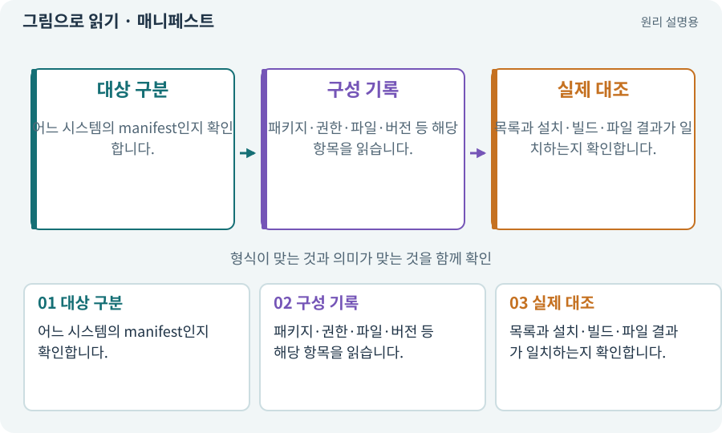

# 매니페스트·패키지 목록·빌드 기록

**분야:** 비동기·다운로드·빌드·버전 관리

매니페스트는 어떤 구성요소와 설정이 포함되어 있는지 설명하는 목록입니다. Unity Packages의 manifest, Android Manifest, 실습 자료의 파일 목록은 이름이 같아도 역할이 다릅니다.

**찾아오는 이름:** 매니페스트·패키지 목록·빌드 기록, 매니페스트, Manifest, manifest.json, manifest, packages-lock.json

## 익숙한 것에 비유하면

제품의 구성품 목록·배송장·규격표가 모두 목록이지만 각각 다른 목적을 가진 것과 같습니다.



개념도입니다. 실제 Unity 화면이나 검사 결과가 아닙니다. 그림의 순서·색은 역할을 구분하며 실제 설정값은 프로젝트에서 확인합니다.

## 이렇게 작동합니다

### 1. 대상 구분

어느 시스템의 manifest인지 확인합니다.

### 2. 구성 기록

패키지·권한·파일·버전 등 해당 항목을 읽습니다.

### 3. 실제 대조

목록과 설치·빌드·파일 결과가 일치하는지 확인합니다.

## 우리 RPG에서는 이렇게 만나요

Packages/manifest.json은 패키지 요청을, 잠금 파일은 해결된 의존성 정보를 기록합니다. 이를 임의로 삭제해 버전 문제를 덮지 않습니다. Android Manifest의 권한은 별도로 검토합니다.

## 이것과 혼동하지 마세요

모든 manifest 파일을 같은 구조의 JSON으로 읽으려 하면 안 됩니다.

## 이해했는지 한 번 생각해 보기

패키지 목록을 바꾸기 전에 무엇을 확인하나요?

<details><summary>답과 이유</summary>

현재 엔진·패키지 호환과 실제 의존성·잠금 상태를 확인합니다.

</details>

## 내 프로젝트에서 확인하고 싶다면

아래 요청은 읽기 전용으로 실제 대상을 확인하는 선택 요청입니다. 코드나 설정을 직접 편집할 필요는 없습니다.

```text
현재 프로젝트에서 매니페스트·패키지 목록·빌드 기록 관련 요소가 어떻게 사용되는지 읽기 전용으로 확인해 줘. 실제 대상과 설정을 찾아 쉬운 말과 작은 예로 설명해 줘. 특히 다음 혼동을 구분해 줘: 모든 manifest 파일을 같은 구조의 JSON으로 읽으려 하면 안 됩니다. 아직 코드·설정·파일은 바꾸지 말고, 확인할 수 없는 내용은 따로 알려 줘.
```

## 이어지는 개념

[패키지·패키지 관리자](package.md) · [의존성·DAG·위상 정렬](dependency.md) · [Build Profile·플랫폼 설정](build-profile.md) · [호환성·코드와 콘텐츠 계약](compatibility.md)

## 이 개념을 사용하는 실습

[58 · PixelLab로 방향별 픽셀 캐릭터 만들기](../index.html#lesson-058) · [63 · Grok 이미지로 같은 자산 시험하기](../index.html#lesson-063) · [74 · 추가 외형을 서버에서 받게 준비하기](../index.html#lesson-074) · [77 · 앱을 바꾸지 않고 외형 업데이트하기](../index.html#lesson-077) · [80 · 나만의 2D RPG 완성하기](../index.html#lesson-080) · [148 · 아트 역할로 새 지역 외형 완성하기](../index.html#lesson-148) · [153 · 대장간 고해상도팩 선택 다운로드하기](../index.html#lesson-153)

## 참고와 설명의 범위

기본 도구 동작은 아래 공식 자료를 참고했습니다. 비유·그림·RPG의 예시 수치와 정책은 이해를 위한 자체 예제입니다. 실제 API·지원 기능은 설치 버전과 계정에서 확인합니다.

- [Unity · Android SDK·NDK·JDK 준비](https://docs.unity3d.com/6000.3/Documentation/Manual/android-sdksetup.html)

그림·계산 예제·조작 모형은 자체 제작한 설명입니다. 실제 Unity 화면, 서비스 생성 결과, 성능 실측 또는 게임 테스트 결과가 아닙니다. 자료 확인: 2026년 9월 26일.
