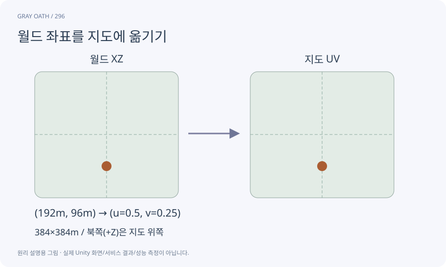

# 월드 좌표를 지도에 옮기기

월드의 XZ 위치를 지도 이미지의0~1좌표로 변환하는 규칙입니다. 화면 확대·이동·회전은 이 기본 좌표에 별도 변환을 적용합니다.

## 익숙한 비유

넓은 운동장의 위치를 작은 종이 지도에 비례해서 표시하는 일입니다.



## 작동 원리

### 1. 경계 기록

지도에 해당하는 월드 최소·최대 XZ를 정합니다.

### 2. 정규화

u=(x-minX)/폭, v=(z-minZ)/높이로 변환합니다.

### 3. 화면 변환

UI 피벗·상하 방향·줌·이동을 일관되게 적용합니다.

## 게임 속 예

384m 폭 지도에서 x가 최소보다192m 큰 위치는 u=0.5입니다. 중심과 네 모서리를 비교해 상하 반전·한 칸 어긋남을 찾습니다.

## 혼동하지 않기

카메라 화면 좌표를 지도 좌표로 그대로 쓰면 카메라를 돌릴 때 핀이 어긋납니다.

## 확인 질문

지도를 확대하면 핀 위치도 바뀌어야 하나요?

지도와 핀을 같은 변환 아래 두거나 동일한 변환 공식을 써 함께 확대해야 합니다.

## 내 프로젝트에서 확인하기

```text
현재 GrayOathRPG3D에서 월드 좌표를 지도에 옮기기을 사용하는 실제 대상과 동작을 읽기 전용으로 확인해 줘. 쉬운 말과 작은 사례로 설명하고 카메라 화면 좌표를 지도 좌표로 그대로 쓰면 카메라를 돌릴 때 핀이 어긋납니다. 이 문제를 어떻게 막는지 보여 줘. 코드·데이터·설정은 아직 수정하지 마.
```

## 관련 해설

[coordinates](coordinates.md) · [viewport](viewport.md) · [quest-marker](quest-marker.md)

## 공식 참고

- [Unity · UI Toolkit EditorWindow](https://docs.unity3d.com/6000.3/Documentation/Manual/UIE-HowTo-CreateEditorWindow.html)
