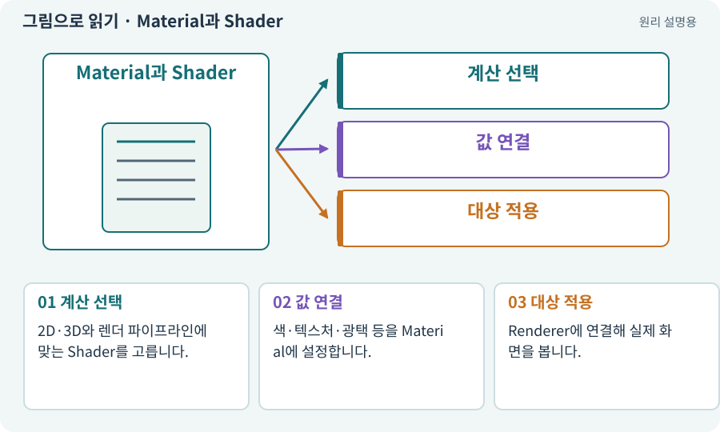

# Material과 Shader

**분야:** 그림·애니메이션·화면 만들기

Shader는 표면을 어떤 계산으로 그릴지 정하는 프로그램이고, Material은 그 계산에 넣을 색·텍스처·값을 모은 설정입니다. 같은 Shader로 여러 Material을 만들 수 있습니다.

**찾아오는 이름:** Material과 Shader, Material, 머티리얼, 재질, Shader, 셰이더

## 익숙한 것에 비유하면

조리법과 각 접시에 넣는 재료·양의 차이입니다. 레시피는 같아도 색과 질감이 달라질 수 있습니다.



개념도입니다. 실제 Unity 화면이나 검사 결과가 아닙니다. 그림의 순서·색은 역할을 구분하며 실제 설정값은 프로젝트에서 확인합니다.

## 이렇게 작동합니다

### 1. 계산 선택

2D·3D와 렌더 파이프라인에 맞는 Shader를 고릅니다.

### 2. 값 연결

색·텍스처·광택 등을 Material에 설정합니다.

### 3. 대상 적용

Renderer에 연결해 실제 화면을 봅니다.

## 우리 RPG에서는 이렇게 만나요

적 한 마리만 빨갛게 피격 표시하려고 공유 Material 값을 바꾸면 모든 적이 붉어질 수 있습니다. 인스턴스별 설정과 자원 정리를 고려합니다.

## 이것과 혼동하지 마세요

3D용 Shader를 2D Renderer에서 그대로 쓴다고 같은 조명 반응이 보장되지는 않습니다.

## 이해했는지 한 번 생각해 보기

한 적을 맞혔는데 모두 번쩍이면?

<details><summary>답과 이유</summary>

공유 재질을 전체 변경했는지 확인합니다.

</details>

## 내 프로젝트에서 확인하고 싶다면

아래 요청은 읽기 전용으로 실제 대상을 확인하는 선택 요청입니다. 코드나 설정을 직접 편집할 필요는 없습니다.

```text
현재 프로젝트에서 Material과 Shader 관련 요소가 어떻게 사용되는지 읽기 전용으로 확인해 줘. 실제 대상과 설정을 찾아 쉬운 말과 작은 예로 설명해 줘. 특히 다음 혼동을 구분해 줘: 3D용 Shader를 2D Renderer에서 그대로 쓴다고 같은 조명 반응이 보장되지는 않습니다. 아직 코드·설정·파일은 바꾸지 말고, 확인할 수 없는 내용은 따로 알려 줘.
```

## 이어지는 개념

[URP·2D Renderer·Universal Renderer](render-pipeline.md) · [Shader Graph·노드·마스크](shader-graph.md) · [조명·Lit·Unlit·그림자](lighting.md) · [드로우콜·배칭·인스턴싱](batching.md)

## 이 개념을 사용하는 실습

[05 · 말로 스프라이트 하나 만들기](../index.html#lesson-005) · [37 · 느려지는 원인을 측정해 고치기](../index.html#lesson-037) · [57 · Unity AI로 바닥과 벽 타일 만들기](../index.html#lesson-057) · [70 · 피격 강조와 보스 예고 셰이더 만들기](../index.html#lesson-070) · [72 · 모바일 효과를 줄여도 위험은 남기기](../index.html#lesson-072) · [74 · 추가 외형을 서버에서 받게 준비하기](../index.html#lesson-074) · [83 · 3D 카메라와 재질로 공간 보기](../index.html#lesson-083) · [84 · 같은 지도를 3D 바닥과 벽으로 만들기](../index.html#lesson-084) · [87 · 같은 캐릭터를 실제 3D 모델로 만들기](../index.html#lesson-087) · [92 · 무기를 손에 쥐고 전리품 표시하기](../index.html#lesson-092) · [95 · 3D 조명과 환경을 읽기 좋게 만들기](../index.html#lesson-095) · [96 · 3D 카메라 가림과 터치 조작 다듬기](../index.html#lesson-096) · [98 · 3D 팩을 2D 팩과 따로 내려받기](../index.html#lesson-098) · [101 · 3D Android 성능 다시 측정하기](../index.html#lesson-101) · [149 · 상태와 보스 효과를 같은 데이터로 맞추기](../index.html#lesson-149) · [153 · 대장간 고해상도팩 선택 다운로드하기](../index.html#lesson-153)

## 참고와 설명의 범위

기본 도구 동작은 아래 공식 자료를 참고했습니다. 비유·그림·RPG의 예시 수치와 정책은 이해를 위한 자체 예제입니다. 실제 API·지원 기능은 설치 버전과 계정에서 확인합니다.

- [Unity Shader Graph · 시작](https://docs.unity3d.com/Packages/com.unity.shadergraph@17.3/manual/Getting-Started.html)

그림·계산 예제·조작 모형은 자체 제작한 설명입니다. 실제 Unity 화면, 서비스 생성 결과, 성능 실측 또는 게임 테스트 결과가 아닙니다. 자료 확인: 2026년 9월 26일.
