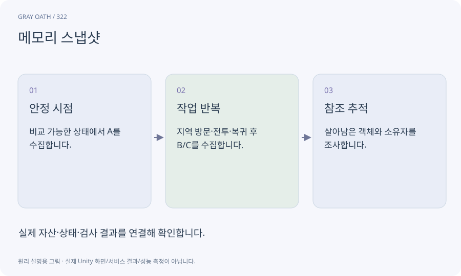

# 메모리 스냅샷

특정 시점에 어떤 객체와 자산이 메모리를 차지하고 무엇이 참조하는지 기록한 자료입니다. 전후 비교로 불필요하게 살아남은 객체를 찾습니다.

## 익숙한 비유

창고의 물건 목록과 누가 보관을 요청했는지를 동시에 찍는 재고 조사입니다.



## 작동 원리

### 1. 안정 시점

비교 가능한 상태에서 A를 수집합니다.

### 2. 작업 반복

지역 방문·전투·복귀 후 B/C를 수집합니다.

### 3. 참조 추적

살아남은 객체와 소유자를 조사합니다.

## 게임 속 예

마을→세 지역→마을 복귀를5회 반복하며 textures/handles/NPC가 계속 쌓이면 참조 체인과 반환 경로를 점검합니다.

## 혼동하지 않기

정상 캐시 때문에 C가 A보다 클 수 있습니다. 바이트 완전 일치만 누수 판정으로 쓰지 않습니다.

## 확인 질문

씬을 내렸는데 모델 메모리가 남는 이유는?

전역 참조·handle·pool·이벤트 구독이 남아 있는지 봅니다.

## 내 프로젝트에서 확인하기

```text
현재 GrayOathRPG3D에서 메모리 스냅샷을 사용하는 실제 대상과 동작을 읽기 전용으로 확인해 줘. 쉬운 말과 작은 사례로 설명하고 정상 캐시 때문에 C가 A보다 클 수 있습니다. 바이트 완전 일치만 누수 판정으로 쓰지 않습니다. 이 문제를 어떻게 막는지 보여 줘. 코드·데이터·설정은 아직 수정하지 마.
```

## 관련 해설

[handle](handle.md) · [cache](cache.md) · [garbage](garbage.md)

## 공식 참고

- [Unity · Memory Profiler](https://docs.unity3d.com/Packages/com.unity.memoryprofiler@1.1/manual/index.html)
