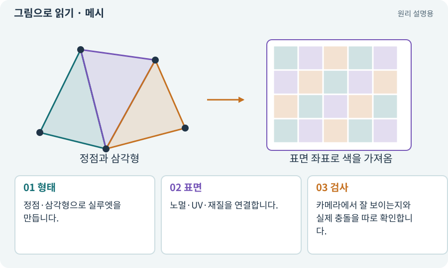

# 메시·정점·삼각형·노멀

**분야:** 그림·애니메이션·화면 만들기

메시는 3D 물체 표면을 정점과 면으로 표현한 자료입니다. 대부분의 렌더링은 삼각형을 사용하며 노멀은 표면이 어느 방향을 향하는지 나타내 조명에 영향을 줍니다.

**찾아오는 이름:** 메시·정점·삼각형·노멀, Mesh, 메시, 정점, Vertex, 삼각형, 폴리곤, Polygon, 노멀, Normal, 로우폴리

## 익숙한 것에 비유하면

철사 골조의 점들을 삼각형 천으로 이어 만든 표면입니다. 표면 방향이 뒤집히면 빛을 받는 모습도 달라집니다.



개념도입니다. 실제 Unity 화면이나 검사 결과가 아닙니다. 그림의 순서·색은 역할을 구분하며 실제 설정값은 프로젝트에서 확인합니다.

## 이렇게 작동합니다

### 1. 형태

정점·삼각형으로 실루엣을 만듭니다.

### 2. 표면

노멀·UV·재질을 연결합니다.

### 3. 검사

카메라에서 잘 보이는지와 실제 충돌을 따로 확인합니다.

## 우리 RPG에서는 이렇게 만나요

로우폴리는 적은 면과 명확한 큰 형태를 활용하는 표현입니다. 면 수가 적어도 그림자·재질·투명 효과가 무거우면 성능이 나쁠 수 있습니다.

## 이것과 혼동하지 마세요

보이는 메시가 Collider와 자동으로 같은 것은 아닙니다.

## 이해했는지 한 번 생각해 보기

3D 벽은 보이는데 통과되면 메시 면을 더 늘려야 하나요?

<details><summary>답과 이유</summary>

먼저 Collider와 레이어를 확인합니다. 렌더링 형태와 물리 경계 문제는 다릅니다.

</details>

## 내 프로젝트에서 확인하고 싶다면

아래 요청은 읽기 전용으로 실제 대상을 확인하는 선택 요청입니다. 코드나 설정을 직접 편집할 필요는 없습니다.

```text
현재 프로젝트에서 메시·정점·삼각형·노멀 관련 요소가 어떻게 사용되는지 읽기 전용으로 확인해 줘. 실제 대상과 설정을 찾아 쉬운 말과 작은 예로 설명해 줘. 특히 다음 혼동을 구분해 줘: 보이는 메시가 Collider와 자동으로 같은 것은 아닙니다. 아직 코드·설정·파일은 바꾸지 말고, 확인할 수 없는 내용은 따로 알려 줘.
```

## 이어지는 개념

[UV와 텍스처 좌표](uv.md) · [Material과 Shader](material.md) · [Collider와 몸체 경계](collider.md) · [조명·Lit·Unlit·그림자](lighting.md)

## 이 개념을 사용하는 실습

[83 · 3D 카메라와 재질로 공간 보기](../index.html#lesson-083) · [84 · 같은 지도를 3D 바닥과 벽으로 만들기](../index.html#lesson-084) · [86 · 3D에서도 클릭한 곳까지 돌아가기](../index.html#lesson-086) · [87 · 같은 캐릭터를 실제 3D 모델로 만들기](../index.html#lesson-087) · [89 · 같은 전투 규칙을 3D에 연결하기](../index.html#lesson-089) · [91 · 보스 예고를 3D 바닥에 맞추기](../index.html#lesson-091) · [94 · 같은 랜덤 던전을 3D로 생성하기](../index.html#lesson-094) · [101 · 3D Android 성능 다시 측정하기](../index.html#lesson-101)

## 참고와 설명의 범위

기본 도구 동작은 아래 공식 자료를 참고했습니다. 비유·그림·RPG의 예시 수치와 정책은 이해를 위한 자체 예제입니다. 실제 API·지원 기능은 설치 버전과 계정에서 확인합니다.

- [Unity · 2D Renderer](https://docs.unity3d.com/6000.3/Documentation/Manual/urp/2DRendererData-overview.html)

그림·계산 예제·조작 모형은 자체 제작한 설명입니다. 실제 Unity 화면, 서비스 생성 결과, 성능 실측 또는 게임 테스트 결과가 아닙니다. 자료 확인: 2026년 9월 26일.
