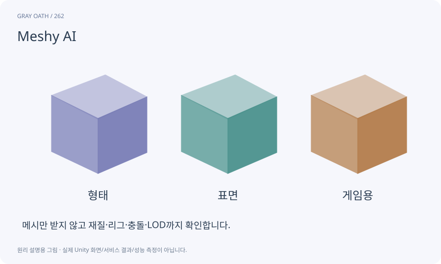

# Meshy AI

텍스트나 이미지에서 3D 자산을 생성하고 후처리 API를 제공하는 서비스입니다. 이 과정에서는 Unity Editor 작업대가 생성 요청과 결과 도입을 관리하게 만듭니다.

## 익숙한 비유

제작 의뢰를 넣는 외부 공방입니다. 납품받은 물건을 게임에 맞게 검사하는 일은 별도로 남습니다.



## 작동 원리

### 1. 의뢰 준비

참조 권리·목적·형식·비용·요청 ID를 확인합니다.

### 2. 생성과 회수

작업 ID로 상태를 조회하고 실제 결과 파일을 받습니다.

### 3. 제품 적합화

피벗·크기·UV·재질·리그·충돌·LOD를 검사합니다.

## 두 제작 경로의 비용과 후처리

서비스 단가와 지원 모델은 요청 시점에 다시 확인합니다. 웹 플랜의 구독료가 API 크레딧이나 모든 후처리를 포함한다고 추정하지 않습니다.

생성 결과는 완성 검증을 통과한 자산이 아닙니다. 납품 URL을 파일로 회수한 뒤 입력·taskId·hash·이용 조건 확인일을 남깁니다.

| 경로 | 잘 맞는 출발점 | 반드시 남는 작업 |

|---|---|---|

| Unity 내부 | 소품·건축·통일된 단순 인물 | 형태·UV·리그·동작·충돌·LOD 확인 |

| Text→3D | 텍스트로 소품 후보 찾기 | preview/refine 비용·축/크기·재질 검사 |

| Image→3D | 승인된 기준 이미지에서 시작 | 뒷면·가려진 부분·권리·스키닝 확인 |

| 자동 리깅 | 명확한 텍스처 있는 사람형 | 본/Avatar·발·루트·소켓 실제 검사 |

| 비인간형 | 날개·여러 다리·특수 관절 | Generic/내부 관절 제작·전용 클립 |

## 게임 속 예

먼저 상자 하나를 만들고 native 상자와 같은1m 규격으로 비교합니다. 좋은 이미지처럼 보여도 과도한 면 수·재질 수·틀린 축은 고칩니다.

## 혼동하지 않기

웹 요금제와 API 크레딧 조건을 같다고 단정하거나 생성 결과를 바로 출시 품질로 인정하지 않습니다.

## 확인 질문

생성한 인간 모델이면 바로 모든 동작이 되나요?

아닙니다. 리깅 조건·본 구조·Avatar·동작·소켓·실제 스키닝을 따로 검사합니다.

## 내 프로젝트에서 확인하기

```text
현재 GrayOathRPG3D에서 Meshy AI을 사용하는 실제 대상과 동작을 읽기 전용으로 확인해 줘. 쉬운 말과 작은 사례로 설명하고 웹 요금제와 API 크레딧 조건을 같다고 단정하거나 생성 결과를 바로 출시 품질로 인정하지 않습니다. 이 문제를 어떻게 막는지 보여 줘. 코드·데이터·설정은 아직 수정하지 마.
```

## 관련 해설

[editor-job](editor-job.md) · [retopology](retopology.md) · [humanoid](humanoid.md) · [pbr](pbr.md)

## 공식 참고

- [Meshy · Text to 3D](https://docs.meshy.ai/en/api/text-to-3d)
- [Meshy · Image to 3D](https://docs.meshy.ai/en/api/image-to-3d)
- [Meshy · API Pricing](https://docs.meshy.ai/en/api/pricing)
