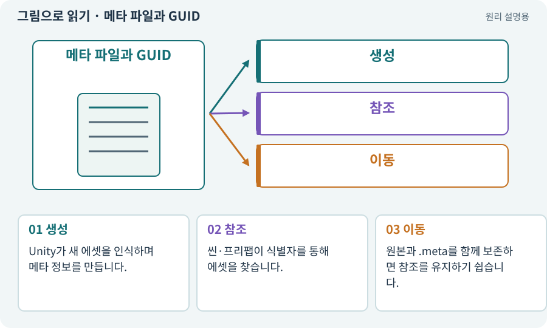

# 메타 파일과 GUID

**분야:** 시작·도구·작업 공간

Unity의 .meta 파일은 에셋 식별자와 가져오기 설정 등을 보존합니다. GUID는 이름이나 폴더 위치와 별도로 에셋을 식별하는 값입니다.

**찾아오는 이름:** 메타 파일과 GUID, 메타 파일, .meta, GUID

## 익숙한 것에 비유하면

사람의 이름표가 바뀌어도 신분 식별 번호는 유지되는 것과 비슷합니다. 단, GUID는 사람 정보가 아니라 에셋 식별용입니다.



개념도입니다. 실제 Unity 화면이나 검사 결과가 아닙니다. 그림의 순서·색은 역할을 구분하며 실제 설정값은 프로젝트에서 확인합니다.

## 이렇게 작동합니다

### 1. 생성

Unity가 새 에셋을 인식하며 메타 정보를 만듭니다.

### 2. 참조

씬·프리팹이 식별자를 통해 에셋을 찾습니다.

### 3. 이동

원본과 .meta를 함께 보존하면 참조를 유지하기 쉽습니다.

## 우리 RPG에서는 이렇게 만나요

검 그림만 다른 폴더로 옮기고 .meta를 잃으면 같은 파일명으로 돌아와도 기존 프리팹 참조가 끊길 수 있습니다. 이동은 AI가 Unity 절차로 수행하게 합니다.

## 이것과 혼동하지 마세요

meta를 임의로 새로 만들거나 여러 파일에 복사하면 식별 충돌이 생길 수 있습니다.

## 이해했는지 한 번 생각해 보기

같은 이름의 PNG로 바꿨는데 참조가 깨질 수 있나요?

<details><summary>답과 이유</summary>

네. 에셋 식별자와 임포트 설정도 관련되므로 이름만 같다고 같은 에셋이 아닙니다.

</details>

## 내 프로젝트에서 확인하고 싶다면

아래 요청은 읽기 전용으로 실제 대상을 확인하는 선택 요청입니다. 코드나 설정을 직접 편집할 필요는 없습니다.

```text
현재 프로젝트에서 메타 파일과 GUID 관련 요소가 어떻게 사용되는지 읽기 전용으로 확인해 줘. 실제 대상과 설정을 찾아 쉬운 말과 작은 예로 설명해 줘. 특히 다음 혼동을 구분해 줘: meta를 임의로 새로 만들거나 여러 파일에 복사하면 식별 충돌이 생길 수 있습니다. 아직 코드·설정·파일은 바꾸지 말고, 확인할 수 없는 내용은 따로 알려 줘.
```

## 이어지는 개념

[에셋과 가져오기](asset.md) · [참조·null·Missing Reference](reference.md) · [프리팹·인스턴스·Variant](prefab.md) · [Git·저장소·커밋](git.md)

## 이 개념을 사용하는 실습

[04 · 되돌릴 수 있는 작업 습관 만들기](../index.html#lesson-004) · [42 · 트리에서 투자하고 저장하기](../index.html#lesson-042) · [65 · 스프라이트를 정리해 실제 캐릭터에 넣기](../index.html#lesson-065) · [79 · 추가 기능을 하나의 게임으로 합치기](../index.html#lesson-079) · [81 · 2D 게임을 남기고 3D 작업 시작하기](../index.html#lesson-081) · [107 · 원본을 보호하고 허용 경로 정하기](../index.html#lesson-107) · [117 · Unity 작업을 한 창구로 모으기](../index.html#lesson-117) · [132 · 필터를 실제 던전과 모바일에 연결하기](../index.html#lesson-132) · [133 · 첫 기능의 실패를 고쳐 다음 기준 만들기](../index.html#lesson-133)

## 참고와 설명의 범위

기본 도구 동작은 아래 공식 자료를 참고했습니다. 비유·그림·RPG의 예시 수치와 정책은 이해를 위한 자체 예제입니다. 실제 API·지원 기능은 설치 버전과 계정에서 확인합니다.

- [Unity · Prefab](https://docs.unity3d.com/6000.3/Documentation/Manual/Prefabs.html)

그림·계산 예제·조작 모형은 자체 제작한 설명입니다. 실제 Unity 화면, 서비스 생성 결과, 성능 실측 또는 게임 테스트 결과가 아닙니다. 자료 확인: 2026년 9월 26일.
