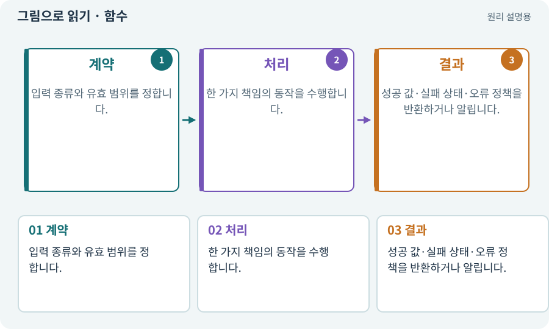

# 함수·메서드·매개변수·반환값

**분야:** 설명을 읽기 위한 기초 언어

함수는 정해진 입력을 받아 처리하는 작은 동작 단위입니다. 클래스에 속한 함수는 메서드라고 부릅니다. 매개변수는 입력 자리, 반환값은 처리 결과입니다.

**찾아오는 이름:** 함수·메서드·매개변수·반환값, 함수, Function, 메서드, Method, 매개변수, 반환값, parameter, return value

## 익숙한 것에 비유하면

계산기에 두 숫자와 연산을 넣고 답을 받는 작은 창구입니다.



개념도입니다. 실제 Unity 화면이나 검사 결과가 아닙니다. 그림의 순서·색은 역할을 구분하며 실제 설정값은 프로젝트에서 확인합니다.

## 이렇게 작동합니다

### 1. 계약

입력 종류와 유효 범위를 정합니다.

### 2. 처리

한 가지 책임의 동작을 수행합니다.

### 3. 결과

성공 값·실패 상태·오류 정책을 반환하거나 알립니다.

## 우리 RPG에서는 이렇게 만나요

피해 함수에 공격력·방어력·계수를 주면 최종 피해를 얻습니다. UI 메서드는 그 결과를 표시하지만 피해 계산을 다시 하지 않도록 책임을 나눕니다.

## 이것과 혼동하지 마세요

반환값이 없다고 아무 영향이 없는 것은 아닙니다. 파일 저장이나 체력 변경 같은 부수 효과가 있을 수 있습니다.

## 이해했는지 한 번 생각해 보기

함수 이름만 같으면 같은 동작인가요?

<details><summary>답과 이유</summary>

입력·구현·반환·부수 효과를 확인해야 합니다.

</details>

## 내 프로젝트에서 확인하고 싶다면

아래 요청은 읽기 전용으로 실제 대상을 확인하는 선택 요청입니다. 코드나 설정을 직접 편집할 필요는 없습니다.

```text
현재 프로젝트에서 함수·메서드·매개변수·반환값 관련 요소가 어떻게 사용되는지 읽기 전용으로 확인해 줘. 실제 대상과 설정을 찾아 쉬운 말과 작은 예로 설명해 줘. 특히 다음 혼동을 구분해 줘: 반환값이 없다고 아무 영향이 없는 것은 아닙니다. 파일 저장이나 체력 변경 같은 부수 효과가 있을 수 있습니다. 아직 코드·설정·파일은 바꾸지 말고, 확인할 수 없는 내용은 따로 알려 줘.
```

## 이어지는 개념

[API와 매개변수](api.md) · [순수 함수·불변 조건·결정적 계산](pure-function.md) · [클래스·객체·인스턴스](class.md) · [이벤트·콜백·구독·이벤트 버스](event.md)

## 이 개념을 사용하는 실습

[03 · AI와 실행 중인 Unity 연결하기](../index.html#lesson-003) · [07 · 캐릭터와 벽이 있는 공간 만들기](../index.html#lesson-007) · [39 · 다른 PC와 Android 에서 실행할 파일 만들기](../index.html#lesson-039) · [42 · 트리에서 투자하고 저장하기](../index.html#lesson-042) · [46 · 랜덤 지도 위를 실제로 걷기](../index.html#lesson-046) · [112 · 네 역할을 순서대로 실행하기](../index.html#lesson-112) · [114 · 테스트를 실행하고 결과 읽기](../index.html#lesson-114) · [123 · 기존 게임의 실제 파일 찾아 연결하기](../index.html#lesson-123) · [124 · 현재 컴퓨터의 Unity 명령 등록하기](../index.html#lesson-124) · [127 · 내 반복 업무에 맞게 도구 개조하기](../index.html#lesson-127) · [142 · 배운 스킬의 변형 선택하기](../index.html#lesson-142)

## 참고와 설명의 범위

기본 도구 동작은 아래 공식 자료를 참고했습니다. 비유·그림·RPG의 예시 수치와 정책은 이해를 위한 자체 예제입니다. 실제 API·지원 기능은 설치 버전과 계정에서 확인합니다.

- [Microsoft · C# 메서드](https://learn.microsoft.com/en-us/dotnet/csharp/methods)

그림·계산 예제·조작 모형은 자체 제작한 설명입니다. 실제 Unity 화면, 서비스 생성 결과, 성능 실측 또는 게임 테스트 결과가 아닙니다. 자료 확인: 2026년 9월 26일.
