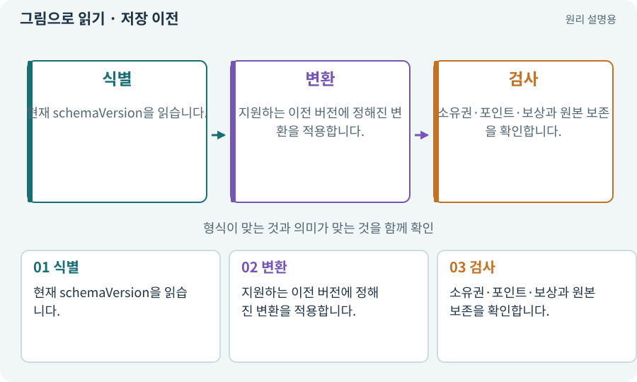

# 저장 이전·마이그레이션

**분야:** 코드·데이터·저장·검사

저장 이전은 옛 형식의 진행 데이터를 새 형식으로 바꾸는 절차입니다. 기존 아이템·옵션·퀘스트를 보존하며 새 필드의 기본값과 보상 정책을 명시합니다.

**찾아오는 이름:** 저장 이전·마이그레이션, 마이그레이션, Migration, 저장 이전, 업그레이드, 스키마 이전

## 익숙한 것에 비유하면

구형 신분증을 새 양식으로 바꾸되 사람이 다른 사람으로 바뀌지 않는 과정입니다.



개념도입니다. 실제 Unity 화면이나 검사 결과가 아닙니다. 그림의 순서·색은 역할을 구분하며 실제 설정값은 프로젝트에서 확인합니다.

## 이렇게 작동합니다

### 1. 식별

현재 schemaVersion을 읽습니다.

### 2. 변환

지원하는 이전 버전에 정해진 변환을 적용합니다.

### 3. 검사

소유권·포인트·보상과 원본 보존을 확인합니다.

## 우리 RPG에서는 이렇게 만나요

스킬 자동 해금을 트리 포인트로 바꿀 때 이미 배운 스킬을 어떤 랭크·사용 포인트로 옮길지 정합니다. 변환을 두 번 실행해도 포인트가 추가되지 않아야 합니다.

## 이것과 혼동하지 마세요

이전 실패를 새 게임 초기화로 조용히 처리하면 사용자의 진행을 잃습니다.

## 이해했는지 한 번 생각해 보기

schema2를 다시 schema3로 이전하면 보상을 또 받아야 하나요?

<details><summary>답과 이유</summary>

아니요. 적용 이력과 결과를 보고 중복 변환·보상을 막습니다.

</details>

## 내 프로젝트에서 확인하고 싶다면

아래 요청은 읽기 전용으로 실제 대상을 확인하는 선택 요청입니다. 코드나 설정을 직접 편집할 필요는 없습니다.

```text
현재 프로젝트에서 저장 이전·마이그레이션 관련 요소가 어떻게 사용되는지 읽기 전용으로 확인해 줘. 실제 대상과 설정을 찾아 쉬운 말과 작은 예로 설명해 줘. 특히 다음 혼동을 구분해 줘: 이전 실패를 새 게임 초기화로 조용히 처리하면 사용자의 진행을 잃습니다. 아직 코드·설정·파일은 바꾸지 말고, 확인할 수 없는 내용은 따로 알려 줘.
```

## 이어지는 개념

[스키마·JSON Schema·계약](schema.md) · [멱등성·재시도해도 한 번](idempotency.md) · [불변 조건·경계값·속성 검사](invariant.md) · [원자적 저장·임시 파일·교체](atomic-save.md)

## 이 개념을 사용하는 실습

[31 · 퀘스트를 받아 엔딩까지 이어가기](../index.html#lesson-031) · [41 · 선택할 수 있는9노드 스킬트리 만들기](../index.html#lesson-041) · [42 · 트리에서 투자하고 저장하기](../index.html#lesson-042) · [80 · 나만의 2D RPG 완성하기](../index.html#lesson-080) · [129 · 기존 2D 게임에서 확장팩 시작하기](../index.html#lesson-129) · [152 · 이전 저장을 새 확장판으로 가져오기](../index.html#lesson-152) · [159 · 최종 확장판 배포 후보 만들기](../index.html#lesson-159)

## 참고와 설명의 범위

기본 도구 동작은 아래 공식 자료를 참고했습니다. 비유·그림·RPG의 예시 수치와 정책은 이해를 위한 자체 예제입니다. 실제 API·지원 기능은 설치 버전과 계정에서 확인합니다.

- [Python · JSON](https://docs.python.org/3/library/json.html)

그림·계산 예제·조작 모형은 자체 제작한 설명입니다. 실제 Unity 화면, 서비스 생성 결과, 성능 실측 또는 게임 테스트 결과가 아닙니다. 자료 확인: 2026년 9월 26일.
