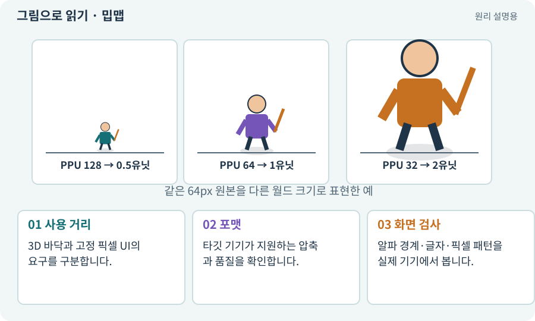

# 밉맵·텍스처 압축

**분야:** 입력·UI·소리·성능

밉맵은 원본보다 작은 텍스처 버전을 미리 만들어 축소 표시에서 사용하는 방식입니다. 텍스처 압축은 GPU가 사용할 자료 크기를 줄이지만 품질과 지원 조건이 다릅니다.

**찾아오는 이름:** 밉맵·텍스처 압축, 밉맵, Mipmap, ASTC, ETC2, 텍스처 압축, 압축 포맷, texture compression

## 익숙한 것에 비유하면

멀리 볼 사진은 작은 사본을 준비하고, 보관할 때 공간을 덜 쓰는 포장을 선택하는 것입니다.



개념도입니다. 실제 Unity 화면이나 검사 결과가 아닙니다. 그림의 순서·색은 역할을 구분하며 실제 설정값은 프로젝트에서 확인합니다.

## 이렇게 작동합니다

### 1. 사용 거리

3D 바닥과 고정 픽셀 UI의 요구를 구분합니다.

### 2. 포맷

타깃 기기가 지원하는 압축과 품질을 확인합니다.

### 3. 화면 검사

알파 경계·글자·픽셀 패턴을 실제 기기에서 봅니다.

## 우리 RPG에서는 이렇게 만나요

바닥은 축소 때 깜박임을 줄이는 밉맵이 도움이 될 수 있지만 작은 픽셀 UI는 다른 정책이 필요합니다. 압축 후 룬 아이콘의 문양이 뭉개지는지도 확인합니다.

## 이것과 혼동하지 마세요

디스크의 PNG 압축률과 GPU 텍스처 압축률은 다릅니다.

## 이해했는지 한 번 생각해 보기

APK 크기가 작아졌으면 GPU 메모리도 같은 비율로 줄까요?

<details><summary>답과 이유</summary>

반드시 그렇지 않습니다. 실제 로드 포맷·밉맵·해상도를 확인합니다.

</details>

## 내 프로젝트에서 확인하고 싶다면

아래 요청은 읽기 전용으로 실제 대상을 확인하는 선택 요청입니다. 코드나 설정을 직접 편집할 필요는 없습니다.

```text
현재 프로젝트에서 밉맵·텍스처 압축 관련 요소가 어떻게 사용되는지 읽기 전용으로 확인해 줘. 실제 대상과 설정을 찾아 쉬운 말과 작은 예로 설명해 줘. 특히 다음 혼동을 구분해 줘: 디스크의 PNG 압축률과 GPU 텍스처 압축률은 다릅니다. 아직 코드·설정·파일은 바꾸지 말고, 확인할 수 없는 내용은 따로 알려 줘.
```

## 이어지는 개념

[파일 용량과 실행 메모리](texture-compression.md) · [텍스처·픽셀·해상도](texture.md) · [패딩·여백·필터링 번짐](padding.md) · [Profiler·병목·실기기 측정](profiler.md)

## 이 개념을 사용하는 실습

다른 개념을 이해하기 위한 보충 해설입니다.

## 참고와 설명의 범위

기본 도구 동작은 아래 공식 자료를 참고했습니다. 비유·그림·RPG의 예시 수치와 정책은 이해를 위한 자체 예제입니다. 실제 API·지원 기능은 설치 버전과 계정에서 확인합니다.

- [Unity · Sprite](https://docs.unity3d.com/6000.3/Documentation/Manual/sprite/sprite-landing.html)

그림·계산 예제·조작 모형은 자체 제작한 설명입니다. 실제 Unity 화면, 서비스 생성 결과, 성능 실측 또는 게임 테스트 결과가 아닙니다. 자료 확인: 2026년 9월 26일.
