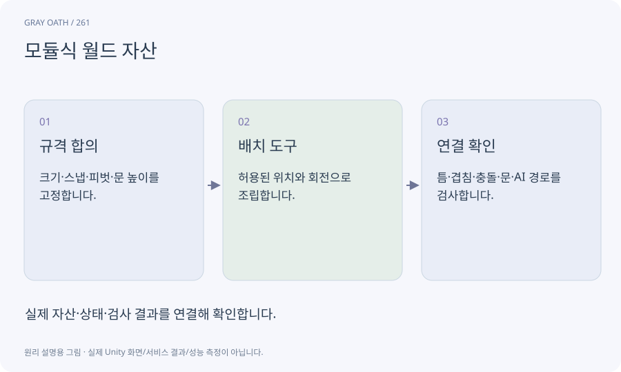

# 모듈식 월드 자산

같은 단위와 연결 규격으로 만든 벽·문·바닥·지붕 묶음입니다. 여러 건물을 재사용 부품으로 구성하면서 길과 스타일을 일관되게 유지합니다.

## 익숙한 비유

문과 바퀴가 정해진 규격으로 맞는 조립 블록입니다.



## 작동 원리

### 1. 규격 합의

크기·스냅·피벗·문 높이를 고정합니다.

### 2. 배치 도구

허용된 위치와 회전으로 조립합니다.

### 3. 연결 확인

틈·겹침·충돌·문·AI 경로를 검사합니다.

## 게임 속 예

2m 벽 모듈 여러 개와 폭1.4m 문 모듈을 조합합니다. 큰 괴물용 문은 별도 통과 반경 규격으로 구분합니다.

## 혼동하지 않기

스냅이 맞는다고 벽의 시각 경계와 실제 콜라이더까지 맞는 것은 아닙니다.

## 확인 질문

모듈 하나를 바꾸면 마을 전체를 새로 만들어야 하나요?

공유 프리팹과 변형 계약에 따라 갱신할 수 있지만 실제 사용처 회귀를 확인해야 합니다.

## 내 프로젝트에서 확인하기

```text
현재 GrayOathRPG3D에서 모듈식 월드 자산을 사용하는 실제 대상과 동작을 읽기 전용으로 확인해 줘. 쉬운 말과 작은 사례로 설명하고 스냅이 맞는다고 벽의 시각 경계와 실제 콜라이더까지 맞는 것은 아닙니다. 이 문제를 어떻게 막는지 보여 줘. 코드·데이터·설정은 아직 수정하지 마.
```

## 관련 해설

[prefab](prefab.md) · [probuilder](probuilder.md) · [bounds](bounds.md)

## 공식 참고

- [Unity · ProBuilder 6](https://docs.unity3d.com/Packages/com.unity.probuilder@6.0/manual/index.html)
