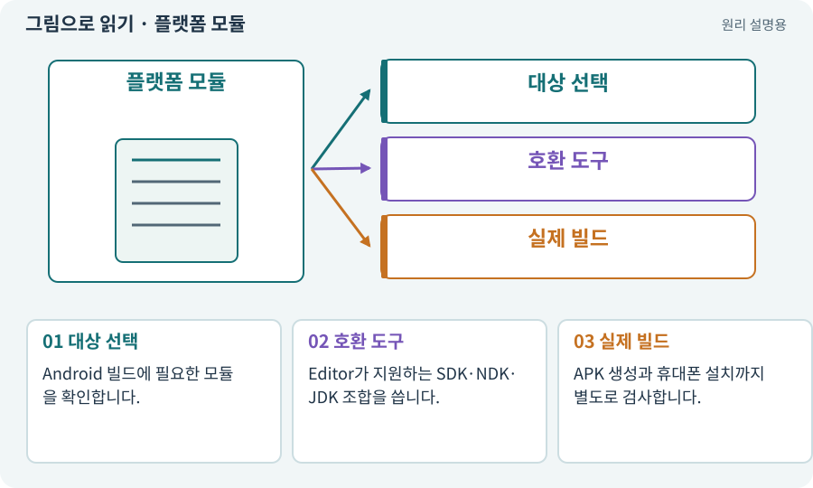

# 플랫폼 모듈·SDK·NDK·JDK

**분야:** 시작·도구·작업 공간

플랫폼 모듈은 Android 등 특정 환경의 게임을 만들기 위한 도구 묶음입니다. SDK는 플랫폼 개발 도구, NDK는 네이티브 코드 도구, JDK는 Java 도구입니다. 서로 대체되는 이름이 아닙니다.

**찾아오는 이름:** 플랫폼 모듈·SDK·NDK·JDK, SDK, NDK, OpenJDK, JDK, Android Build Support, 플랫폼 모듈

## 익숙한 것에 비유하면

국내 제품을 해외 전압과 규격에 맞춰 포장하려면 여러 검사·포장 도구가 필요한 것과 같습니다.



개념도입니다. 실제 Unity 화면이나 검사 결과가 아닙니다. 그림의 순서·색은 역할을 구분하며 실제 설정값은 프로젝트에서 확인합니다.

## 이렇게 작동합니다

### 1. 대상 선택

Android 빌드에 필요한 모듈을 확인합니다.

### 2. 호환 도구

Editor가 지원하는 SDK·NDK·JDK 조합을 씁니다.

### 3. 실제 빌드

APK 생성과 휴대폰 설치까지 별도로 검사합니다.

## 우리 RPG에서는 이렇게 만나요

PC용 Play가 되더라도 Android 도구가 없으면 Android 빌드는 막힙니다. AI가 설치된 Java를 무조건 재사용하지 않고 Unity의 호환 경로를 확인하게 합니다.

## 이것과 혼동하지 마세요

SDK만 설치했다고 ARM64 네이티브 빌드까지 준비됐다고 판단하지 않습니다.

## 이해했는지 한 번 생각해 보기

SDK와 APK의 차이는 무엇인가요?

<details><summary>답과 이유</summary>

SDK는 만드는 도구이고 APK는 그 도구로 만든 설치 파일입니다.

</details>

## 내 프로젝트에서 확인하고 싶다면

아래 요청은 읽기 전용으로 실제 대상을 확인하는 선택 요청입니다. 코드나 설정을 직접 편집할 필요는 없습니다.

```text
현재 프로젝트에서 플랫폼 모듈·SDK·NDK·JDK 관련 요소가 어떻게 사용되는지 읽기 전용으로 확인해 줘. 실제 대상과 설정을 찾아 쉬운 말과 작은 예로 설명해 줘. 특히 다음 혼동을 구분해 줘: SDK만 설치했다고 ARM64 네이티브 빌드까지 준비됐다고 판단하지 않습니다. 아직 코드·설정·파일은 바꾸지 말고, 확인할 수 없는 내용은 따로 알려 줘.
```

## 이어지는 개념

[게임 빌드·개발 빌드·배포](build.md) · [APK·Android 설치 파일](apk.md) · [Mono·IL2CPP·AOT](il2cpp.md) · [ABI·ARM64·x86_64](abi.md)

## 이 개념을 사용하는 실습

[01 · 빈 2D 프로젝트 만들기](../index.html#lesson-001)

## 참고와 설명의 범위

기본 도구 동작은 아래 공식 자료를 참고했습니다. 비유·그림·RPG의 예시 수치와 정책은 이해를 위한 자체 예제입니다. 실제 API·지원 기능은 설치 버전과 계정에서 확인합니다.

- [Unity · Android SDK·NDK·JDK 준비](https://docs.unity3d.com/6000.3/Documentation/Manual/android-sdksetup.html)

그림·계산 예제·조작 모형은 자체 제작한 설명입니다. 실제 Unity 화면, 서비스 생성 결과, 성능 실측 또는 게임 테스트 결과가 아닙니다. 자료 확인: 2026년 9월 26일.
