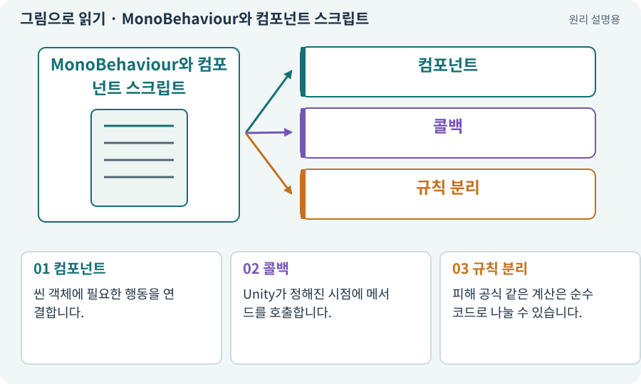

# MonoBehaviour와 컴포넌트 스크립트

**분야:** 코드·데이터·저장·검사

MonoBehaviour는 Unity 객체의 컴포넌트로 동작하며 Update·OnEnable 같은 생명주기 기능에 참여하는 기반 클래스입니다. 모든 게임 계산이 이를 상속해야 하는 것은 아닙니다.

**찾아오는 이름:** MonoBehaviour와 컴포넌트 스크립트, MonoBehaviour, 모노비헤이비어

## 익숙한 것에 비유하면

무대에 직접 올라와 동작하는 배우와 무대 밖에서 계산하는 계산기를 구분합니다.



개념도입니다. 실제 Unity 화면이나 검사 결과가 아닙니다. 그림의 순서·색은 역할을 구분하며 실제 설정값은 프로젝트에서 확인합니다.

## 이렇게 작동합니다

### 1. 컴포넌트

씬 객체에 필요한 행동을 연결합니다.

### 2. 콜백

Unity가 정해진 시점에 메서드를 호출합니다.

### 3. 규칙 분리

피해 공식 같은 계산은 순수 코드로 나눌 수 있습니다.

## 우리 RPG에서는 이렇게 만나요

HealthView는 체력바 객체에 붙고 DamageCalculator는 숫자만 계산하게 분리하면 씬 없이 피해 공식을 검사하기 쉽습니다.

## 이것과 혼동하지 마세요

파일 이름이 맞아도 실제 GameObject에 붙고 필요한 참조가 연결됐는지 확인해야 합니다.

## 이해했는지 한 번 생각해 보기

피해 공식 테스트에 항상 씬과 카메라가 필요할까요?

<details><summary>답과 이유</summary>

순수 규칙으로 분리했다면 필요하지 않을 수 있습니다.

</details>

## 내 프로젝트에서 확인하고 싶다면

아래 요청은 읽기 전용으로 실제 대상을 확인하는 선택 요청입니다. 코드나 설정을 직접 편집할 필요는 없습니다.

```text
현재 프로젝트에서 MonoBehaviour와 컴포넌트 스크립트 관련 요소가 어떻게 사용되는지 읽기 전용으로 확인해 줘. 실제 대상과 설정을 찾아 쉬운 말과 작은 예로 설명해 줘. 특히 다음 혼동을 구분해 줘: 파일 이름이 맞아도 실제 GameObject에 붙고 필요한 참조가 연결됐는지 확인해야 합니다. 아직 코드·설정·파일은 바꾸지 말고, 확인할 수 없는 내용은 따로 알려 줘.
```

## 이어지는 개념

[컴포넌트](component.md) · [수명주기·초기화·정리](lifecycle.md) · [순수 함수·불변 조건·결정적 계산](pure-function.md) · [컴파일·어셈블리·도메인 리로드](compile.md)

## 이 개념을 사용하는 실습

[06 · 시작 메뉴와 테스트 공간 연결하기](../index.html#lesson-006) · [37 · 느려지는 원인을 측정해 고치기](../index.html#lesson-037) · [84 · 같은 지도를 3D 바닥과 벽으로 만들기](../index.html#lesson-084)

## 참고와 설명의 범위

기본 도구 동작은 아래 공식 자료를 참고했습니다. 비유·그림·RPG의 예시 수치와 정책은 이해를 위한 자체 예제입니다. 실제 API·지원 기능은 설치 버전과 계정에서 확인합니다.

- [Unity · 컴포넌트](https://docs.unity3d.com/6000.3/Documentation/Manual/Components.html)

그림·계산 예제·조작 모형은 자체 제작한 설명입니다. 실제 Unity 화면, 서비스 생성 결과, 성능 실측 또는 게임 테스트 결과가 아닙니다. 자료 확인: 2026년 9월 26일.
