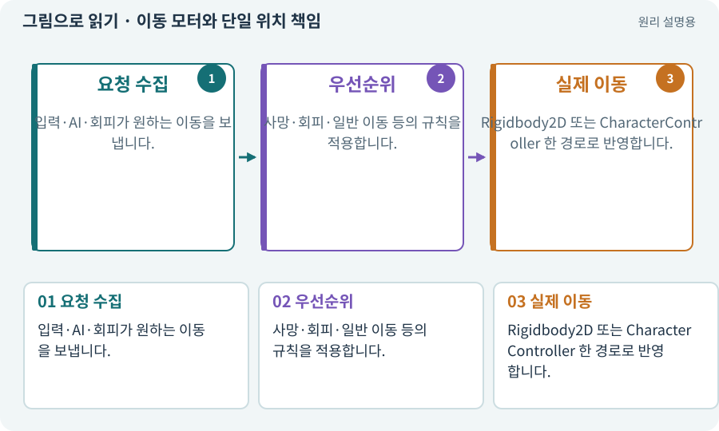

# 이동 모터와 단일 위치 책임

**분야:** 오브젝트·좌표·움직임

이동 모터는 걷기·클릭 경로·회피·밀려남 요청을 받아 최종 이동을 한 곳에서 처리하는 프로젝트의 구성요소입니다. Unity의 모든 프로젝트에 같은 이름으로 존재하는 기능은 아닙니다.

**찾아오는 이름:** 이동 모터와 단일 위치 책임, 모터, Motor, PlayerMotor, ActorMotor3D, 단일 모터

## 익숙한 것에 비유하면

버스의 운전대는 하나지만 승객·내비게이션·신호등의 요청을 함께 고려하는 구조입니다. 각자 운전대를 돌리면 위험합니다.



개념도입니다. 실제 Unity 화면이나 검사 결과가 아닙니다. 그림의 순서·색은 역할을 구분하며 실제 설정값은 프로젝트에서 확인합니다.

## 이렇게 작동합니다

### 1. 요청 수집

입력·AI·회피가 원하는 이동을 보냅니다.

### 2. 우선순위

사망·회피·일반 이동 등의 규칙을 적용합니다.

### 3. 실제 이동

Rigidbody2D 또는 CharacterController 한 경로로 반영합니다.

## 우리 RPG에서는 이렇게 만나요

WASD를 누르면 클릭 목적지를 취소합니다. 회피가 끝나면 허용된 일반 이동으로 돌아가고, 오래된 클릭 경로가 다시 살아나지 않게 합니다.

## 이것과 혼동하지 마세요

NavMeshAgent·Transform·CharacterController가 동시에 위치를 갱신하게 두지 않습니다.

## 이해했는지 한 번 생각해 보기

클릭 이동에 회피 스크립트를 추가한 뒤 떨리는 이유는?

<details><summary>답과 이유</summary>

서로 다른 코드가 같은 위치를 덮어쓰는지 조사합니다.

</details>

## 내 프로젝트에서 확인하고 싶다면

아래 요청은 읽기 전용으로 실제 대상을 확인하는 선택 요청입니다. 코드나 설정을 직접 편집할 필요는 없습니다.

```text
현재 프로젝트에서 이동 모터와 단일 위치 책임 관련 요소가 어떻게 사용되는지 읽기 전용으로 확인해 줘. 실제 대상과 설정을 찾아 쉬운 말과 작은 예로 설명해 줘. 특히 다음 혼동을 구분해 줘: NavMeshAgent·Transform·CharacterController가 동시에 위치를 갱신하게 두지 않습니다. 아직 코드·설정·파일은 바꾸지 말고, 확인할 수 없는 내용은 따로 알려 줘.
```

## 이어지는 개념

[Rigidbody2D와 물리 몸체](rigidbody.md) · [CharacterController](controller.md) · [경로와 경유점](navigation.md) · [요청 ID·세대 ID·오래된 응답](request-id.md)

## 이 개념을 사용하는 실습

[08 · WASD로 벽에 부딪히며 이동하기](../index.html#lesson-008) · [09 · 클릭한 곳까지 벽을 돌아가기](../index.html#lesson-009) · [10 · 모바일 조이스틱과 버튼 배치하기](../index.html#lesson-010) · [14 · 나를 발견하고 공격하는 적 만들기](../index.html#lesson-014) · [28 · 여덟 구역의 첫 던전 만들기](../index.html#lesson-028) · [46 · 랜덤 지도 위를 실제로 걷기](../index.html#lesson-046) · [47 · 실패하는 시드를 찾고 복구하기](../index.html#lesson-047) · [48 · 적이 나를 보고 놓치게 만들기](../index.html#lesson-048) · [65 · 스프라이트를 정리해 실제 캐릭터에 넣기](../index.html#lesson-065) · [81 · 2D 게임을 남기고 3D 작업 시작하기](../index.html#lesson-081) · [85 · 3D 캐릭터를 한 모터로 움직이기](../index.html#lesson-085) · [86 · 3D에서도 클릭한 곳까지 돌아가기](../index.html#lesson-086) · [88 · 3D 모델에 걷기와 공격 연결하기](../index.html#lesson-088) · [89 · 같은 전투 규칙을 3D에 연결하기](../index.html#lesson-089) · [90 · 적의 판단을 3D 공간에 연결하기](../index.html#lesson-090) · [96 · 3D 카메라 가림과 터치 조작 다듬기](../index.html#lesson-096) · [135 · 벽을 통과하지 않는 회피 만들기](../index.html#lesson-135)

## 참고와 설명의 범위

기본 도구 동작은 아래 공식 자료를 참고했습니다. 비유·그림·RPG의 예시 수치와 정책은 이해를 위한 자체 예제입니다. 실제 API·지원 기능은 설치 버전과 계정에서 확인합니다.

- [Unity · Rigidbody2D.MovePosition](https://docs.unity3d.com/6000.3/Documentation/ScriptReference/Rigidbody2D.MovePosition.html)
- [Unity · CharacterController](https://docs.unity3d.com/6000.3/Documentation/Manual/class-CharacterController.html)

그림·계산 예제·조작 모형은 자체 제작한 설명입니다. 실제 Unity 화면, 서비스 생성 결과, 성능 실측 또는 게임 테스트 결과가 아닙니다. 자료 확인: 2026년 9월 26일.
